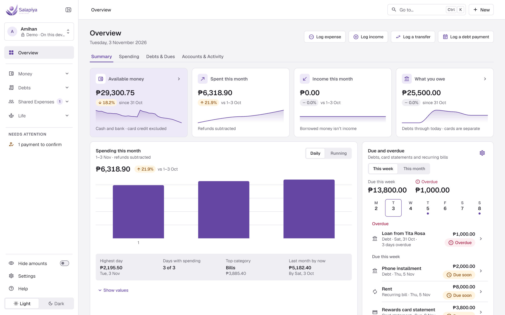
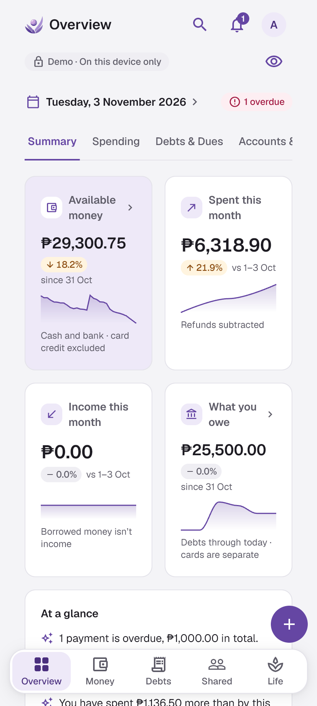
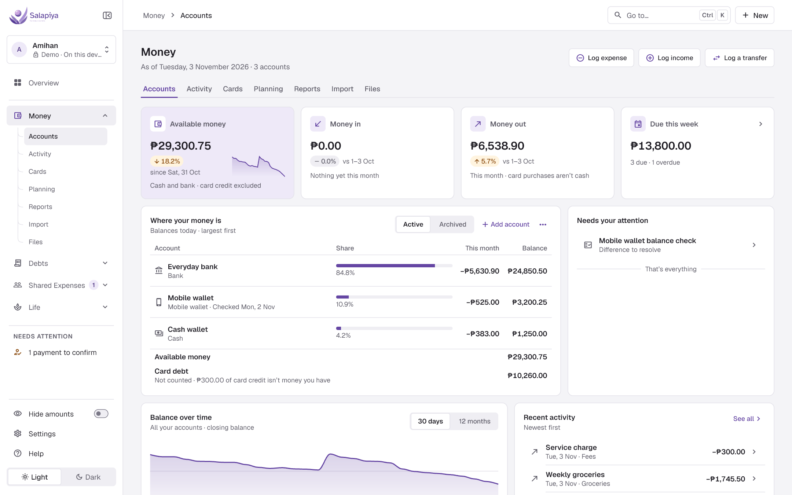
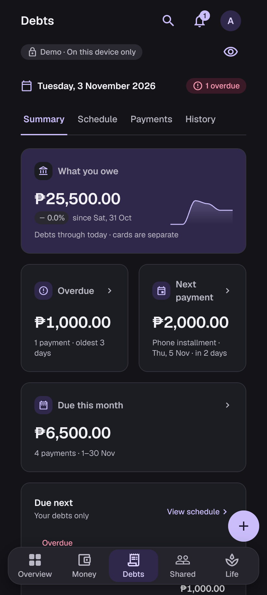
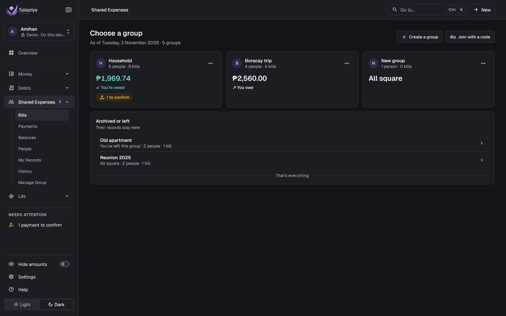
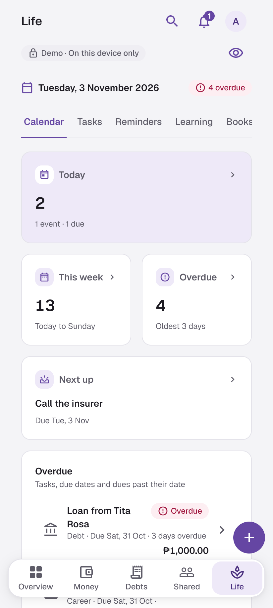

<p align="center">
  
</p>

<h1 align="center">Salapiya</h1>

<p align="center">Keep track of your money and your day, on Windows and Android, even offline.</p>

<p align="center">
  
  
  
  <a href="https://github.com/RAbnza/Personal-Management-Platform/actions/workflows/salapiya-flutter.yml"></a>
  
</p>

## Table of Contents

- [About](#about)
- [Screenshots](#screenshots)
- [Features](#features)
- [Getting Started](#getting-started)
- [Usage](#usage)
- [Configuration](#configuration)
- [Tech Stack](#tech-stack)
- [Roadmap](#roadmap)
- [Documentation](#documentation)
- [Contributing](#contributing)
- [License](#license)
- [Contact](#contact)
- [Acknowledgments](#acknowledgments)

## About

**The problem.** Money moves through a lot of places at once: bank accounts, e-wallets, credit cards, debts you're paying off, and bills you split with family and friends. Keeping it all in your head (or a spreadsheet) means you never quite know what you have, what's due, or who owes whom. Most apps that help want a bank connection or an always-online account.

**Who it's for.** People who want a clear, private record of their own money activity, and small groups (family, friends, housemates) who share expenses. Amounts are in Philippine pesos.

**What makes it different.**

- **It's a record, not a bank.** Salapiya tracks money activity that happens elsewhere. It never moves, lends, borrows or pays money itself.
- **Offline first.** Your profile lives on your device, encrypted. Everything works without an internet connection; signing in with Google is optional and only adds sync between your devices and shared groups.
- **Exact money.** Amounts are stored as whole centavos, never floating point. A correction never overwrites what you recorded; it keeps the original and adds the fix.
- **One app, two platforms.** Windows and Android share one Flutter codebase and one design system, with layouts that adapt to each.

This repository also holds the earlier **web version** (`src/`, Next.js and PostgreSQL). It is kept as a working reference for the financial rules, tests and migrations, and is not deployed ([ADR 0005](docs/adr/0005-v3-scope-and-platform-transition.md)).

## Screenshots

All screenshots use the app's built-in synthetic demo data. Full sets for both platforms and both themes are in [`docs/screenshots/`](docs/screenshots/).

**Overview.** The home screen: available money, what's due next, debt progress and recent activity at a glance.

| Windows | Android |
| --- | --- |
|  |  |

**Money and Debts.** Accounts, activity, cards, planning and reports in Money; every debt with its schedule, payments and what's due next in Debts.

| Money (Windows) | Debts (Android, dark) |
| --- | --- |
|  |  |

**Shared Expenses and Life.** Split bills with a group and see who owes whom; keep your agenda, tasks, learning, books and career applications next to your money.

| Shared Expenses (Windows, dark) | Life (Android) |
| --- | --- |
|  |  |

## Features

- **Money:** accounts, income and expenses, splits, transfers and fees, corrections and reversals, reports, CSV import and export.
- **Debts and cards:** debts with payment schedules and urgency, credit cards with statements and installments, recurring bills.
- **Planning:** budgets, savings goals and forecasts.
- **Shared Expenses:** groups with invitations and roles, exact payer and share amounts, settlements the recipient confirms, and a private record of your own side of each bill.
- **Life:** events, agenda and reminders, tasks, learning, books, and career applications and interviews.
- **Profiles and data:** encrypted offline profiles, optional Google sign-in for sync and shared groups, encrypted backups you can restore on a new device.
- **Look and feel:** light, dark and high-contrast themes, keyboard navigation on Windows, and text that scales.

## Getting Started

### Prerequisites

- [Flutter](https://docs.flutter.dev/get-started/install) **3.47.7** (Dart **3.13.5**). Other versions may work but aren't tested.
- **Windows builds:** Windows 10 or 11 (x64) with Visual Studio and its *Desktop development with C++* workload.
- **Android builds:** the Android SDK and an emulator or a phone with USB debugging. The tested emulator is a Pixel 9 profile on Android 17 (API 37).

Check your setup with `flutter doctor`.

### Installation

```powershell
git clone https://github.com/RAbnza/Personal-Management-Platform.git
cd Personal-Management-Platform/apps/salapiya
flutter pub get --enforce-lockfile
flutter run -d windows
```

The app starts offline and creates an encrypted profile on your device. Without Google configuration, the sign-in option explains that it's unavailable; everything else works.

Release builds (a Windows installer and a signed APK) are shared privately and aren't published here. How they're installed, updated and restored is in [Operations and release](docs/OPERATIONS_AND_RELEASE.md#salapiya--final-release-and-project-closure).

<details>
<summary>Running the web reference app</summary>

Install Node **24.21.0**, pnpm **12.9.1** and Docker Desktop, then run `pnpm install --frozen-lockfile` from the repository root. Copy `.env.docker.example`, `.env.bootstrap.example`, `.env.migration.example`, `.env.test.example` and `.env.example` to the same names without `.example`, keeping the local passwords consistent between them. Never commit environment files or use these development secrets in production.

1. `pnpm services:up`
2. `pnpm db:provision:roles`
3. `pnpm db:check:runtime`
4. `pnpm db:migrate`
5. `pnpm jobs:migrate`
6. `pnpm db:setup:test`
7. `pnpm db:migrate:test`
8. `pnpm jobs:migrate:test`
9. Configure security-email encryption and start the separate worker as described in [operations](docs/OPERATIONS_AND_RELEASE.md#v1-operations).
10. `pnpm dev`, then open `http://localhost:3000`. Mailpit is at `http://localhost:8025`.

Migration credentials belong to deployment commands only. The web runtime uses just `app_domain` and `auth_adapter`, and the worker has its own queue, auth-maintenance and lifecycle connections. No runtime uses `SET ROLE`, table ownership or `BYPASSRLS`.

</details>

## Usage

Run these from `apps/salapiya`.

| Task | Command |
| --- | --- |
| Run on Windows | `flutter run -d windows` |
| Run on Android | `flutter devices`, then `flutter run -d <device-id>` |
| Try the synthetic demo | `flutter run -d windows --dart-define=SALAPIYA_DEMO=true` |
| Run with Google sign-in and sync | `flutter run -d windows --dart-define-from-file=build/p2-public-defines.json` (see [Configuration](#configuration)) |
| Check formatting | `dart format --output=none --set-exit-if-changed lib test integration_test tool` |
| Analyze | `flutter analyze --no-pub` |
| Run a test file | `flutter test --no-pub test/<file>_test.dart` |
| Build for Windows | `flutter build windows` |
| Build a debug APK | `flutter build apk --debug` |
| Retake the screenshots | `flutter test integration_test/readme_screenshots_test.dart -d windows --dart-define=SCREENSHOT_DIR=<absolute path to docs/screenshots>` |

On Android, start the emulator with the VS Code task *Salapiya: start Android emulator* or `scripts/salapiya/start-emulator.cmd`. Native integration tests should use `--no-uninstall` so they don't remove an existing profile. The full test strategy is in [Verification](docs/OPERATIONS_AND_RELEASE.md#verification).

## Configuration

The app needs no configuration to run offline. Google sign-in and sync use **public** build defines; `node prepare-p2.mjs` in `services/salapiya/p0` writes them to `apps/salapiya/build/p2-public-defines.json`. Never put secrets, sessions or signing passwords in defines.

| Name | Kind | Purpose |
| --- | --- | --- |
| `SALAPIYA_SUPABASE_URL` | Build define | Supabase project URL for sign-in and the backend. |
| `SALAPIYA_PUBLIC_KEY` | Build define | The project's public (anon) key. |
| `SALAPIYA_POWERSYNC_URL` | Build define | PowerSync instance URL for sync. |
| `SALAPIYA_ENVIRONMENT` | Build define | `development` (default) or `pilot`. A pilot also needs the two values below. |
| `SALAPIYA_EXPECTED_PROJECT` | Build define | The pilot's Supabase project; must differ from development. |
| `SALAPIYA_EXPECTED_SYNC_INSTANCE` | Build define | The pilot's PowerSync instance; must differ from development. |
| `SALAPIYA_DEMO` | Build define | `true` opens the synthetic demo instead of a real profile. |
| `SALAPIYA_KEYSTORE` | Environment | Android release keystore path. Release signing needs all four signing values or none. |
| `SALAPIYA_STORE_PASSWORD` | Environment | Keystore password. |
| `SALAPIYA_KEY_ALIAS` | Environment | Signing key alias. |
| `SALAPIYA_KEY_PASSWORD` | Environment | Signing key password. |
| `SALAPIYA_UNSIGNED_STAGING` | Environment | `true` allows an unsigned APK for diagnostics only; it can't be distributed. |

An unknown or mixed environment refuses to connect and stays usable offline. Signing and environment details are in [private release operations](docs/OPERATIONS_AND_RELEASE.md#salapiya-private-release-operations).

## Tech Stack

| Area | Technology |
| --- | --- |
| App | Flutter 3.47.7 / Dart 3.13.5 for Windows and Android |
| Local data | SQLite (`sqlite3` 3.8.0) with encrypted local profiles |
| Sign-in and sync | Supabase Auth with Google, Supabase PostgreSQL, PowerSync (`powersync` 2.5.0); backend migrations and functions in `services/salapiya/p0/` |
| Design | An in-house design system and component kit (`lib/design_system/`), Geist type, light, dark and high-contrast themes |
| Distribution | Unsigned Inno Setup installer (Windows), signed APK (Android) |
| Testing | Flutter unit, widget and integration tests on Windows and the Android emulator |
| Web reference app | Next.js 16.3.8, React 19.2.8, TypeScript, Drizzle ORM, PostgreSQL 17, Better Auth, pg-boss, Tailwind CSS 4, Vitest, Playwright |

## Roadmap

- [x] Web app V1–V3 and its redesign (October 2026)
- [x] Salapiya on Windows and Android: Money, Debts, Shared Expenses, Life, sync and backups
- [x] Private release `0.6.1+8` (29 October 2026)
- [x] Debt payment scheduling and urgency
- [x] Full UI redesign and design system, released as `0.7.0` (3 November 2026)
- [ ] Next major update: new features and changes built on the design system
- [ ] Trusted Windows code signing and a wider range of tested phones

Known limitations of the current release (unsigned Windows installer, attachments kept on the device, no store distribution) are listed in [accepted limitations](docs/OPERATIONS_AND_RELEASE.md#accepted-limitations). The full timeline is in [Development history](docs/DEVELOPMENT_HISTORY.md).

## Documentation

- [Product and features](docs/PRODUCT_AND_FEATURES.md)
- [Architecture](docs/ARCHITECTURE.md)
- [Database](docs/DATABASE.md)
- [Domain rules](docs/DOMAIN_RULES.md)
- [Design system](docs/DESIGN_SYSTEM.md)
- [Operations and release](docs/OPERATIONS_AND_RELEASE.md), including [native development setup](docs/OPERATIONS_AND_RELEASE.md#salapiya-native-development-foundation) and [testing](docs/OPERATIONS_AND_RELEASE.md#verification)
- [Development history](docs/DEVELOPMENT_HISTORY.md)
- [Architecture decision records](docs/adr/)

## Contributing

This is a personal project and I'm not taking pull requests right now. Bug reports and suggestions are welcome as [GitHub issues](https://github.com/RAbnza/Personal-Management-Platform/issues).

## License

This repository has no license file, so default copyright applies: all rights reserved. The bundled fonts are under the SIL Open Font License (`apps/salapiya/assets/fonts/*/OFL.txt`), and `src/components/patterns/magic-dock.LICENSE` covers that component.

## Contact

Rendel Abainza: [github.com/RAbnza](https://github.com/RAbnza)

## Acknowledgments

- [Flutter](https://flutter.dev), [Supabase](https://supabase.com) and [PowerSync](https://www.powersync.com), which the app is built on.
- [Geist](https://vercel.com/font), [Nunito Sans](https://fonts.google.com/specimen/Nunito+Sans) and [Source Sans 3](https://fonts.google.com/specimen/Source+Sans+3), bundled under the SIL Open Font License.
- **How it was built:** development was AI-assisted. I set the scope, made the product and architecture decisions, and reviewed every milestone; the implementation was carried out with AI coding agents working from the repository instructions (`AGENTS.md`, `CLAUDE.md`). Each milestone ended with a written handoff and its verification evidence, kept under [`docs/archive/`](docs/DEVELOPMENT_HISTORY.md#phase-records).
