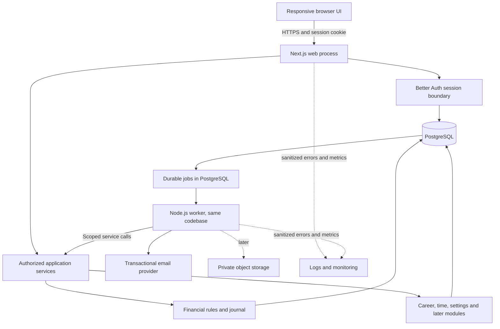
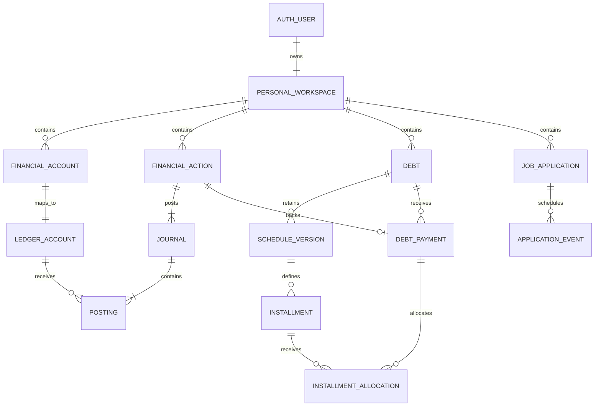
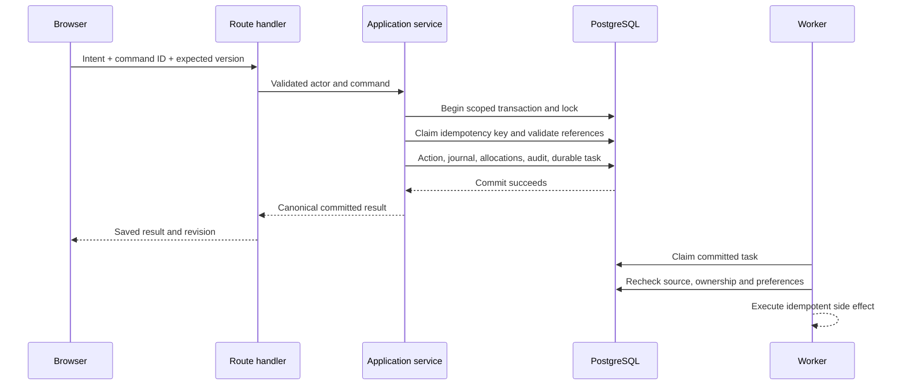
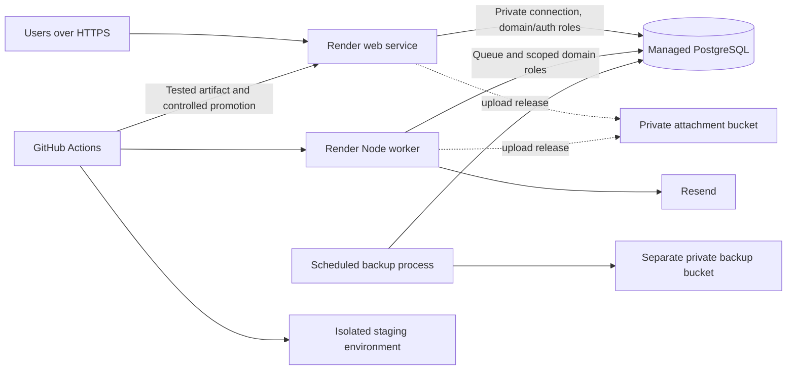

# Architecture

## Contents

- [Salapiya native architecture (product blueprint sections 7, 8, 11, 15, 20, 21 and 23)](#salapiya-native-architecture-product-blueprint-sections-7-8-11-15-20-21-and-23) (from `docs/SALAPIYA_PRODUCT_AND_PLATFORM_BLUEPRINT.md`)
- [System Architecture](#system-architecture) (formerly `docs/reference/SYSTEM_ARCHITECTURE.md`)

## Salapiya native architecture (product blueprint sections 7, 8, 11, 15, 20, 21 and 23)

### 7. Selected technology and module architecture

#### 7.1 Baseline and rationale

| Area | Selected baseline | Reason and limits |
| --- | --- | --- |
| Applications | Flutter/Dart, one shared product codebase | A big rewrite was acceptable (D17), so getting desktop and mobile behaviour right matters more than reusing web code. Platform adapters and an adaptive UI are still needed. |
| Local data | SQLite via the validated Flutter/PowerSync-compatible storage stack | Durable transactions, local reads and offline work. Encryption, exact types, schema constraints and upgrades all have to be proven. |
| Remote identity | Supabase Auth with Google | A standard, recoverable identity for sync and groups; not needed for local-only use. |
| Remote data | Managed Supabase PostgreSQL | Fits the relational financial and group rules, and transactional validation, better than rewriting everything for a document model. |
| Sync infrastructure | PowerSync | Reuses transport and local replication; I still have to build the authorization, financial commands and conflict resolution. |
| Files | Private object storage with local download cache | File transfer stays separate from syncing small structured records. Provider configuration and scanning are gated. |
| Business rules | Shared pure Dart domain code within both clients; validated remote command implementation | Fast local responses, with remote integrity enforced separately. Keeping two languages in step needs fixtures, not assumptions. |

Flutter supports Windows and Android, but that doesn't mean every plugin supports every target. See [Flutter platforms](https://docs.flutter.dev/reference/supported-platforms), [Supabase Flutter](https://supabase.com/docs/guides/getting-started/quickstarts/flutter), and the publisher's [PowerSync package](https://pub.dev/packages/powersync). Pin versions I've tested together when I run Gate G0; the web repo's version numbers aren't the native dependency choices.

#### 7.2 Application boundaries

A modular app with presentation, application commands and queries, pure domain rules, repositories and platform adapters. Money, Debts and Cards, Planning, Sharing, Career, Time, Trackers, Profile and Sync, and Files and Recovery each hang together, without jumping to microservices.

UI state is temporary. The local database owns saved records, durable drafts and pending commands. State-management libraries coordinate views; they're not a second source of financial truth. Use reactive local queries and bounded results. Pick one main approach to state management and routing during G0 rather than mixing competing frameworks. Riverpod-style state coordination and maintained declarative routing are the kinds of thing I'm considering; this plan doesn't approve exact packages or versions by itself.

The server authenticates every request, checks ownership, membership and versions, then runs one whole domain command in a single transaction. Keep the surface of application commands narrow, like validated PostgreSQL RPC with a small API layer where needed. Clients never get to write arbitrary ledger rows. Least-privilege database grants, API checks and sync filtering are all needed, and service-role secrets stay on the server.

#### 7.3 What is not automatically portable

Next.js server rendering, browser sessions, raw PostgreSQL functions, RLS, lock semantics, deferred triggers, pg-boss jobs and the S3/ClamAV setup don't turn into native features by switching UI frameworks. Every invariant and side effect needs its replacement named.

SQLite's local transactional checks and the controlled command layer protect against bugs in the app; someone with full control of their own device can still edit the local files. The service treats uploaded data as untrusted and enforces shared and remote rules on its own. Tampering locally can't give anyone access to another person's records.

#### 7.4 Alternatives considered

Tauri with React would reuse more of the web UI and domain language directly, and it's the fallback if Flutter's critical integrations fail. Because a big rewrite was acceptable (D17), I leaned towards Flutter; I'm not claiming it measured faster. Tauri's documented Next.js path needs a static export, so the current server app wouldn't just drop in. [Tauri Next.js integration](https://v2.tauri.app/start/frontend/nextjs/).

Firestore has useful offline caching, but its documented last-write-wins updates and offline transaction limits don't give the relational financial guarantees this app needs. It's not the main data model. [Firestore offline data](https://firebase.google.com/docs/firestore/manage-data/enable-offline), [transactions](https://firebase.google.com/docs/firestore/manage-data/transactions).

Fully separate native clients would mean more upkeep for one developer. Peer-hosted sync would make availability depend on personal devices and make recovery harder. Self-hosting might be a cost trade-off later; I'm not assuming it's free or less work.

### 8. Offline operation, authority and synchronization contract

#### 8.1 Authority by mode

| Mode/data | Authority and user experience |
| --- | --- |
| Local-only private profile | The local transactional data is the truth. Every personal launch feature has to work with no backend, including the advanced local management. |
| Connected private profile | PostgreSQL holds the accepted record across devices. Each device reads its local accepted data plus local work that's clearly pending. A local save is durable before the service accepts it. |
| Shared group | The service holds accepted group history and membership; local copies and pending commands let you read and capture offline. No device acts as the group's server. |
| Derived values | Projections that can be rebuilt from the records they come from; never balances or totals someone edits on their own. |
| Attachments | A file's details and transfer status are separate from whether its bytes are actually on a device. |

The interaction model is local-first, with the server deciding when synced data is reconciled. It isn't a promise that everything is consistent everywhere at once while offline. PowerSync's own docs say conflict handling and idempotent backend writes are the app's job. [PowerSync conflict handling](https://docs.powersync.com/handling-writes/handling-update-conflicts).

#### 8.2 Operational availability

| Workflow | Offline behavior | Online requirement |
| --- | --- | --- |
| Startup, local creation, private reads/search, downloaded history | Works without refreshing the sign-in | None |
| Ordinary income, expense, transfer, new bill and payment report | Validated and saved durably on the device; connected effects stay pending until accepted | Sync and revalidation for acceptance across devices or by the group |
| Reports and forecasts | Worked out over the complete local data available, labelled with freshness and anything pending | Refresh for newer remote changes |
| Complex debt/card closure, schedule replacement, allocation/correction or capacity-dependent actions | Fully local in local-only mode; connected mode allows review and drafts | Finishing online can be required where stale concurrent state would make acceptance unsafe |
| Google enrollment, another-device retrieval, invitation acceptance, membership/ownership changes | Explains that a connection is needed and keeps what the user entered | Required |
| Local reminders and downloaded file access | Available, as far as OS scheduling and the files present allow | None |
| Undownloaded files, remote updates and cloud recovery | Availability and status shown plainly | Required |

Gate G3 has to produce a command-by-command availability table for every M and S row. Ordinary recording stays offline; this exception isn't a way to turn the whole finance module online-only. Finishing advanced actions offline can grow once its invariants are proven.

#### 8.3 Durable command processing

A proposed contract, still to be proven against the SDK I pick:

1. A user action is validated with the exact domain rules and given a stable command id, schema version, device identity, the expected record and source versions, and a digest of its payload.
2. The pending intent and whatever's needed to show it locally are committed together. A power cut must never leave a balance change with no recoverable command behind it.
3. A whole domain command is uploaded through an authenticated endpoint. Ledger rows replicated on their own never count as permission to post money.
4. The server checks current authority, dependencies and versions, then records the accepted action, its journal and evidence, the audit and an idempotent receipt in one go, or returns a structured rejection or conflict.
5. The same command id with the same normalized payload returns its earlier result. The same id with a different payload fails. Actions are identified by stable ids and dependencies, not the order of device clocks.
6. The receipt and the downloaded accepted state are reconciled without showing the accepted action and its pending projection twice. An upload acknowledgement and a finished download checkpoint are different events.
7. Temporary failures retry with bounded backoff. Permanent validation or authority conflicts move to a review state you can inspect; they never hold up every unrelated upload forever.
8. Rejected intent and real private money evidence are kept. A correction or retry creates new, explicit intent where it's needed; a rejected command is never marked synced, and an invalid payload is never resent again and again under new ids.

PowerSync's exact queue, transaction and checkpoint behaviour, and its support for local-only tables, have to be tested. A bounded command adapter and pending projection are fair application work; building a second general-purpose sync engine isn't the default. Accepted financial tables that only download, plus local pending command records, is a proposed approach, not something the SDK has been shown to guarantee.

#### 8.4 Conflicts and duplicates

| Situation | Required behavior |
| --- | --- |
| Two distinct expenses recorded on separate devices | Keep both if each is valid on its own; no balance row gets overwritten. |
| Same submitted command retried after response loss | Return the original outcome without a second economic effect. |
| Same real-world purchase manually entered twice under different IDs | Offer duplicate detection and review; idempotency alone can't prove they're the same purchase. |
| Concurrent correction of one bill/action | Expected-version rejection, then a comparison and review; amounts never go last-write-wins. |
| Two payments consume the same remaining liability/allocation capacity | Server validation runs one at a time; incompatible intent is rejected or held, and evidence of a real payment is kept for a reviewed classification. |
| New expense makes another device's savings reservation underfunded | Keep the real expense and explain the shortfall; never invent cash or quietly delete a reservation. |
| Record archived/deleted remotely while offline edits exist | Enforce the transition currently allowed and keep the draft or conflict; nothing comes back to life on its own. |
| Member removed before an offline command uploads | Recheck current membership and deny new group writes; local private evidence stays available. |
| Unrelated new bill advances group state | Don't reject every independent create just because a global version changed; validate the dependencies actually affected. Scope version changes carefully. |

Monetary fields, posted journals, settlement transitions, schedule versions and provider facts never auto-merge. For non-financial entries, start with explicit record-version conflicts; merging field by field could come later.

#### 8.5 Read consistency and user-facing status

Financial reports get a consistent accepted snapshot, with any overlay of local pending entries marked as such. A dedicated Sync area shows the last successful sync, the pending count and review failures you can act on. Ordinary screens get short labels, not implementation detail.

**Saved on this device** means it's durable locally. **Synced** means accepted and reconciled to the service checkpoint that applies. **Waiting for connection** means it's waiting to transfer. **Needs review** means the user needs to do something. For settlements, **Confirmed by recipient** is its own business state; a synced pending settlement isn't a confirmed receipt of payment.

Download enough history for the local calculations that need it; pagination must never quietly turn the sum of a visible page into an account or group total. Supported capacity limits have to be stated and validated. Missing first-download history blocks claiming a complete balance, not unrelated features.

### 11. Security, privacy and lifecycle

The security level I approved is practical baseline protection, not an enterprise control programme. It covers strict ownership, secure authentication, encrypted transport, protected credentials, suitable local storage protection, auditable financial transitions and being able to recover.

End-to-end encryption isn't a first-release requirement. Authorized infrastructure admins can technically reach private and group data stored in the cloud, and the app says so. Group members can't reach each other's private records. Turning on sync uploads the private data to the chosen services, so once connected the product isn't described as device-only.

Use maintained encryption and the OS's credential storage; no home-made cryptography, and no database key derived straight from a short PIN. The SQLite encryption path I pick has to be validated on both platforms. Attachment bytes, temporary exports and logs need protecting as well as the database files. An optional biometric or system app lock is a convenience and access control, separate from encryption and recovery. Handling the database and backup keys securely is Gate G4; it's not something SQLite or PowerSync gives me for free.

Every command, file request and subscription scope is authenticated and authorized. Never ship service-role, database-owner, signing or OAuth client secrets inside the apps. Bounded validation, least-privilege grants, rate and size limits, current membership checks, safe local file paths and careful handling of external links. Financial values, notes, tokens, invite secrets and attachment contents never go into telemetry.

Removing the local profile, revoking a device, deleting the cloud account and leaving a group are separate things. Consequential actions show what goes, what stays shared, unsynced data that's at risk and whether recovery is possible. Deleting in the cloud needs online authentication and a fresh check; deleting a local-only profile works offline with an explicit confirmation. A delete queued on the device isn't a finished deletion everywhere.

Decide how kept backups and shared history are handled before real use. Don't promise instant erasure from old backups or from other members' downloads. A restore has to reapply account deletions and revocations, never bring unauthorized access back. The private pilot needs no advertising or behavioural analytics; any diagnostic upload is explicit and redacted.

### 15. Repository and migration organization

I'm continuing in `RAbnza/Personal-Management-Platform`. The accepted web baseline and its tests and docs stay as a reference I can run. Don't take the web app apart at the start, and don't keep two competing product roadmaps going forever.

The structure I proposed: a new `apps/salapiya/` Flutter app, a bounded backend area like `services/salapiya/` or documented Supabase functions and migrations, cross-language fixtures under `contracts/`, and the existing documents under `docs/`. That's a starting suggestion, not permission to move current files. Look at the repository's tooling and decide the exact paths in G0.

Create a fresh native local schema and a deliberately mapped remote schema. Don't replay every web migration inside SQLite. Reuse PostgreSQL logic only after checking how much it depends on Better Auth and web workspace identities, privileged roles and the old lifecycle machinery. Port the semantic fixtures into Dart and backend tests; don't reuse web UI tests mechanically as native acceptance.

No real legacy data needs migrating. Create synthetic seed data and edge-case fixtures on purpose. Cleaning or resetting the old test environment stays its own explicit action. Once real pilot data exists, schema upgrades and backup compatibility for Salapiya become required.

Before building starts, add narrowly scoped pointers or ADRs to the current handoff and architecture documents, so nobody (me included, later) follows stale status text. This plan on its own doesn't rewrite those historical records. Don't rename the repository or publish changes without deciding to do that as its own piece of work.

### 20. Risk register and mitigation

| Risk | Consequence | Mitigation / visible decision |
| --- | --- | --- |
| Financial sync treated as generic row replication | Duplicated/overwritten money or invalid allocations | Command receipts, server transactions, pending-state model, G1/G3. |
| Flutter rewrite loses subtle legacy behavior | Incorrect debt/card/group semantics | Feature matrix, existing domain docs, shared golden fixtures and A16–A19. |
| Full financial launch scope is underestimated | Long delivery or pressure to drop advanced features | Staged development; explicit progress by M/S row; scope changes require an explicit recorded decision. |
| Google identity loss or enrollment collision | Lost access or accidental profile overwrite | Managed identity recovery, backup, safe profile choice and G2. |
| Sync streams expose records outside RLS assumptions | Privacy breach | Independently tested stream authorization, no service secrets in clients, A14. |
| Free-tier suspension/limits | Delayed sync/recovery or unexpected migration work | Offline resilience, usage measurement, G7 and no paid assumptions. |
| Encryption protects data but makes recovery impossible | Permanent loss after device failure | Portable encrypted archives and tested independent key recovery, G4. |
| Device background restrictions | Late updates/reminders | Foreground sync path, durable work, device-specific notification disclosures. |
| Old clients/backups resurrect obsolete data | Duplicates or restored revoked access | Version windows, receipts/tombstones, server revalidation and A23/A28. |
| Files outgrow free storage or bypass safety checks | Cost/security problems | Bounded attachments, explicit coverage, real validation/scanning and G8. |
| Provider/plugin/API changes | Broken builds or sign-in | Pinned versions, dependency review, provider-boundary adapters and tested upgrades. |
| Broad Life scope competes with financial priority | Feature bloat | Launch only approved essentials/presets; defer custom tracker builder and deep analytics. |

### 21. Decision register

| ID | Decision | Status / rationale |
| --- | --- | --- |
| D01 | Salapiya; Your money, on your terms. | Approved as the final name and tagline from the workshop; the repository name doesn't change. |
| D02 | Windows and Android with substantial capability parity | Approved; the UI and input adapt, the meaning stays the same. |
| D03 | One local profile per installation | Approved; there's no real need for several people on one install. |
| D04 | Local creation/use without mandatory account | Approved; no anonymous online registration needed first. |
| D05 | Optional Google connection; one remote account/private profile, multiple devices | Approved; replaces my earlier email-and-password-first idea. |
| D06 | Continue with Google can retrieve an existing profile directly | Approved; no empty profile created first. |
| D07 | Synchronize private data as well as groups | Approved; one person using several devices is core scope. |
| D08 | All existing implemented financial capabilities launch together | Approved; replaces the earlier financial deferrals. Building in stages isn't cutting scope. |
| D09 | Overview, Money, Debts, Shared Expenses, Life | Approved; Debts is prominent, and Life stays even though the name is finance-focused. |
| D10 | Calendar/reminders, Tasks/Learning/Books and Career essentials at launch | Approved; meaningful wider personal use from the start. |
| D11 | Custom tracker builder/migrations, deep Career/tracker analytics later | Approved as deferred; the preset and history design underneath stays compatible. |
| D12 | Flutter, SQLite, Supabase and PowerSync baseline | Approved for planning, gated on real proof of platform support, integrity and cost; no native acceptance before that. |
| D13 | Owner-independent cloud groups, active-member bill creation, creator corrections, recipient confirmations | Approved; no owner approval queue for every bill, and owners can't see private ledgers. |
| D14 | Versioned conflict review and durable retries | Approved as a principle; the exact queue and command implementation is still G1/G3. |
| D15 | Baseline security; no initial end-to-end encryption requirement | Approved; say plainly that admins are trusted, and keep user isolation and protected storage. |
| D16 | Private distribution and free-tier pilot | Approved; no paid-service commitment and no public launch. |
| D17 | Substantial rewrite acceptable; no legacy real-data migration | Approved; existing data is throwaway, but that doesn't automatically approve deleting it. |
| D18 | Continue in the existing repository | Approved; keep the web reference and history, with the replacement built separately. |
| D19 | Logo and final native assets later | Deferred; no logo is generated here, and none is implied to be approved. |
| D20 | Independent backups and reviewed recovery | Approved requirement; the exact format, encryption and retention get validated in G4/G8. |

### 23. Reference index

#### Repository domain references

- [Credit cards and statements](DOMAIN_RULES.md#v2-credit-cards-and-statements).
- [Recurring obligations](DOMAIN_RULES.md#v2-b--recurring-obligations).
- [Budgets](DOMAIN_RULES.md#v2-c--budgets).
- [Savings goals](DOMAIN_RULES.md#v2-d--savings-goals).
- [Forecasts](DOMAIN_RULES.md#v2-e--forecasts).
- [Career analytics](DOMAIN_RULES.md#v2-f--richer-career-analytics) — advanced analytics deferred, evidence kept.
- [Scheduled notifications](DOMAIN_RULES.md#v2-g--scheduled-opted-in-notifications) — what the sources mean stays; the native channel redesign is set out here.
- [Files, imports and portability](DOMAIN_RULES.md#v2-h--supporting-files-imports-and-portability).
- [Shared Expenses implementation](archive/web/SHARED_EXPENSES_IMPLEMENTATION.md).
- [V3 tracker workflows](PRODUCT_AND_FEATURES.md#adaptable-trackers-workflows).
- [V1 user guide](PRODUCT_AND_FEATURES.md#v1-user-guide), [CSV exports](DATABASE.md#v1-csv-export-contract), and [lifecycle operations](OPERATIONS_AND_RELEASE.md#v1-lifecycle-operation).
- [Approved web redesign plan](archive/web/COMPREHENSIVE_UI_UX_REDESIGN_PLAN.md), [M4/M5 handoff](archive/web/REDESIGN_M4_M5_HANDOFF.md), and [M6 acceptance](archive/web/REDESIGN_M6_ACCEPTANCE.md).

#### External technical references

Official documentation I checked while preparing the workshop and these docs on October 19, 2026. Recheck anything time-sensitive before building or spending money. These sources describe what the products can and can't do; they don't accept Salapiya's implementation.

- [Flutter supported platforms](https://docs.flutter.dev/reference/supported-platforms) and [adaptive design](https://docs.flutter.dev/ui/adaptive-responsive).
- [Supabase Flutter guide](https://supabase.com/docs/guides/getting-started/quickstarts/flutter) and [Google sign-in](https://supabase.com/docs/guides/auth/social-login/auth-google).
- [Google OAuth application states](https://developers.google.com/identity/protocols/oauth2/production-readiness/overview).
- [PowerSync Flutter SDK](https://docs.powersync.com/client-sdks/reference/flutter), [publisher package](https://pub.dev/packages/powersync), and [conflict handling](https://docs.powersync.com/handling-writes/handling-update-conflicts).
- [Supabase pricing](https://supabase.com/pricing) and [PowerSync pricing](https://powersync.com/pricing).
- [Android persistent background work](https://developer.android.com/develop/background-work/background-tasks/persistent).
- [Tauri Next.js guidance](https://v2.tauri.app/start/frontend/nextjs/) and [Firestore offline/transaction guidance](https://firebase.google.com/docs/firestore/manage-data/enable-offline).

## System Architecture

**Native continuation (October 20, 2026):** The [Salapiya blueprint](PRODUCT_AND_FEATURES.md#salapiya--product-revision-and-windowsandroid-migration-blueprint)
sets the new Windows and Android direction. See the [P0 foundation](OPERATIONS_AND_RELEASE.md#salapiya-native-development-foundation)
and the [actual native verification](archive/salapiya/P0_VERIFICATION.md). What follows
keeps the historical web contracts and evidence; its web architecture and older
instructions to stop don't choose or accept the native implementation. G0-G4 are still open.

**Project:** Personal Management Platform (working name)  
**Architecture version:** 1.0  
**Date:** October 5, 2026  
**Primary source:** `PROJECT_VISION_AND_FEATURE_BLUEPRINT.md`, version 1.3, October 5, 2026, read in full (sections 1–19).  
**Source SHA-256:** `AAB9E718338D3D11EC4D434330D2573456FA6BF953E4A6D3397DC9618915ECB4`  
**Status:** The current web architecture, with the original design and conditional operational guidance kept. V1/V2 completion and V3's targeted acceptance are recorded in their handoffs; this spec on its own isn't test evidence.

**Roadmap amendment — October 16, 2026:** [ADR 0005](adr/0005-v3-scope-and-platform-transition.md) and the [V3 development plan](archive/web/V3_DEVELOPMENT_PLAN.md) replace the earlier V3 commitment to external calendars and the plan to release the web app to production after V3. The version, date and source hash above identify the original design inputs, not the amended files. The real V1/V2/V3 completion evidence is in the handoffs, with V3 accepted under the later targeted strategy. The current web infrastructure stays the baseline for building and verifying through the full UI/UX redesign; finishing its production deployment and readiness is no longer planned. The historical hosting, provider and production requirements below are kept as conditional records, not current provisioning tasks or technology decisions for the future platform.

**Approved redesign alignment — October 17, 2026:** V3-A–D are finished under [targeted local acceptance](OPERATIONS_AND_RELEASE.md#v3-change-impact-acceptance); the broader automatic CI passed separately at `239c360` ([run](https://github.com/RAbnza/salapiya-app/actions/runs/38911065106)). The approved [redesign plan](archive/web/COMPREHENSIVE_UI_UX_REDESIGN_PLAN.md), [M1–M6 roadmap](archive/web/UI_UX_REDESIGN_MILESTONES.md) and [decision register](archive/web/UI_UX_REDESIGN_DECISIONS_REQUIRED.md) now decide presentation and navigation. M1 foundations are finished and were approved on October 17, 2026 (Asia/Manila); M2 is ready to start on its own ([handoff](archive/web/REDESIGN_M1_HANDOFF.md)); M2-M6 haven't started. **Personal workspace** is the working identity. Final branding and F01–F07 wait for future platform planning and development; architecture decisions come after the redesign and before native work. No replacement framework, database, identity, sync or provider has been chosen. The modular monolith, auth, scoped roles and RLS, services and APIs, database, transactions, worker, and the financial, private and group boundaries all stay.

### 1. Authority, intent, and reading guide

The blueprint sets the product requirements. On top of that, I asked for a complete technology recommendation and private multi-user accounts from the start. Instructions inside the blueprint count as product requirements and design context, not orders to deploy, install software or change accounts.

This document turns those requirements into implementation boundaries, data ownership, financial invariants, command contracts, operational controls and release gates. The database schema, API spec, interface design, backlog and automated tests should all follow from it.

Terms used throughout:

- **Requirement:** behaviour the blueprint or my request explicitly asks for.
- **Decision / recommended default:** an architectural choice made here. Use it unless a recorded architecture decision replaces it.
- **Open / gate:** a choice that needs confirming, or evidence, before the feature it affects is built or released. An open decision is never a licence to guess quietly.
- **Future:** a designed boundary for an extension, not a requirement to build its tables or infrastructure in V1.

The default architecture is an online, responsive web app: a modular monolith, one PostgreSQL database, and one private personal workspace per user. Under the user-friendly financial actions, the financial core uses a small balanced journal. Applications and trackers stay their own specialized domains. Calendar entries and reports come from domain records. Authentication, ownership checks, database isolation and account deletion are all part of the first release.

That architecture still governs M1–M6; the later Windows and Android direction doesn't mean replacing it now. Most future personal features should work offline with data on the device, and some sync and collaboration online. Frameworks, local storage, the backend, identity, sync and conflict protocols, and data migration all wait for separate platform architecture planning and approval. The current security, privacy, authorization and integrity guarantees hold the whole way through.

Sections 2–5 cover scope and the stack; 6–10 identity, data, finance and transactional APIs; 11–16 the UI and product modules; 17–21 privacy, operations and tests; 22–24 decisions, release order and the final consistency review.

| Quick navigation | Main references |
| --- | --- |
| System and dependencies | [Architecture](#3-overall-architecture), [stack and library matrices](#4-technology-stack-and-dependency-matrix), [modules](#5-module-boundaries-and-internal-organization) |
| Private users and data | [Accounts and isolation](#6-multi-user-accounts-authentication-and-authorization), [data model](#7-data-architecture-and-sources-of-truth) |
| Money and commands | [Ledger](#8-financial-core-and-accounting-correctness), [debt](#9-debt-schedules-payments-and-settlement), [API and consistency](#10-commands-apis-transactions-and-errors) |
| Connected product | [UI](#11-frontend-architecture-and-user-experience), [time](#12-calendar-reminders-and-background-processing), [reports](#13-reports-dashboards-and-analytical-definitions), [groups](#16-shared-expenses-separate-group-authority-and-private-integration) |
| Production readiness | [Security/lifecycle](#17-security-privacy-audit-and-lifecycle), [portability](#18-imports-exports-files-and-restoration), [operations](#20-deployment-cicd-observability-and-recovery), [testing](#21-testing-architecture-and-release-evidence) |
| Delivery and review | [Decision gates](#22-decisions-risks-and-unresolved-questions), [sequence](#23-implementation-sequence-and-development-guardrails), [blueprint consistency](#24-final-consistency-review-against-the-blueprint) |

### 2. Scope and architectural priorities

#### 2.1 Release boundaries

| Release | Architectural deliverable | Explicit boundary |
| --- | --- | --- |
| First usable slice | Registration, verified sign-in, recovery, sessions, private workspace/settings; accounts; income, expenses, category splits, completed transfers and fees; application list/stages; agenda; guided setup | Multi-user isolation is already enforced. No single-owner shortcut. Core financial writes are atomic and idempotent. |
| Coherent V1 | Manual debts/schedules, imported opening liabilities, net disbursement, payment allocation, schedule revision, settlement, reconciliation, dashboard, all requested reporting periods, history, CSV exports, in-app reminder controls, deletion | Manual provider-confirmed amounts; no general amortization engine. No dependency on external reminder delivery. |
| V2 financial maturity | Cards/statements, recurring plans, budgets, goals, forecasts, richer career analytics, opted-in scheduled notifications | Actual postings remain distinct from expected occurrences. Uploads/imports/portable restoration can be added here behind separate gates. |
| V2 companion | Shared expense groups, accepted invitations, one or multiple payers, equal/exact shares, confirmation/disputes, private ledger linking | Required for the completed product. Group membership never grants private workspace access. |
| V3 | Learning, Books and Personal Tasks presets; versioned templates/custom fields; validated entries, immutable history and safe migrations; tracker reporting/statistics; internal Calendar/Agenda deadlines, reminders and relevant cross-domain integration | Preserve versions, ownership and existing entries. External calendar-provider synchronization is deferred to approved future platform architecture; no offline support or packaging in V3. |
| After V3 | Comprehensive UI/UX Redesign → Platform Architecture Planning → Windows/Android Development → Platform-Specific Acceptance | Web remains the environment through redesign; future technologies and feature changes require separate decisions. No current web production deployment/readiness completion is planned. |
| Later selectively | In-transit transfers, refinancing, multiple payment sources, standalone lending, richer group splits/simplification, multiple currencies, offline synchronization, general sharing | Add only with explicit financial and authorization rules; no premature implementations. |

I recommend adding core partial refunds in **V1**, because they use the same journal and correction machinery and stop people misfiling a common kind of receipt. It's a recommendation, not an extra release commitment from the blueprint. If it's deferred, no refund form appears until its allocation and reporting rules exist. Credit-card refunds come with cards.

#### 2.2 Non-negotiable architectural invariants

1. A sign-in user, a personal workspace, a financial account, and a shared expense group are distinct identities.
2. Every private read and write is scoped to an authenticated owner, including relationships, reports, exports, jobs, files, and notification destinations.
3. A financial action commits its journal, allocations, revisions, history, and relevant reminder changes together or commits none.
4. Posted account/liability balances derive from journal postings. No independent editable balance or expense total exists.
5. Planned dates and future scheduled charges never create actual funds, expenses, or recognized debt automatically.
6. Every actual cash receipt identifies a receiving account owned by that workspace. The sender is metadata, not the destination.
7. Money uses exact arithmetic. Income, spending, cash flow, principal repayment, recognized liability, and scheduled payable are separate metrics.
8. Corrections preserve evidence. Retry, double-click, duplicate worker execution, and concurrent edits must not duplicate economic effects.
9. Generated calendar entries link to one authoritative source. Reminder dismissal does not complete that source.
10. Provider names are data. No business rule switches on GCash, BDO, Maya, or a family member's identity.
11. Group and personal balances have separate authorities. Another member cannot post to a user's private ledger without that user's explicit authorization.
12. Whole-account deletion can remove financial history under the declared lifecycle policy; financial immutability is not an excuse for indefinite personal-data retention.

### 3. Overall architecture

#### 3.1 Modular monolith with two process types

One repository and one application domain model. A Next.js web process and a small Node.js background worker run from the same versioned codebase. They share PostgreSQL but have different credentials and jobs. The worker is a way of running code, not a microservice with business rules of its own.

The browser talks to same-origin JSON endpoints. Route handlers authenticate, validate input, call application services and shape safe responses. Application services own transactions and coordinate the domain functions. Repositories run scoped SQL. Pure financial functions build and check posting plans with no HTTP or database dependencies.

Server-rendered reads call the same query services directly, without HTTP requests back into the app. Business changes go through Route Handlers so there's one visible command surface. The same change never gets written separately in Server Actions, route handlers and UI callbacks.



Financial consistency always lives inside a database transaction. Email and other remote I/O happen after the commit, through durable tasks. The V1 agenda and reports read the real data directly; they never wait for a worker before showing a saved payment.

#### 3.2 Deliberately small infrastructure

No microservices, Kubernetes, Kafka, Redis, search cluster, warehouse, GraphQL, full event sourcing or general plugin runtime to start with. PostgreSQL handles the relationships, transactional writes, filtered reporting and the modest number of jobs. Reads and commands are separate in the code, without separate databases or distributed CQRS infrastructure.

I chose this so that I, working alone, can follow a workflow from the form to the transaction to the report. The main trade-off is that module boundaries are kept by code review, imports and tests rather than by separate processes.

### 4. Technology stack and dependency matrix

#### 4.1 Selection and version policy

**Web architecture selection (not a list of installed packages):** TypeScript, React with Next.js App Router on Node.js 24 LTS, PostgreSQL 17, Drizzle ORM with `pg`, Better Auth database sessions, Zod, React Hook Form, TanStack Query/Table, shadcn/ui with one consistent, accessible family of primitives, and a job worker backed by PostgreSQL.

Node 24 is an LTS release, checked against the [Node release schedule](https://nodejs.org/en/about/previous-releases). When building starts, pick the current patched, stable Next.js release that works with the chosen React release. Pin PostgreSQL 17 so local, CI and production match; moving to a newer supported major is a deliberate upgrade, not whatever the provider defaults to. Check the provider actually offers it before provisioning.

For M1–M6 the installed, pinned stack stays; approving the redesign doesn't mean upgrading packages. The managed hosting and provider choices below are historical or conditional under ADR 0005. Pin exact installed versions in the lockfile and the runtime and container config, and never put floating `latest` versions in production builds. Prefer stable documented APIs, read advisories, and prove the auth, ORM and database integration before building features. Better Auth and Drizzle move faster than PostgreSQL, so their integration is a seam with tests around it. The links below go to official docs and repositories; I checked the key compatibility, isolation, session, worker and hosting capabilities on October 5, 2026. That doesn't vouch for every future package version.

**Priority:** R = required for this design; S = strongly recommended; O = optional. An R dependency for a later phase is only required when that feature ships, not installed up front. Dependencies grouped in one row do complementary jobs, each described in the row.

#### 4.2 Application, data, and identity

| Technology / dependency | Priority and phase | Purpose and placement; work avoided | Project fit and tradeoff |
| --- | --- | --- | --- |
| [TypeScript](https://www.typescriptlang.org/docs/) with strict mode | R, first slice | Browser, services, worker and tests; shared contracts and explicit money/date types reduce mismatches | One language for a solo developer; types do not replace runtime validation. Enable unchecked-index and optional-property checks. |
| [React](https://react.dev/) + [Next.js App Router](https://nextjs.org/docs/app) | R, first slice | Components and same-origin web/API application; routing, layouts, rendering and bundling | Strong UI ecosystem and portfolio value without another backend deployment. Server/client boundaries and cache behavior require discipline. |
| Node.js 24 LTS | R, first slice | Standard web and worker runtime | Compatible ecosystem and long-lived workers. Do not use edge runtime for database transactions or assume browser APIs behave identically on the server. |
| [PostgreSQL](https://www.postgresql.org/docs/17/) | R, first slice | Single relational source of truth; constraints, transactions, row security, JSONB for later tracker values | Financial relationships suit SQL. SQL design and migration review are still required. |
| [Drizzle ORM](https://orm.drizzle.team/docs/overview) + Drizzle Kit | R, first slice | Typed query/schema layer and migration generation | SQL remains visible for journal/report queries and RLS. Some constraints/triggers need handwritten SQL; generated migrations must be reviewed. |
| [node-postgres (`pg`)](https://node-postgres.com/) | R, first slice | Connection pool and driver underneath Drizzle | Conventional persistent Node deployment; every transaction uses one checked-out connection. Bigint values must not be coerced into JS numbers. |
| [Better Auth](https://better-auth.com/docs/authentication/email-password), [Drizzle adapter](https://better-auth.com/docs/adapters/drizzle) | R, first slice | Registration, password hashing, verification/recovery tokens, cookie sessions and session APIs | Avoids custom authentication while retaining application-owned SQL data. Requires patching, configuration tests and email delivery; no authentication vendor UI lock-in. |
| [Zod](https://zod.dev/) | R, first slice | Request/response contracts, form schemas, environment and job-payload validation | Good TypeScript inference; cross-record ownership and money rules still belong in server services/database constraints. |
| [pg-boss](https://github.com/timgit/pg-boss) | S, first slice | Durable email/lifecycle jobs, retries, and later reminder scheduling using PostgreSQL | Avoids another broker and a custom queue. Adds DB load and a worker; handlers still require idempotency and retention limits. Validate its transaction adapter for the pinned Drizzle release. |
| Native `bigint` + a small `Money` module | R, first slice | Centavo arithmetic, parsing, checked ranges and explicit allocation rounding | Addition/subtraction do not need a money framework. The custom part is a narrow value type with tests, not custom floating-point mathematics. |
| [decimal.js](https://mikemcl.github.io/decimal.js/) | O, later calculations | Rates, weighted calculations and supported forecasts with explicit rounding | Avoids binary floating-point for fractional calculations. Not necessary for V1 centavo arithmetic and never evidence of a provider's interest policy. |
| [rate-limiter-flexible](https://github.com/animir/node-rate-limiter-flexible) | S, public launch | PostgreSQL-backed limits for expensive business endpoints; auth also uses Better Auth's documented limiter | Avoids hand-built distributed counters. Configure separate policies and retention; verify PostgreSQL store/version compatibility. |

Drizzle has explicit [transaction APIs](https://orm.drizzle.team/docs/transactions) and [RLS definitions](https://orm.drizzle.team/docs/rls). They help this design, but they don't make queries tenant-safe by themselves.

#### 4.3 Frontend and interaction libraries

This table is guidance on what to choose and adopt, not proof that every package is installed. The current manifest has React/Next, Tailwind/CVA/clsx/tailwind-merge, Radix Dialog, RHF/resolvers/Zod, Lucide, Recharts, date-fns and timezone tools, and next-themes; Geist comes through the existing Next font integration. TanStack Query/Table, cmdk, Sonner, DayPicker, FullCalendar/Temporal, Driver.js and dnd-kit aren't installed at this baseline. Follow [Plan Section 9](archive/web/COMPREHENSIVE_UI_UX_REDESIGN_PLAN.md#9-library-strategy-and-platform-reuse): grow one family of owned components on Radix; bring in Query/Table only where something actually uses them, cmdk for the destination menu, and anything else only for a proven need. FullCalendar or native date-picker alternatives, virtualization, tours, drag and drop, and motion libraries are conditional or deferred, not required. Approving documentation doesn't install or upgrade anything.

| Technology / dependency | Priority and phase | Purpose and placement; work avoided | Project fit and tradeoff |
| --- | --- | --- | --- |
| [TanStack Query](https://tanstack.com/query/latest/docs/framework/react/overview) | S, first slice | Remote state, pagination, mutation lifecycle and invalidation in interactive pages | Avoids custom request caches. Query keys include user/workspace context; disable financial mutation auto-retries unless reusing the same command key. |
| React local state + URL search parameters | R, first slice | Dialogs, unsaved view state, shareable period/filter controls | No Redux/Zustand initially. URL state excludes sensitive free-text details and private payloads. |
| [React Hook Form](https://github.com/react-hook-form/react-hook-form) + `@hookform/resolvers` | S, first slice | Form lifecycle, dynamic category/fee rows and Zod integration | Avoids repetitive touched/dirty/error handling. Server validation remains authoritative; preserve strings while entering monetary values. |
| [Tailwind CSS](https://tailwindcss.com/docs) | S, first slice | Consistent responsive spacing, typography and themes | Fast solo iteration; enforce design tokens to avoid arbitrary visual divergence. |
| [shadcn/ui](https://ui.shadcn.com/docs) + [Radix Primitives](https://www.radix-ui.com/primitives) | S, first slice | Owned component source plus accessible dialogs, menus, selects and focus behavior | Customizable without building interaction primitives. Choose the Radix-backed component variants consistently; copied code needs maintenance and accessibility verification. |
| `class-variance-authority`, `clsx`, `tailwind-merge` | S, with UI components | Component variants, conditional class names, and conflicting utility resolution | Small complementary helpers used by the component convention; avoid parallel styling abstractions. |
| [Lucide React](https://lucide.dev/guide/packages/lucide-react) | S, first slice | Consistent tree-shakeable icons | Saves custom icon work; icons need labels and cannot carry status alone. |
| [Sonner](https://sonner.emilkowal.ski/) | S, first slice | Accessible transient notifications | Saves toast lifecycle code; important save errors also stay inline. A toast is not durable transaction evidence. |
| [TanStack Table](https://tanstack.com/table/latest) | S, first slice | Ledger/application sorting, filters, selection and server pagination | Flexible headless tables; implement semantic markup and mobile layouts. Avoid a spreadsheet-style grid until needed. |
| [TanStack Virtual](https://tanstack.com/virtual/latest) | O, measured need | Rendering large currently loaded lists | Reduces DOM cost; pagination remains primary and virtualization requires accessibility testing. |
| [Recharts](https://recharts.org/) | S, V1 reports | Trend/category charts built from server-calculated aggregates | Fits React; load lazily and pair charts with exact-value tables. Numeric chart coordinates are never the financial authority. |
| [date-fns](https://date-fns.org/) + [`@date-fns/tz`](https://github.com/date-fns/tz) | S, first slice | Date formatting, calendar operations and explicit time-zone calculations | Avoids ad hoc date math. All-day dates remain separate date-only strings; DST and recurrence policy still need explicit tests. |
| [React DayPicker](https://daypicker.dev/) | S, first slice | Date and date-range form selection alongside the UI components | Saves custom calendar-grid/keyboard behavior. Match the selected shadcn recipe to its supported package major; current v10 documentation uses `@daypicker/react`. Convert selected values to explicit date-only contracts. |
| Native `Intl.NumberFormat` | R, first slice | Localized display, with exact money string formatting at boundaries | No extra currency-format dependency. Do not round-trip displayed money through a floating-point number. |
| [FullCalendar React](https://fullcalendar.io/docs/react), `@fullcalendar/react` and its supported view/interaction modules | S, V2 calendar views | Month/week presentation and event interaction | Complements the V1 agenda. Current v7 uses React package subpath modules; do not mix v6 plugin packages with v7. Premium resource views are unnecessary. Source edits still route to domain commands. |
| [`temporal-polyfill`](https://fullcalendar.io/docs/timeZone) | S, with FullCalendar v7 | Calendar peer dependency and explicit named-zone conversion at the widget boundary | Supports the selected calendar's current time model without inventing timezone conversion. Keep domain dates in the shared date contract; do not introduce a second conflicting recurrence engine. |
| [Driver.js](https://driverjs.com/) | O, V1 guidance | Replayable contextual tours | Saves overlay positioning. Checklist/help must work without the tour; tours never submit financial forms. |
| [`@dnd-kit`](https://dndkit.com/) | O, later career board | Accessible drag/drop interactions | Avoids custom dragging. Keep keyboard stage controls and explicit history dates; ship the table first. |

#### 4.4 Delivery, files, jobs, and diagnostics

| Technology / dependency | Priority and phase | Purpose and placement; work avoided | Project fit and tradeoff |
| --- | --- | --- | --- |
| [Resend](https://resend.com/docs/api-reference/emails/send-email) + `resend` SDK | R capability, selected provider for first slice | Verification/recovery/security email; later opted-in reminders | Avoids SMTP operations; external cost, quota, deliverability and privacy dependency. Place behind a small email adapter. Authentication email is required even when reminder email is deferred. |
| [React Email](https://react.email/docs/introduction) | O, V1 polish | Reusable email templates and rendering | Better template maintenance; simple escaped HTML/plain-text templates are sufficient initially. |
| [csv-stringify](https://csv.js.org/stringify/) | S, V1 | Streaming quoted CSV exports with formula-escape settings | Avoids fragile CSV string concatenation. Document spreadsheet-safe escaping and export schema. |
| [csv-parse](https://csv.js.org/parse/) | S, V2 import | Streaming supported CSV inputs | Handles syntax, not semantic dates or deduplication. Import still needs mapping and preview. |
| [Amazon S3](https://docs.aws.amazon.com/AmazonS3/latest/userguide/Welcome.html), `@aws-sdk/client-s3`, `@aws-sdk/s3-request-presigner` | S, V2 uploads; also selected backup destination | Private object storage, managed API access and short-lived signed transfers | Avoids serving files from ephemeral web disks. Adds IAM/region/cost configuration; public buckets are forbidden. Backup credentials/bucket are separate from user uploads. |
| [`file-type`](https://github.com/sindresorhus/file-type) + [ClamAV](https://docs.clamav.net/) | S, upload release | Content-type inspection and quarantined malware scanning | Saves signature/scanner implementation. Neither proves a file harmless; maintain scanner updates and restrictive preview/download rules. |
| [Pino](https://github.com/pinojs/pino) | S, first slice | Structured server/worker logs with allowlisted fields and redaction | Searchable diagnostics without custom logging. Logs are not financial audit history. |
| [`@sentry/nextjs`](https://docs.sentry.io/platforms/javascript/guides/nextjs/) | S, public launch | Sanitized exception tracking and selected performance signals | Faster failure diagnosis; external processor with quotas. Disable replay and default PII collection; scrub URLs, payloads and breadcrumbs. |
| [OpenTelemetry JS](https://opentelemetry.io/docs/languages/js/) | O, measured need | Correlated spans across web, worker and database | Useful when latency diagnosis needs traces; avoid duplicate Sentry instrumentation and high-cardinality sensitive attributes. |
| [Render](https://render.com/docs) web service, worker and paid managed PostgreSQL | S, selected production platform | Managed deployments, TLS, private networking and database operations | Conventional Node hosting suits transactions and workers. Paid baseline is more predictable than a sleeping demo tier; verify pricing and recovery terms at launch. |

#### 4.5 Testing and developer tools

| Technology / dependency | Priority and phase | Purpose and placement; work avoided | Project fit and tradeoff |
| --- | --- | --- | --- |
| [Vitest](https://vitest.dev/guide/) | R, first slice | Domain, service and integration test runner | Fast TypeScript tests; database behavior needs actual PostgreSQL, not mocked repositories alone. |
| [fast-check](https://fast-check.dev/docs/introduction/) | S, financial core | Generated money, rounding, reversal and allocation invariants | Finds edge cases beyond examples. Keep deterministic seeds on failure and independent assertions. |
| [Testing Library](https://testing-library.com/docs/react-testing-library/intro/) + `user-event` + `jsdom` | S, first slice | Component tests by accessible behavior | Avoids tests coupled to implementation details; use browser tests for actual navigation/rendering boundaries. |
| [Playwright](https://playwright.dev/docs/intro) + `@axe-core/playwright` | R for E2E; S for axe, V1 | Isolated multi-user browser workflows, downloads, mobile emulation and accessibility checks | Covers cross-layer acceptance; automated accessibility checks need manual keyboard review too. |
| [MSW](https://mswjs.io/) | O, UI development | Deterministic API failures/loading in component tests | Useful for failed-save UX; not a substitute for real authorization/transaction integration tests. |
| [Docker Compose](https://docs.docker.com/compose/) | S, development/CI | Repeatable PostgreSQL and mail sandbox; isolated test database | Avoids environmental drift. Windows users need a working container environment or an equivalent dedicated development database. |
| [Mailpit](https://mailpit.axllent.org/) | S, local development | Capture verification and recovery mail without real delivery | Safe local inspection; production uses the provider adapter. |
| [pnpm](https://pnpm.io/), ESLint, Prettier, `tsx` | S, first slice | Reproducible dependency install, architectural lint rules, formatting and development scripts | Familiar tooling; pin package manager and avoid unnecessary monorepo orchestration. |
| [GitHub Actions](https://docs.github.com/en/actions) + Dependabot | S, first slice | CI checks, migration/build tests and dependency update proposals | Avoids manual release checklists alone; do not auto-merge major/security-sensitive changes without relevant tests. |
| [k6](https://grafana.com/docs/k6/latest/) | O, launch/load validation | Repeatable workload and percentile latency tests | Useful once realistic fixtures exist; load tests use synthetic data in staging. |

#### 4.6 Meaningful alternatives

- **Next.js versus Vite + Fastify:** a separate SPA and API would work, but adds routing, deployment and contract wiring. I chose Next.js for one deployable web boundary, and keep the domains framework-independent so they could be pulled out later.
- **Drizzle versus Prisma:** both work with PostgreSQL. I picked Drizzle for visible SQL, custom constraints and reporting. Prisma would be a fair choice for a team that knows it, but don't install both, and don't assume either one replaces designing transactions and ownership.
- **Better Auth versus managed auth:** managed auth means less credential work, but brings pricing and a dependency on the provider's lifecycle. The library I picked keeps control and ordinary database sessions; patching and delivering recovery are then my job. If the auth proof fails, choose a managed provider through an ADR before building product features.
- **Balanced journal versus ad hoc signed transaction rows:** a small journal takes more careful modelling at the start, but it stops financed spending, upfront fees, refunds and group receivables from being handled in contradictory ways. Users never have to learn accounting terms.
- **Render versus Vercel plus separate services:** long-running Node processes and a worker next to them make database connections and scheduling simpler. Vercel is still possible later if the worker and database layout and caching are checked again.

### 5. Module boundaries and internal organization

| Module | Owns | Allowed dependencies / contracts |
| --- | --- | --- |
| Identity and workspace | User lifecycle, profile, owner mapping, preferences, session-facing operations | Auth library and narrowly scoped workspace provisioning; does not calculate finances. |
| Financial core | Financial accounts, ledger accounts, actions, journals, postings, reversals, category allocations, reconciliation | Ownership context, categories and transaction infrastructure. All money-affecting modules post through this module. |
| Debt | Debt terms, schedule versions, installments, payment/settlement allocations | Financial core commands in the same transaction; exposes due-source queries. |
| Career | Applications, stage/outcome history, events, role/resume snapshots | Shared validation/history; exposes due-source queries. No dependency on finance. |
| Time and reminders | Personal events, unified agenda DTOs, reminder preferences/occurrence state | Read interfaces from source modules; source adapters handle mutations. |
| Reporting and dashboard | Read queries, definitions, period controls, export schemas | Approved read contracts/views; no domain mutation or separately maintained expense records. |
| Guidance and settings | Onboarding state, guide versions, enabled modules, user help | Calls normal commands for real setup; tutorial playback is read-only. |
| Cards and planning, later | Statements, plans, expected occurrences, goal allocations | Financial core plus time contracts; cannot redefine cash or expense rules. |
| Shared expenses, later | Groups, participants, bills, group balances, confirmations/disputes | Separate group authorization; private integration through explicit per-user finance commands. |
| Trackers, later | Versioned templates, definitions, entries | Shared time/history capabilities; cannot implement a competing ledger or job pipeline. |

A simple repository layout:

```text
src/app/                    pages, layouts, thin route handlers
src/modules/<module>/       domain functions, services, repositories, contracts, UI
src/platform/auth/          Better Auth configuration and session boundary
src/platform/db/            pools, scoped transaction helper, migrations
src/platform/jobs/          job transport and handlers
src/platform/email/         delivery adapter and templates
src/shared/                 Money, dates, errors, IDs, safe UI primitives
src/worker.ts               worker entry point
tests/{unit,integration,e2e}/
docs/reference/adr/                   decisions that change this baseline
```

Repositories need an authorized transaction or query context, never a loose `userId` sent from the browser. No generic repository abstraction. Domain modules export explicit use cases and DTOs, and other modules don't reach into their tables to change them. ESLint restricted-import rules keep database and auth code out of browser bundles, and one module's internals out of another's callers.

Modules coordinate synchronously with typed function calls inside one transaction. Durable tasks carry ids, a version, a scope and a small allow-listed payload. A lightweight job interface earns its place; a general event bus or plugin framework doesn't.

### 6. Multi-user accounts, authentication, and authorization

#### 6.1 Identity and workspace model

Better Auth manages `AuthUser`. `UserProfile` holds the name the app shows and the lifecycle status. `PersonalWorkspace` has `id`, `owner_user_id`, `kind`, `currency`, `timezone`, `week_start` and lifecycle timestamps, with a unique owner enforced for the personal-workspace kind. The defaults are PHP, Asia/Manila and a Monday week start, confirmed during setup.

Each real user gets exactly one private personal workspace. V1 has no general workspace-membership table and no household admin. Keeping the workspace id separate leaves room for other workspace types later without implying any sharing now. A future demo would be its own sandbox scope or deployment with synthetic data, not a boolean filter casually mixed into real financial queries.

Setting up a workspace is idempotent once authentication is verified: one transaction inserts the profile, workspace, default categories and settings only if they aren't there yet. A unique constraint stops two first requests at once from making two workspaces. Until setup succeeds, the app shows a setup error you can recover from and blocks domain commands. Don't assume the auth library's user-creation hook and the app's setup share a transaction. A half-finished registration can be retried safely.

In V1 the currency can't change once there are postings. Changing the timezone affects what's displayed and future reminder scheduling, never financial effective dates or stored instants. Different users can turn on different modules and reminder settings.

#### 6.2 Chosen sign-in and recovery experience

Email and password, with email verification. Registration is for separate people, not one hard-coded owner. A first closed beta can use a configurable registration allow-list or expiring invitation codes; opening registration later mustn't need a schema rewrite. Normalize identity emails the way the auth library does; don't strip dots or plus suffixes based on what one provider happens to do.

Better Auth handles password hashing, token generation, verification and resets. App policy allows long passphrases, password-manager autofill and paste, and a documented minimum length (12 characters recommended) with no arbitrary composition rules. A reasonable maximum the library supports keeps hashing work bounded. Authentication endpoints never reveal whether an account exists through different recovery messages.

The flows I recommend:

1. Registration → verification email → verified sign-in → idempotent workspace setup → optional onboarding.
2. Forgotten password → generic acknowledgement → short-lived one-time link to an allowlisted application route → new password → revoke all existing sessions → sign in again.
3. Password change or email change → recent reauthentication; verify a new email before replacing the old identity; notify the prior email of the change without sensitive financial content.
4. Unavailable email → point the user to recovering their mailbox. V1 has no informal admin password reset based on knowing a family member. Any other recovery method needs a designed proof-of-ownership flow.

Better Auth documents [email/password recovery](https://better-auth.com/docs/authentication/email-password). Turn on `revokeSessionsOnPasswordReset` explicitly; its [configuration reference](https://better-auth.com/docs/reference/options) shows it isn't the default. Reset and verification URLs never go into ordinary logs, analytics, referrers or public error reports.

The email provider only delivers; verification and recovery state stays with the auth library. Delivery callbacks either accept the send task durably or return a failure that can be retried. If asynchronous delivery needs a bearer link, that short-lived payload is encrypted with its own rotating server key, queue access is restricted, and it's deleted after sending or expiry. Job results holding tokens aren't kept. If the email provider is down, the app never claims the mail was delivered.

#### 6.3 Session policy

Opaque, database-backed sessions in secure HttpOnly cookies. In production the cookies are Secure, SameSite as appropriate (Lax for the same-origin app), host-scoped and invisible to JavaScript. No bearer tokens in localStorage. Sessions last seven days with documented refresh behaviour, plus a thirty-day absolute maximum checked on the server. Shorten these if the risk or user feedback calls for it.

Protected reads and writes don't use session cookie caching or stateless-only validation, so a revocation on the server applies on the very next request. The app boundary checks sessions against the database. There's a list of sessions and devices, sign-out of the current session, sign-out everywhere, and revoking one at a time. Only the metadata needed to recognize a session is stored, and IP and user-agent retention is trimmed.

Deleting, changing the password or email, and later recovery or MFA changes need you to have signed in again within the last five minutes. Renewing a session on its own doesn't prove a fresh password check. After signing out or switching accounts, the Query caches clear, server-rendered state refreshes and other tabs are told. Memoizing the session within one request is fine; memoizing user data across requests isn't. These controls build on the library's [session APIs](https://better-auth.com/docs/concepts/session-management).

The released V1-C4 deletion challenge uses a Better Auth plugin endpoint with the pinned library's password verifier, origin protection and persistent rate limiter. It records a five-minute `auth.session_assurance` that the server owns; renewing a session never creates that proof. Session review returns an estimated device and timestamps, without tokens or IPs, and revocation uses the library's supported operations. A password change checks the current password and revokes other sessions. Expired session metadata and verification credentials are cleaned up by a bounded housekeeping process that only touches auth; it also removes the library's global abuse counters after thirty days of inactivity, keeping active limit windows. Production has to set how often it runs; expiry on its own doesn't delete stored metadata.

MFA and passkeys would be a sensible security step later, using what the auth library supports, not a second home-made authentication system. Settle backup and recovery behaviour before turning them on.

#### 6.4 Authorization at every boundary

Authentication answers who's signed in. Authorization answers whether that user can do this operation on every record involved. A login page or a middleware redirect isn't enough. Every route handler, server query, download, command and worker handler enforces its own policy.

`ActorContext` is built from a validated server session: the user id, the personal workspace id looked up in the database, the session id and the request id. Owner or workspace fields sent by the client on personal commands are rejected or ignored. A workspace id in a URL isn't trusted just because it looks valid.

For a transfer, both financial accounts, every fee bearer, the categories and any linked source records are checked against the same workspace. For a debt payment: the debt, the paying account, the schedule version, the installments and any original action. Search, counts, joins, relation expansion, charts and export filters get the same checks. Random UUIDs are hard to guess, but they don't grant access.

A missing private record, or one you don't own, returns 404, so probing can't reveal that it exists. 403 is for a known, visible resource where a role can't do a particular action. Unexpected foreign-key errors come back as safe validation failures, without exposing another user's ids or data.

#### 6.5 Database isolation as a second barrier

Every private domain table has `workspace_id NOT NULL`. Parent tables have a unique `(workspace_id, id)` key, and child relationships use composite foreign keys such as `(workspace_id, account_id)` → `FinancialAccount(workspace_id, id)`. That blocks links across workspaces even when two valid ids are sent together. Tags, allocations, audits and attachment relations follow the same rule.

PostgreSQL RLS, with `USING` policies for reads and updates and `WITH CHECK` policies for inserts and updates. The common policy requires the row's workspace to match the transaction-local context and belong to the signed-in user. `PersonalWorkspace` itself is scoped by `owner_user_id`, and queries avoid recursive policies. Reports use an invoker-rights view or a scoped query, never a view that bypasses the owner. PostgreSQL documents the owner and superuser bypass and the default-deny behaviour in its [row-security reference](https://www.postgresql.org/docs/17/ddl-rowsecurity.html).

The transaction helper checks out one connection, starts a transaction, sets the trusted user and workspace context with transaction-local `set_config`, runs everything through that transaction object, then commits or rolls back. No context means no access. Never use connection-wide tenant settings, and never run a query on the general pool partway through this helper. That goes for read-only reports too.

Separate roles:

| Role | Permitted purpose | Restrictions |
| --- | --- | --- |
| Migration owner | Schema, policies, constraints and queue schema upgrades | Deployment-only secret; never available to normal request handling. |
| Application domain role | Scoped domain SQL | Not table owner, superuser or BYPASSRLS; no role switching, DDL or TRUNCATE; force RLS on private tables. |
| Auth adapter role | Library-managed auth tables and required auth housekeeping | No financial/career/table access; session and credential data never exposed through generic repositories. |
| Queue broker role | Claim/acknowledge job envelopes | No unrestricted private-domain access. Payloads are minimized; credential is worker-only. |
| Worker domain role | Execute a job in its verified owner/group scope | Re-establish context, check lifecycle/membership and source version; no global bypass for convenience. |
| Lifecycle operator | Narrowly scoped deletion/restore procedures | Separate credential/process authorization, recorded execution; not a general public admin endpoint. |

RLS protects against a forgotten query predicate, not against a fully compromised server that can forge its context. Parameterized SQL, restricted credentials and safe server code still matter. Test with the real runtime roles; tests that only run as the database owner can't prove isolation.

### 7. Data architecture and sources of truth

#### 7.1 Core relational model

The names below are conceptual; the real schema can use snake_case. Records are identified by UUIDs. `created_at` and `recorded_at` are UTC `timestamptz`, a mutable aggregate's `version` is an integer, and effective dates are PostgreSQL `date`. An event's original timezone is stored separately as an IANA name.

| Aggregate / records | Source-of-truth responsibility | Key relationships and constraints |
| --- | --- | --- |
| AuthUser, Session, credential/token tables | Identity and session lifecycle | Library-owned schema; application profile references immutable auth user ID. |
| PersonalWorkspace, Preferences, ModulePreference, OnboardingProgress | Private scope and user configuration | One personal owner; unique per-workspace settings/module step keys. |
| Category, Tag, record-tag joins | User-controlled classification | Seed per workspace; category archive preserves history; joins have scoped FKs. |
| FinancialAccount, LedgerAccount | User-visible fund locations versus internal accounting buckets | One cash ledger account per financial account; currency and normal balance; no mutable authoritative balance. |
| FinancialAction, ActionRevision | User-visible economic action and immutable change chain | Unique workspace/client command ID; reversal/replacement links; current revision pointer is controlled. |
| Journal, Posting | Dated balanced accounting movement | One action may own several journals; each journal has one currency/date, at least two postings and zero signed sum. |
| Debt, DebtScheduleVersion, Installment | Liability identity, provider terms, versioned schedule | One active schedule version; immutable former versions and mappings; due status derived from obligations and allocations. |
| DebtPayment, PaymentComponent, InstallmentAllocation, Settlement | Meaning of a payment and its due allocations | Exactly one linked financial action per payment; explicit recognized/unallocated components. |
| Reconciliation | Statement/app comparison and evidence | Account, cutoff, observed amount, app amount/version, reason and optional correction action. |
| JobApplication, StageHistory, ApplicationEvent | Application identity, stages, interviews and follow-ups | Repeated interviews have separate IDs; effective and recorded dates retained. |
| PersonalEvent, ReminderRule, ReminderOccurrence | Manual events and user reminder state | Generated agenda entries are queries; reminder source references must be validated. |
| AuditRevision, Activity | Evidence versus friendly activity feed | Scoped target links; revision records transactional; activity is a sanitized presentation. |
| CommandReceipt, durable job records | Idempotency and asynchronous intent | Unique command key/hash; tasks queued in the same transaction as their source change where required. |

Category allocations are categorized expense postings. A separate editable expense table must never become a second source of truth. A join or metadata table can tie postings to a purchase line or a fee component, but the totals always reconcile to the postings.



The diagram leaves out audit and ownership columns and the internal expense, income and equity ledger accounts to stay readable; they're still required in the real schema. Financial relationships use concrete foreign keys. A generic `source_type/source_id` reference is only allowed in non-financial presentation or job metadata, with a controlled resolver, source-lifecycle tests and an orphan detector. It never stands in for debt, payment or account foreign keys.

#### 7.2 Authoritative versus derived values

| Value | Authority | Projection / refresh policy |
| --- | --- | --- |
| Posted cash, recognized liability | Posted journal entries | Sum by ledger account and date; rebuildable cache only after measurement. |
| Outstanding principal | Principal-classified liability movements, if known | Null/unknown when breakdown cannot be supported; never infer from scheduled total. |
| Remaining scheduled payable | Active schedule's remaining obligations and due allocations | Separate from ledger liability; include coverage/breakdown flags. |
| Expense/category totals | Classified expense postings and linked credits | Shared report queries; no UI-side second formula. |
| Statement balance, later | User-verified closed statement snapshot | Preserved even when remaining amount due changes. |
| Agenda | Debt/career/personal/other source dates | Indexed source queries through adapters; no duplicate generated event row. |
| Reminder dismissal/snooze | ReminderOccurrence | Does not alter source status. |
| Group balances, later | Confirmed group bills/corrections/settlements | Separate from any user's optional private ledger link. |

No ambiguous stored flags like `isPaid` on both an installment and its payment rows. Due residuals are derived; if a summary is ever stored, its rebuild strategy and which transaction owns it are stated.

#### 7.3 Dates and historical setup

A financial `effective_date` is a local accounting date the user picks; a created timestamp never stands in for it. All-day deadlines use `date` and stay the same across zones. Timed events store a UTC instant plus the IANA timezone entered; DST times that don't exist or happen twice are handled explicitly, never resolved quietly.

**Opening cutoff default:** a balance entered for date D is the balance at the end of D, and normal activity starts on D+1. The UI says this clearly and offers the previous day as the cutoff when today's actions need recording. Ordinary new entries on or before an account's opening cutoff are blocked. A controlled historical-import or correction workflow can revise the opening baseline, with a before-and-after reconciliation. That way old activity never gets imported on top of a balance that already includes it.

Opening cash and existing liabilities post to opening-equity buckets, not income or expenses. Installments already paid in the past come in as historical schedule state with their evidence, and create no new cash payment. Coverage starts at the cutoff and shows on reports.

### 8. Financial core and accounting correctness

#### 8.1 A small internal balanced journal

The UI offers actions like Receive income, Add expense, Transfer, Record borrowing, Pay debt, Refund and Correct. Each command builds a posting plan. Users never pick debit and credit accounts themselves.

Internal ledger kinds: cash asset, receivable or clearing asset, liability, expense, income, opening equity and explicit adjustment equity. Cards will use liability accounts, and group receivables and payables will use scoped sub-accounts. Categories are a dimension on expense and income postings, not balances kept on their own.

Signed centavos are stored: debits positive, credits negative, and a journal always sums to zero. Asset and expense balances are debit-normal; liability and income balances are credit-normal, so the liability shown is the signed sum negated. Every posting names a ledger account in the same workspace and currency as its journal, and a journal's effective date applies to all its entries.

One user action can hold several balanced journals when its fee parts have different dates. The whole action saves in one go, and each part lands in the right reporting period. A V1 completed transfer moves both sides of the principal on the same effective date; different departure and arrival dates need the future in-transit workflow.

#### 8.2 Exact money and rounding

- PostgreSQL `bigint` stores centavos; TypeScript `bigint` performs arithmetic. `SUM(bigint)` can return numeric text from PostgreSQL: parse exact integer strings rather than Number.
- JSON transmits minor units as decimal strings, for example `{ "currency": "PHP", "amountMinor": "501500" }`. Form input remains a decimal string until strictly parsed. Reject malformed grouping, exponent notation, NaN and more than two decimal places for PHP.
- Set a recommended per-component maximum of PHP 1,000,000,000.00 and validate aggregate overflow against the storage range; this is a product limit, not a technical claim that all bigint values are safe browser numbers.
- Reject negative user amounts where the command already expresses direction. Dedicated refund/reversal commands determine signs. Zero-value actions are rejected unless a documented nonfinancial operation needs them.
- Equal splits use quotient/remainder centavo allocation in a stable participant order. Show who receives each extra centavo and persist that assignment. Weighted future splits use largest remainder with a stable tie rule.
- Percentages and estimates round only at a declared boundary. Chart plotting can use bounded numeric approximations after server calculation, but labels and exported financial values remain exact.

#### 8.3 Posting recipes

Amounts in this table are PHP, to keep it readable. Each debit total equals its credit total.

| Action | Debit | Credit | Reporting meaning |
| --- | --- | --- | --- |
| Opening bank balance 2,000 | Bank cash 2,000 | Opening equity 2,000 | Opening funds; no income. |
| Salary actually received 10,000 | Selected bank cash 10,000 | Salary income 10,000 | Cash and period income increase; sender remains metadata. |
| Gift actually received 500 | Selected wallet cash 500 | Gift income 500 | Distinct income classification; destination is mandatory. |
| Purchase 1,000 split 700/300 | Grocery expense 700; household expense 300 | Paying cash 1,000 | One deduction and two category portions. |
| Completed transfer 5,000 with source fee 15 | Destination cash 5,000; fee expense 15 | Source cash 5,015 | Internal principal cancels; spending and external outflow are 15. |
| Fee withheld from a 5,000 source debit | Destination cash 4,985; fee expense 15 | Source cash 5,000 | Preview makes gross/deposited amounts explicit. |
| Loan with principal 10,000, net proceeds 9,800 | Receiving cash 9,800; fee expense 200 | Loan liability 10,000 | Borrowing is not income. |
| Loan 10,000 received, extra 200 fee capitalized | Receiving cash 10,000; fee expense 200 | Loan liability 10,200 | Do not also deduct the fee from cash. |
| Existing recognized debt 6,400 at cutoff | Opening equity 6,400 | Loan liability 6,400 | No new borrowing flow or expense. |
| Financed purchase 6,000 | Purchase expense 6,000 | Relevant liability 6,000 | Spending now, cash later. |
| Pay principal 1,000, newly recognized interest 100, cash fee 10 | Loan liability 1,000; interest expense 100; fee expense 10 | Paying cash 1,110 | Expenses 110; net liability decrease 1,000. |
| Pay already recognized liability 1,100 plus new fee 10 | Loan liability 1,100; fee expense 10 | Paying cash 1,110 | Expenses only 10, even if prior liability included interest. |
| Refund 250 into cash | Receiving cash 250 | Original expense category 250 | Refund-classified spending offset on refund date, not income. |
| Confirmed waiver of recognized interest 400 | Loan liability 400 | Interest expense/recognized-cost offset 400 | Noncash reduction linked to a recognized charge. Imported unknown components use disclosed opening/adjustment treatment. |
| Unexplained positive reconciliation adjustment 100 | Cash 100 | Adjustment equity 100 | Explicit adjustment, not inferred income. |

Different fee bearer accounts produce separate cash or liability postings, still classified as fee expense. A fee can't be both taken from the proceeds and added to the debt again unless the user confirms two separate real charges. Previews with several fees show their labels, amounts, dates, bearers and combined effect.

#### 8.4 Database and service safeguards

Application services check what a command means and build the complete plan. Database constraints enforce the referential and row-level facts, and a deferred constraint trigger checks each committed journal's balanced sum, minimum number of postings, scope, currency and posted parent state; `CHECK` constraints alone can't validate sums across child rows. Test that trigger with direct SQL under the runtime role, including attempts at partial inserts.

Protected database rules make posted journals and postings reject UPDATE and DELETE, and no posting can be added to a journal once it's finalized. In one write transaction the app creates a journal in a building state, inserts its entries, then finalizes it; a deferred check at commit rejects any journal still building. So a journal is assembled atomically without ever leaving an editable posted parent. Financial form drafts, where offered, live separately and never show up in balance queries. In V1 a save either posts the whole action or fails; there's never a half-posted action left lying around. The lifecycle purge role is the one deliberate exception, for deleting a whole workspace.

Balances sum every posted signed entry, originals and their offsetting reversals included. Never filter out an original while keeping its reversal. A financial action's details group its correction chain, so you see what it means now and its history without mistaking corrections for new purchases.

#### 8.5 Refunds, rebates and correction semantics

A refund is a real new event, dated when it happens. Each one links to a purchase and allocates its categories, and the original purchase is locked while cumulative refunds are checked. An ordinary purchase refund can't exceed what's refundable on the purchase; fees need their own explicit fee refund, and unusual extra compensation needs its own separately classified action. Several partial refunds work without rewriting the purchase.

Gross spending is signed purchase and charge activity after corrections cancel out; refunds and rebates on recognized costs are offsets, classified separately. Net spending takes those offsets away. A reversal takes the original's reporting class with the opposite sign, so a correction never inflates gross spending, cash flow or refund totals, and the replacement carries the corrected meaning. Business actions are counted by their logical identity and current revision, not by journal rows.

The cashback rule I recommend: merchant cashback linked to a purchase is a spending offset; general wallet or bank rewards are labelled reward income. The user picks which when recording the money actually arriving. Expected cashback stays planned. A debt waiver produces no cash receipt unless a separate real receipt happened. Waiving future interest that was never recognized only changes schedule and avoided-charge metadata, not expense postings.

Changing the amount, account, currency, effective date, a recognized fee, a category allocation or a liability allocation creates a reverse-and-replace command, which needs a reason. A wrong historical action is corrected at its original effective date (and the replacement at its corrected date), while the correction's own timestamp is now. A real refund or a later settlement uses its actual new date. Plain descriptions, notes and references can have audited metadata revisions without a financial reversal. Renaming a category changes the label, not historical amounts; moving amounts to another category is an explicit financial revision.

#### 8.6 Cash, availability and reconciliation

Tracked liquid funds is the signed sum of the cash accounts, unexplained negative balances included, so the reconciliation identities stay true. The available-to-spend view doesn't count negative balances as usable money, shows a separate warning about a deficit or incomplete history, and never adds credit limits. The sum of positive accounts is never relabelled as net liquid funds. An archived account stays in historical and current totals while it still holds tracked value; archiving changes navigation, not who owns the money.

A real transaction that takes a manual account below zero is allowed after a clear warning and an explicit acknowledgement. The warning's outcome is recorded; the app never invents an overdraft policy or drops the transaction. A transfer that's genuinely still pending is outside the completed-transfer command and is never posted as completed.

Archived accounts refuse ordinary new activity until they're restored. Historical corrections and reversals can still point to them through the correction workflow, which keeps the old financial evidence and updates the totals. Archiving an account that still has a balance needs a preview explaining it; archiving never clears the balance.

A reconciliation records the balance the user saw and its cutoff, the calculated amount at the time of comparing, the difference, the source version and an optional statement reference. If a later write or a backdated correction changes the comparison, the reconciliation is flagged as needing review instead of still claiming to be verified. An explicit adjustment needs a date, amount and reason, and links back to the reconciliation. Never adjust automatically to the provider's balance.

### 9. Debt schedules, payments, and settlement

#### 9.1 Supported V1 debt semantics

Personal loans, installment loans and financed purchases, entered by hand with amounts the provider confirmed. A flexible obligation can be represented with manual charges and dates, but issuer-specific revolving-credit maths belongs to the card release. No universal amortization, and no inferring an interest rate from installment totals.

Stored separately:

- Original principal as known contractual metadata.
- Recognized liability from the ledger, with principal/interest/fee classifications where supported by evidence.
- Outstanding principal, either a defensible classified amount or unknown.
- Current and historic schedule versions, including future expected charges.
- Paid amounts and allocation evidence, including amounts awaiting classification.
- Lifecycle state (active, settled, settled early, cancelled) and separately derived overdue status.

Cancelling doesn't let a live liability vanish. A debt with postings needs a correction, waiver, settlement or another explicit resolution before its recognized balance can go.

#### 9.2 Payment components versus installment allocation

A payment has two separate allocations. The **accounting allocation** says how the cash lowers an existing liability, recognizes a new charge, or waits to be classified. The **due allocation** says which contractual installments it satisfied. Paying an installment doesn't prove the whole amount was principal.

One `DebtPayment` points to one `FinancialAction`, and its parts and installment allocations save in the same transaction. The form can suggest paying the oldest due first, but the user sees it and confirms. A partial payment leaves a positive amount still due. Extra payments need an explicit allocation to future obligations, recognized principal, or an advance or clearing amount; a debt is never quietly pushed below zero.

Fees paid outside the contract don't automatically count towards an installment. The due allocations plus an explicit unapplied contractual amount equal the contractual part of the payment, not counting separately identified external fees. The accounting parts plus those fees equal the cash actually taken out.

**Unknown breakdown default:**

1. If the provider-confirmed recognized total exists and the payment is confirmed to reduce that total, reduce an unclassified liability component. Preserve unknown principal/interest rather than inventing percentages. Previously recognized charges are not expensed again.
2. If the amount includes a known new charge, recognize that charge separately and reduce the known liability portion.
3. If neither liability reduction nor new charge allocation is known, record actual cash against a clearly labeled payment-clearing asset. A user-confirmed due payment may still satisfy a scheduled amount, but recognized debt remains unresolved until classified. The dashboard/report discloses the clearing balance and incomplete liability picture.
4. Later classification reclassifies clearing into liability reduction and/or expense without another cash deduction. Do not mark settlement complete while unresolved clearing or a liability mismatch remains.

Clearing is an accounting control, not a claim that the money is available or collectable. Uncertain clearing stays out of available funds and the default tracked net position, and is shown separately. This careful default settles an ambiguity in the blueprint without inventing a provider breakdown. Check its wording with representative users before building debts.

#### 9.3 Schedule revisions

Schedules are versions that never change, each with a reason, effective date, creator and type: correction or renegotiation. A revision previews the old and new due dates and amounts, the paid amounts carried over, what's left to pay, and the reminders affected. Where an obligation survives a date correction, it keeps its identity. For obligations that change, explicit supersession and allocation mappings are recorded instead of copying payments into a second schedule.

Historical payment allocations keep their original references. A mapping onto the current schedule is a projection of those same payments, not extra payments, so each payment is summed once. The kept allocations plus explicit unapplied amounts have to reconcile, and installments paid in the past are never marked as newly due. Old schedule versions stay available to explain things.

The new active version, the allocation mapping, the audit, reminder cancellations and rescheduling, and any financial correction needed all commit together. Changing only a due date needs no posting. A new charge the provider confirmed needs a posting; future scheduled interest on its own doesn't. Stale revision previews are rejected using the debt's version. Refinancing is deferred, and will have to settle the original debt and create a new borrowing action.

#### 9.4 Early settlement

The command takes the settlement date, the actual paying account and payment, the confirmed payoff, recognized charge and waiver parts, avoided future charges, a reference, a reason and the debt version it expects.

For a recognized PHP 6,400 liability: debit liability PHP 6,000 / credit cash PHP 6,000, then debit liability PHP 400 / credit the right recognized-charge offset PHP 400. After the whole atomic action, the recognized liability is exactly zero with no payment allocation left unresolved. The old terms are kept, and future unpaid obligations and reminders are cancelled.

If the PHP 6,400 is only the future scheduled amount and the recognized liability is PHP 6,000, paying PHP 6,000 clears what's recognized. The avoided PHP 400 goes into the settlement and schedule history, with no expense reversal. If the recognized amount is something else again, the mismatch is shown, and a supported correction, charge or waiver is needed before `settled_early` is allowed.

Never work out a payoff from the months remaining or hide a leftover with a rounding adjustment. A settlement is the user's confirmed record of what happened; the app doesn't make the payment or claim to calculate the lender's official payoff.

### 10. Commands, APIs, transactions, and errors

#### 10.1 API convention

Same-origin, REST-like JSON under `/api/v1`, with Better Auth owning `/api/auth/*`. Resource ids are UUIDs, and the typed schemas and inferred DTOs are shared with the client. Internal database entities and credentials stay out of response types. Contracts start out defined in code; generated OpenAPI only comes in if an external client makes it worth it.

| Endpoint example | Contract and responsibility |
| --- | --- |
| `GET /api/v1/me` | Minimal user/workspace/settings and capabilities; no credential fields. |
| `POST /api/v1/accounts` | Create owned financial account plus opening posting atomically. |
| `POST /api/v1/financial-actions/preview` | Validate intent, show postings/effects/warnings and dependency versions; no saved money movement. |
| `POST /api/v1/financial-actions` | Discriminated income/expense/transfer/borrowing/refund command; no arbitrary client-authored journal. |
| `GET /api/v1/financial-actions/:id` | Explain action, categorized amounts and correction chain in owner scope. |
| `POST /api/v1/financial-actions/:id/corrections` | Reason, replacement intent, preview token/version and idempotency key. |
| `POST /api/v1/debts/:id/payments` | One payment action plus accounting/due allocations. |
| `POST /api/v1/debts/:id/schedule-revisions` | Explicit versioned terms and allocation mapping. |
| `POST /api/v1/debts/:id/settlements` | Verified payoff workflow with strict residual checks. |
| `POST /api/v1/reconciliations` | Cutoff comparison; optional adjustment is an explicit separate confirmed command. |
| `PATCH /api/v1/applications/:id` | Versioned metadata/stage change; history effective date required for stage changes. |
| `POST /api/v1/applications/:id/events` | Interview/assessment/follow-up source; automatically visible through agenda query. |
| `GET /api/v1/agenda` | Bounded date range, module/status filters and stable source keys. |
| `POST /api/v1/reminders/:id/snooze` | Reminder-state operation; does not change debt/event status. |
| `GET /api/v1/reports/financial` | Shared period definitions, filters, currency, coverage and drilldown references. |
| `GET /api/v1/exports/transactions.csv` | Scoped, bounded streaming CSV with explicit schema/coverage. |
| `GET /api/v1/commands/:commandId` | Retrieve the owner's persisted result after an uncertain save. |
| `POST /api/v1/account/deletion-requests` | Fresh authentication, explicit scope and confirmation; begins lifecycle workflow. |

Collection queries have allow-listed sort keys, a bounded page size (50 by default, 100 at most) and a stable order like `(effective_date DESC, id DESC)`. Large ledgers and activity use opaque cursor pagination; small admin and settings lists can use offsets. Filtering happens before pagination, and report totals are never the total of whatever page is loaded.

#### 10.2 Transaction protocol

In V1, financial commands in a workspace run one at a time by locking its financial-state or workspace row first. That simple choice suits a personal finance workload and avoids subtle concurrency bugs in settlements and refunds. Other aggregates are locked in a fixed id order. Ordinary career writes use optimistic versions and don't wait on unrelated finance work. Only revisit the coarse lock if contention is actually measured.

The service does this:

1. Validate session, current user/workspace lifecycle, origin/CSRF controls, body size and input schema.
2. Open a scoped transaction, obtain the workspace write lock, and claim the command key.
3. Check expected aggregate versions, referenced record ownership, account status, currency and all allocation totals.
4. Recompute the preview/posting plan from authoritative current state. If material assumptions changed, require review rather than accepting a stale preview.
5. Insert complete action/journals/postings, payment/schedule metadata, immutable audit revisions, a financial data revision increment, and durable tasks/cancellation state.
6. Validate database constraints and commit once.
7. Return the committed result and affected query scopes. Only now show success; invalidate relevant client views.

A preview is advice, never a reservation. Its normalized payload hash and dependency versions can be stored or signed where useful, but everything is revalidated at commit. Acknowledging a below-zero warning is tied to the current intent and can't get round ownership or arithmetic checks.

Commands use READ COMMITTED plus the explicit write locks. Reports with several queries use a read-only REPEATABLE READ transaction, so cards, charts and detail totals all come from one database snapshot. SQL deadlocks and serialization failures can retry the whole idempotent command a small, bounded number of times with jitter. Validation conflicts are never retried as if they were passing infrastructure faults.



#### 10.3 Idempotency and concurrency

The client generates one command UUID when an action is ready to submit, and keeps it through retries and uncertain network outcomes. Uniqueness is per workspace and command id; the command type, normalized payload hash, result identity and completion status are stored in the same transaction as the action. Same key and same payload returns the earlier result; same key and a different payload returns 409. A second request that waits on the first transaction reads its committed result instead of creating another action.

Financial action command ids and compact command receipts are kept as long as the financial record exists; ordinary non-financial receipt bodies can expire after a documented interval. The uniqueness evidence is never deleted in a way that lets an old financial retry become a new payment. To recover after a reload, the client keeps only the opaque pending command id in sessionStorage, with no financial payload and no auth token. If a commit's response gets lost, the command-status endpoint or a retry with the same key settles it.

Mutable resources use integer versions and conditional writes, and a stale update returns 409 with safe conflict details. Two partial refunds, debt payments or settlements at once re-check the remaining amounts after locking. Bank reference strings aren't globally unique, so they can't be idempotency keys. A similar date, amount or content can raise a duplicate warning, never an automatic merge.

#### 10.4 Error contract and validation layers

Errors use one consistent problem response: `status`, a stable `code`, a safe `message`, optional field errors, `requestId` and `retryable`. Typical codes: `VALIDATION_FAILED`, `STALE_VERSION`, `ALLOCATION_MISMATCH`, `CURRENCY_MISMATCH`, `IDEMPOTENCY_CONFLICT`, `SOURCE_CHANGED`, `RATE_LIMITED` and `TEMPORARY_UNAVAILABLE`.

- 400: malformed JSON or query syntax; 401: no valid session; 404: unavailable/nonowned private resource.
- 409: stale version or command-key conflict; 422: business validation failure; 429: abuse/usage limit with retry guidance.
- 500/503: unexpected/internal or transient failure; return a request ID, not SQL, stack trace, tokens or private record content.

Client schemas give instant feedback; server schemas enforce what comes in from outside; domain services enforce the business rules across records; database constraints are the last line. Each financial action is a discriminated union, string lengths, array counts and date ranges are bounded, and unknown write fields are rejected so nothing gets mass-assigned. An HTML form can't pick an arbitrary journal account or change ownership.

The UI tells apart a validation failure, a confirmed failure, saving, saved and **outcome unknown**. A timeout doesn't prove anything was rolled back. Form input in memory that can be recovered is kept, status lookup and retry are offered, and there's no promise of offline durability. Technical errors are traced by the request id, while the field errors you can act on stay visible.

### 11. Frontend architecture and user experience

M1–M6 are built in the existing Next.js/React web environment. The [approved frame](archive/web/COMPREHENSIVE_UI_UX_REDESIGN_PLAN.md#6-application-frame-navigation-and-shared-interaction-contracts) uses Home, an integrated module switcher, contextual Add, Find a screen and Account utilities, local section navigation and adaptive list and detail layouts instead of a permanent global sidebar. Money, Career, Calendar, Trackers, Shared expenses when it's on, and Reports stay easy to find; mobile uses labelled Home / Calendar / Modules / More. Every current route, source link and capability flag stays. Hiding something from navigation isn't authorization, and it never changes data, reports or the separate Agenda and reminder preferences.

The approved design plan decides warm-neutral surfaces, violet and lavender actions, restrained accents, Geist, central semantic tokens, balanced density and light and dark themes. The [design guidelines](archive/DESIGN_SYSTEM_pre-redesign.md#design-system-and-visual-guidelines) keep the stable requirements on finance, accessibility, privacy and states. Reuse `src/components/ui`, the shell and the domain components; add shared compositions only when reuse is proven, and keep domain commands and validation out of presentation. Final branding can still be swapped in; no offline or native behaviour is added.

Server Components for authenticated first reads and light layout; Client Components for forms, tables, charts and interactive controls. Database and auth modules are marked server-only. Narrow DTOs go back, not whole ORM rows. The framework's [data-security guidance](https://nextjs.org/docs/app/guides/data-security) sets the server and client boundaries; authorization lives in the service layer, not just in what the UI renders.

The existing Server Component reads and command lifecycles still hold. Where a milestone brings in TanStack Query to replace repeated interactive fetch state, Query owns only that remote state; React Hook Form owns editable form state; URL parameters own safe filters and periods; component state owns dialogs and passing selections. None of these get duplicated. Hydration uses a fresh server QueryClient per request and scoped client keys, and no private Query cache is persisted. Financial changes never update a balance speculatively: they show a pending indicator and replace or invalidate from the committed server result. Small UI preferences that can be undone can use optimistic updates with rollback.

Every workflow with an amount has a summary preview: the paying or receiving accounts, the actual cash effect, the spending effect, the liability effect, fees, the effective date and warnings. Category splits show exactly how much is left to allocate. A receipt form asks whether the money is income, borrowing, a refund or a transfer from your own account. The salary destination can be edited on every receipt; optional defaults only prefill it.

Responsive forms put phone entry, keyboard focus and readable labels first. Tables fold into useful detail views on small screens. Error summaries move focus to the first invalid field, and status comes with text or icons as well as colour. Charts come with tables, named periods and links to the records behind them. Amounts keep their exact values on screen even when a chart plots approximate coordinates.

Onboarding stores its versioned steps and progress separately from real records. Finished setup commands go through the ordinary idempotent services. Skipping, resuming or replaying a tour never recreates accounts or transactions. Career-only users skip money setup, and optional modules stay opt-in. Help has task instructions, empty-state actions and an accessible way to give feedback, where the user controls any diagnostics shared.

**Module-disable default:** hiding a module keeps its data, and its existing agenda items stay visible with a hidden-module badge. The app explains this before you hide it, and offers a separate agenda filter and reminder setting. Financial reports still include the kept financial records by default; a navigation preference can't make debt or spending disappear. Hiding a module or turning it back on never changes data irreversibly.

### 12. Calendar, reminders, and background processing

#### 12.1 Agenda as a projection

Each source module provides a bounded `listAgendaItems` query and an authorized source route. The shared DTO has a stable source kind, id and occurrence key, a title, a date-only or timed interval, the source's status, the module to show it under, whether it can have reminders, and the source version. V1 merges debt installments, career events and next actions, and personal events. An application's next-action field and its linked follow-up event never show as two separate items.

In V1 projections are queried directly, ordered by date and time, with module filters. A generated event isn't another editable appointment. Editing it opens the debt, application or tracker command; only personal events you added yourself are edited directly in Calendar. Completing, cancelling or settling something changes what's visible automatically, because the source query changes. Overdue means an eligible source that isn't resolved and whose date is before today in the user's zone.

A date-only debt deadline is never compared against UTC midnight; a debt due today becomes overdue on the next local day. Clashing timed events can be flagged, but the app never quietly moves an interview or a provider's due date.

#### 12.2 Reminder state

There are rules (an explicit override per source, or the module default) and occurrence state (dismissed, snoozed until, disabled, delivery state). In-app indicators are worked out on read; occurrence state is stored when a dismiss, snooze or settings command first needs it, never as a side effect of a GET. Being correct doesn't depend on a browser staying open or a nightly cron job.

A logical reminder key is built from the owner or scope, the source, the occurrence, the reminder rule and the channel. A source version is a validity check, not a reason to send the same reminder again after someone edits an unrelated note. Changes to the dates, status or rules that matter cancel old scheduling generations. A due date that really changes can start a new generation, explained in the history. A payment that clears the amount due invalidates all its unpaid reminders. Reminder metadata keeps a debt's due-resolution epoch, so if a later correction makes the same obligation due again, even in the same schedule, it gets a fresh notification generation. A partial payment updates the remaining amount shown without resetting acknowledgement. Changing reminder generations never rewrites the real financial or schedule evidence.

Dismissing only dismisses the reminder. Snoozing moves when it next shows or is delivered, and the user can see that. Turning reminders off is separate from turning a module off. For overdue items in V1 I recommend a lasting in-app badge rather than repeated external alerts; how often to send external overdue alerts stays a V2 preference gate.

#### 12.3 Durable tasks and external delivery

Required application work is queued with pg-boss's supported transaction integration, in the same transaction as the source change. Prove how it rolls back in the integration spike. If the pinned adapter can't share the existing transaction, use a small transactional outbox and dispatcher instead; a best-effort enqueue after the commit is never the only record of required work. Pick one approach and record it, rather than keeping both by default.

V1 worker jobs cover auth and security mail, lifecycle cleanup and maintenance; later ones cover opted-in reminders, exports and imports, attachment scanning and bounded recurrence generation. Job schemas are versioned. Where possible jobs keep only ids and scope, never snapshots of salaries, employers or account names. Right before acting, a handler rechecks the current lifecycle, permissions, preferences, source version and whether the thing is still unresolved. A deleted user or a removed member can't get a queued private export just because it was authorized hours ago.

Delivery state records scheduled, claimed, suppressed or cancelled, accepted by the provider, delivered (if there's evidence), bounced and failed. The provider accepting a message doesn't prove the user got it or read it. Exponential retry, a bounded number of attempts, a dead-letter state and a backlog age an operator can see. Webhooks need signature validation and idempotent event ids.

Internal notification rows have a unique logical delivery key, which external delivery uses as the provider's idempotency key where it's supported. A crash after the provider accepted a message but before acknowledging it is an uncertain outcome: reconcile with the provider's evidence, or hold it for review once its deduplication window has passed. An at-least-once worker can't promise exactly-once email. There's also a small race when a source is resolved after the provider has accepted a message; a message already sent can't be taken back.

External reminders need opt-in, the local timezone, quiet hours, content privacy preferences and an opt-out per channel. By default notification text leaves out amounts and company names. Quiet hours hold reminders back without moving the source's deadline. Required account-security mail is kept apart from optional financial and career reminders.

#### 12.4 Recurrence, later

Recurring definitions generate expected occurrences, each identified uniquely by `(rule_id, logical_occurrence_date, generation)`. They're generated over a bounded rolling horizon, not an endless schedule. An occurrence can be planned, linked or paid, completed, skipped or cancelled. A date arriving never posts money; a completion command links an existing action or posts one idempotently.

The limited recurrence grammar supported is built on date-fns calendar operations: daily, weekly or monthly, with an explicit end, count or interval. For monthly days 29–31 the default is a last-valid-day rule the user selects explicitly, with a preview. If arbitrary RFC-style recurrence is ever needed, look at a mature recurrence library then; it must never quietly swap the product's shorter-month rule for skipped months.

Changing one occurrence records an override; changing future ones creates a rule version effective from a boundary. Completed and past occurrences are kept, and obsolete pending jobs are cancelled. Nothing shifts for weekends or holidays without a confirmed rule. Syncing with external calendars is outside V3 and deferred until later platform architecture planning approves the direction, scopes, conflict policy, stable external ids, echo suppression and deletion behaviour. Internal Calendar and Agenda integration is still required in V3; notification delivery is a separate feature that already exists.

### 13. Reports, dashboards, and analytical definitions

One reporting service provides weekly, monthly, calendar-quarter, yearly and custom periods. Inclusive date inputs become half-open boundaries `[start, next_day_after_end)`. Financial queries filter on effective dates; timed career activity filters on boundaries converted to UTC. The start of the week is the user's choice. Interactive ranges that are invalid or far too wide are rejected or sent to a bounded export.

Financial reports come from classified postings and source metadata. A calculation-definition version is stored and reported, so later changes in meaning can be explained. Every response has the period, filters, PHP currency, the workspace timezone, coverage and cutoffs, when it was generated, the financial data revision and any uncertainty flags that apply. Backdated corrections revise historical reports on purpose. An exported snapshot stays a dated artifact; it's never quietly rewritten, and it's never promised as official accounting that can't change.

| Metric | Definition and exclusions |
| --- | --- |
| Income | Salary/gift/reward-income postings within the period; excludes loan proceeds, own transfers, principal recovered and purchase refunds. |
| Gross recognized spending | Purchase/recognized-charge expense activity net of correction reversals; includes financed purchases and separately identified fees/interest. |
| Refunds/rebates | Applicable linked expense credits by actual refund/waiver date; distinguish cash refunds from noncash liability waivers. |
| Net recognized spending | Gross spending minus eligible spending offsets; no duplicate principal repayment. |
| External cash inflows/outflows | Cash legs crossing the tracked cash boundary; classify borrowing, refunds, payments, income and expenses separately. Internal completed-transfer principal is excluded, fees included. |
| Opening and closing liquid funds | Signed ledger cash balances immediately before start and through period end. Opening setup entries during the interval are disclosed as explicit baseline additions/adjustments, not income. |
| Debt payment total | Cash paid toward obligations, with principal/known charges/unallocated components displayed; overlapping expense components are disclosed, not added twice. |
| Recognized liabilities | Credit-normal balances of supported liabilities, separately showing credit/advance states and unknown components. |
| Scheduled payable | Remaining contractual dues including identified future charges; never added to recognized liability as another debt. |
| Tracked net position | Included tracked cash/assets/confirmed receivables/card credits less recognized liabilities; list included kinds, excluded uncertain clearing and missing history. Available credit is excluded. |

Cash reconciliation has to satisfy:

```text
Closing liquid funds
  = Opening liquid funds
  + External cash inflows
  - External cash outflows
  + Explicit balance/baseline adjustments
```

The blueprint's cash-flow fixture has to produce PHP 36,915 closing funds from PHP 24,500 opening + PHP 30,000 salary − PHP 12,400 cash spending − PHP 4,500 principal − PHP 500 newly recognized interest − PHP 185 fees. Recognized expenses are PHP 13,085 and the net cash change is PHP 12,415. Those are separate assertions, not two names for one total.

Source posting labels are kept so transfer principal can be split from fees even inside one journal. In the future in-transit workflow, departure and arrival move money between liquid cash and transit assets, with a separately shown net movement to or from owned non-liquid funds so the expanded identity still holds. A transfer is never reclassified as income just to make a report balance.

The debt and liability roll-forward reconciles separately: opening recognized debt + newly recognized borrowing and charges − reductions and waivers + corrections = closing debt. Expense, cash-flow and liability reports look at the same money from different angles; their totals are never added into one meaningless overall amount.

Report SQL aggregates postings and allocations at the right grain before joining, so a purchase with three tags and two installments never shows up six times in the totals. A category filter limits the category amounts; account filters need documented behaviour for transfers, which have two sides. Combined reports cancel internal movements only inside the tracked scope they include, and label single-account movements properly.

Dashboard queries reuse these definitions: things needing attention first, then financial and career summaries, the agenda and activity. A pending or unclassified payment, a missing principal breakdown, a stale reconciliation or an unlinked group allocation shows as incomplete coverage. Every number links to a detail query with the same period and filter contract.

Refunds land in the period they actually happen by default, even if the purchase was last year. An optional purchase-cost view puts the original and its linked refunds together without rewriting period reports. Career cohorts count applications submitted in a period and the outcomes seen by a named as-of time; counting events and counting distinct applications are different measures. An empty denominator returns null with "not applicable", not zero or NaN.

### 14. Career and tracker domain design

#### 14.1 Applications and history

`JobApplication` is one attempt, not one company. It stores the company and role, where it was found, the URL, a snapshot of the role description, the actual application date, location and work arrangement, an optional salary range and currency, technologies, contact information, notes, a reference to the resume version and the next action. Posting URLs can expire; V1 doesn't fetch them automatically on the server.

Stage and outcome stay separate, and Saved isn't submitted. Stages can be skipped and interviews repeated; a stage change records its effective date and when it was entered. Accepted, rejected, withdrawn, offer declined, offer expired and employer cancelled are explicit outcomes. Reopening an attempt is a recorded transition, not an overwrite of its final history. No response is an observation with a date, never an automatic rejection.

Each interview or assessment is an `ApplicationEvent` with a time and timezone, a link or location, preparation notes and an outcome. Follow-ups can be dated events. A stage change can commit together with a next event the user explicitly asked for, but a stage on its own never invents an interview date. A second attempt at the same company and role raises a warning, with the choice to carry on.

In V1, resume versions are fixed identifiers, notes and reference links; later uploads will keep the exact file and version used. Updating your latest resume never rewrites an old application. Contact details and salary expectations are private fields, kept out of logs and out of external notifications by default.

Career reporting uses the history to work out how long each stage took, and handles repeated stages, open stages and corrections explicitly. Interviews are counted separately from applications that reached an interview. Define the response event and the as-of cutoff before adding conversion funnels; richer cohort analysis can wait for V2 without losing the raw history it needs.

#### 14.2 Versioned trackers, V3

`TrackerTemplateVersion` owns the field definitions: stable field ids, type, validation, choices and the main title, status and deadline mapping. `Tracker` points to a template lineage and version; `TrackerEntry` stores validated JSONB values plus a version, and an indexed, extracted title, status and due date. The extracted columns update in the same transaction as the entry values and can be rebuilt; they're never edited on their own.

Start with preset Learning, Books and Personal Tasks templates, and the field types text, number, date, checkbox and single-select. Templates and custom fields users create come later in V3, once version and migration safety is in place. TypeScript/Zod validation is built from a strict allow-list of definition types. No arbitrary JavaScript, SQL, formulas or executable template content. Number fields aren't the financial Money type unless a separately designed non-financial display needs it.

Adding optional fields can stay compatible; adding required ones needs defaults or a migration plan. Removing a field archives its definition and keeps the values; changing a type or select options creates a version and a migration preview, with handling for invalid entries. Never rewrite every entry quietly. Date and status mappings feed agenda projections through the same source contract as Career and Debt.

Habit streaks need dated check-in records and timezone rules; one completion checkbox can't produce them reliably. Sharing tracker templates, later, would be sharing content, not permission to read someone's trackers. Trackers can link to financial or career records, but those modules stay the real source.

The finished V3 keeps database Section 14's versioned model for templates, fields and options, trackers, entries and revisions, and migrations. V3-A/B built presets, customization and safe migration; V3-C added reports and statistics, internal Calendar and reminders, onboarding and navigation, portability and lifecycle; V3-D finished the approved targeted acceptance and documentation. The second piece of work replaced the original big verification campaign with change-impact verification. The [V3 handoff](archive/web/V3_DEVELOPMENT_HANDOFF.md) and the [impact matrix](OPERATIONS_AND_RELEASE.md#v3-change-impact-acceptance) have the actual evidence and its limits; the approved redesign keeps these built contracts.

### 15. Financial roadmap extension design

#### 15.1 Cards and statements, V2

A card maps to a liability ledger account, with the issuer, name and limit as metadata. A card purchase is still entered as an expense, even though how it's funded differs from cash.

The existing purchase and expense entry is the main place to record it. When the funding source chosen is a credit card, the server uses the card-purchase recipe:

recognized spending increases;

card liability increases;

liquid cash does not move.

Nobody has to enter the purchase once in Expenses and again in a Cards module.

The Cards area manages liability, activity, statements, payments, reconciliation, fees, interest, refunds, card credits, utilization and installment plans; it isn't another purchase tracker.

Purchases and recognized fees and interest post spending and liability; payments post less cash and less liability; refunds offset spending and liability or create an overpayment credit. Pending authorizations are separate records, for information only, until they're recognized as posted activity.

The transaction date, posting date and which statement a charge belongs to are stored separately. By default I recommend reporting recognized purchases by transaction date, with explicit views cut off by the provider's posting for reconciliation. Which statement a charge goes on follows verified posting and cycle information, never a guessed date rule.

CardStatement stores the verified cycle dates, statement balance, minimum due and due date, which never change. StatementEntry links recognized activity, and allocation records explain payments and credits against the statement. Closing a statement doesn't create another purchase, and doesn't recalculate its original balance after a payment. The remaining statement due changes through allocations in effect, while the original verified statement balance stays fixed.

Don't assume minimum-payment, interest, available-credit or payment-allocation formulas are the same across issuers. A closed statement entered by hand can reveal transactions that weren't recorded; reconciliation sorts them out explicitly instead of inventing postings.

A card installment plan links the original spending to the scheduled obligations the provider confirmed, without recognizing the same purchase every month. The number of installments on its own isn't enough evidence for interest, fees, the total repayment or due dates. New charges recognized from the provider become separate financial actions.

An overpaid card shows as card credit and stays out of liquid funds. A card balance in credit isn't shown as negative debt.

Utilization handles missing or zero limits, states its balance date, and works out total eligible outstanding balances divided by total eligible limits. Card-credit balances stay out of the credit-used numerator, and cards with no limit are called out. Available credit stays an estimate and is never cash.

When a purchase paid by card is also a shared expense, it's still entered once. Private Finance records the card liability and the owner's private spending and receivable effects; the group side records what the payer put in and each participant's share. Other group members never get the payer's private card or account ids.

#### 15.2 Planning, budgets and savings goals

Budgets are limits per category and period, compared against defined net or gross spending (I recommend net, with refunds shown). Changing a budget doesn't change any expense. Forecasts combine the actual opening position with expected occurrences and assumptions, and show actual and predicted totals separately.

Savings goals reserve eligible cash you own; they aren't another asset. Goal allocations add up within an allowed eligible pool, and allocating happens under the same workspace financial lock so two at once can't over-reserve. When actual spending shrinks the pool, underfunding is recalculated and a warning shown, instead of past reservations changing quietly. Moving money between accounts doesn't create more savings. Releasing or reserving funds only changes reservation records.

#### 15.3 Transfers in transit and later receivables

When it arrives, money in transit uses an owned asset you can't spend: departure debits transit and credits the source cash; arrival debits the destination and credits transit. Failure or return, and fee refunds, are separate confirmed actions with their own dates. A started transfer is a lifecycle record, not a cash posting, until the money actually leaves. Paired references are kept, and a transfer can't be completed twice.

Standalone lending posts cash to a receivable, and getting principal back lowers the receivable; it isn't income. Write-offs need an explicit reason and classification. Group receivables come out with shared expenses, even while standalone lending stays deferred. Investments and noncash assets need a valuation and reporting policy before they count in tracked net position. Currency conversion needs rates, realized differences and balancing rules before a workspace supports several currencies; storing a currency code now doesn't mean FX is built.

### 16. Shared expenses: separate group authority and private integration

#### 16.1 Authorization and membership

`ExpenseGroup`, `GroupMembership`, `Invitation` and `Participant`. Tables the group owns use `group_id` with composite group-scoped foreign keys and RLS, never a personal workspace id copied from whoever created it. Active membership only allows the documented group actions. Personal ledger links carry the owner's workspace and stay invisible to other members.

Owner and member roles. Owners manage membership and settings and can archive the group; members record the bills and settlements they're allowed to. At first only a bill's creator revises it. An owner can flag or propose a correction, but can't quietly edit someone else's bill or look at their private account. Managing membership is limited to current owners, with a recent sign-in for consequential changes. Membership RLS is designed so no policy queries itself recursively: where needed, a narrowly audited permission predicate with a fixed search path and no broad data-returning privileges. Membership changes and group commands that depend on authorization coordinate on the group lock, then recheck membership before committing.

Invitation tokens are random, expire and work once, and only a hash is stored. Accepting one needs the intended user signed in and verified, and shows plainly what group history they'll see. An invitation sent to an email is tied to that verified email; arbitrary callers can't search a user directory. Each registered user has at most one active participant identity per group.

People who aren't registered have a display name and a flag saying their entries are recorded by hand; they have no auth identity, no private workspace and no notifications. Claiming or linking one needs an invitation, explicit acceptance and a review of the balance and history. Matching names never merges anyone.

The former-member policy I recommend: read-only access to the records they could see before leaving, plus later resolution and corrections of those existing obligations; unrelated new bills, contacts and uploads stay hidden. This is built with explicit visibility bounds and record entitlements, not just `membership.active`. Removal takes away write rights and unrelated access at once. Leaving keeps obligations, and archived groups keep their history. Settle this policy, and what it means for deletion, before building invitations.

#### 16.2 Group financial model
SharedExpense versions contain description/date/currency/total and their PayerContribution and ParticipantShare rows.

V2 supports one or more payers per bill. One payer stays the simplest, default UI, but the model and service rules never assume exactly one contribution.

For every finalized current bill revision:

sum(PayerContribution.amount) = bill total
sum(ParticipantShare.amount) = bill total

Both are checked separately, under the group lock.

A payer doesn't have to have a share, a participant doesn't have to pay, and any subset of members can be in a bill.

V2 starts with equal and exact (custom) splits between participants. Splitting by category and splitting between people stay separate.

Group-level corrections are stored as explicit revisions; finalized evidence is never edited.

A participant's current balance is worked out across every bill in effect, refunds and confirmed settlements:

Group net receivable
  = Current contributions paid for bills
  - Current shares consumed
  - Effective refund amounts returned to payers
  + Effective refund reductions of consumed shares
  + Confirmed settlements paid
  - Confirmed settlements received

Positive means the group owes the participant; negative means the participant owes the group.

All current participant net positions add up to exactly zero.

So debts in both directions net out automatically in what's shown now, while the original bills stay as they were. If A owes B PHP 1,000 from one bill and B owes A PHP 800 from another, A currently owes B PHP 200.

Views between two people and settlement suggestions for the whole group are derived projections, not balances stored and edited.

Reported, proposed and disputed settlements add nothing to confirmed group balances. The read model can also show pending outgoing and incoming settlement amounts, and a clearly labelled projected balance if those pending settlements are confirmed.

A confirmed settlement has a payer, recipient, date, amount, allocations, who confirmed it, a version and a state. Full settlements, custom partial amounts, allocations to chosen expenses, partly settling one bill, and spreading one settlement across several eligible bills are all supported.

An overpayment is explicit and becomes an advance or a reverse position; it's never cut off.

Settlement suggestions can match the group's debtors with its creditors to cut the number of payments while keeping everyone's net position. Suggestions never post money or change balances. Don't claim the mathematically fewest transfers unless the algorithm guarantees it. Redirecting a settlement through indirect obligations needs explicit agreement or confirmation from the people affected.

A disputed bill keeps the obligation visible, marked as disputed, and no settlement suggestions are made for the disputed amount.

Centavos are allocated the same way every time: PHP 100 / 3 is PHP 33.34, PHP 33.33 and PHP 33.33, with who gets the extra named.

Group writes run one at a time on the group row and version, separately from private workspace locks. Private-link commands that touch both scopes lock in the documented order: the group first, then workspace ids ascending. Membership is checked again after the locks are taken, and nothing anywhere takes them in the reverse order.

#### 16.3 Optional per-user private posting

Group history records what the participants agree happened. Posting to a personal ledger needs each user to pick their own account and approve it. `PrivateLedgerLink` uniquely ties a workspace, a source kind, id and version, and a posting purpose to a financial action. Group DTOs never include account ids, names or balances. Group reports and private reports are separate, and are never added together as if they were separate expenses.

Here's how the blueprint's PHP 1,200 dinner works:

| Person / action | Private postings | Group effect |
| --- | --- | --- |
| Payer explicitly posts the linked dinner | Debit dinner expense 400 and group receivable 800; credit selected GCash 1,200 | Shares 400 each; payer net +800, brothers -400 each. |
| Brother accepts his allocation | Debit dinner expense 400; credit group payable 400 | No new group bill; acceptance affects only personal coverage. |
| Brother pays 400, recipient confirms, both link their actual movement | Brother: debit payable 400 / credit own cash 400. Payer: debit own receiving cash 400 / credit receivable 400 | Confirmed settlement reduces their group positions once. |
| Other brother pays 150 | Same recipe for 150 | His remaining payable is 250; payer remains owed 250. |

Confirming on its own doesn't pick a receiving account or post into both private ledgers. The recipient can confirm and post to their own ledger in one command; the payer gets a pending link or classification to act on. Taking it into a personal ledger can happen later, with its own idempotency key. No distributed all-or-nothing transaction across different users' approvals is needed.

If someone uses groups without a private ledger, the app shows their group balance and that nothing's posted personally, without inventing private spending. If a settlement is posted privately before the related bill has been taken in, either the bill has to be taken in or an explicitly labelled clearing path used, so no unexplained negative payable appears.

Cash actually sent before the recipient confirms can debit settlement clearing and credit the payer's cash; confirming later reclassifies the clearing against the payable without taking the money out again. Cash actually received before it's linked can debit the recipient's cash and credit pending-receipt clearing; confirming or linking reclassifies it against the receivable. Pending cash movements are real on the private side while the group settlement is still unconfirmed, and the app shows the difference and why.

An existing private purchase is linked through an explicit conversion: the other participants' expense shares are reversed or reclassified into a receivable, with no extra cash movement. Existing private transfers and payments are linked and reclassified, never posted again. A private action can't be linked twice for the same amount and purpose. Group payable and receivable sub-accounts can't also be created as lender debts for the same obligation.

Entry should never represent one real purchase twice. If you record an expense and mark it as shared, the app can create the linked private financial evidence and the group bill in one reviewed workflow. In the same way, a shared purchase paid by card can create the card liability, your own share of the spending and the group receivable, without doubling the spending or the card liability.

With several payers, each registered payer only controls taking the bill into their own private records. The group records exactly what each put in, but never shows how someone funded it. One person might use cash and another a credit card, without either's account or card details reaching the group.

Confirming something in the group never lets anyone write to another participant's private ledger.

#### 16.4 Corrections, overpayments and settlement suggestions

Bill edits keep their versions and notify the registered members affected. A group correction changes group balances atomically, but never quietly rewrites anyone's private ledger. The private version they took in earlier shows as out of step and offers a reviewed way to correct it. Reports show differences still pending.

Reversing a confirmed settlement follows the same rule: reversing the group's settlement evidence doesn't pretend a real cash transfer was physically returned.

Refunds reverse the payer and share effects they apply to. Someone fully settled can end up being owed money after a refund or correction; their earlier payments are kept, not erased.

An overpayment needs a preview and creates a reverse balance or an advance instead of stopping at zero. A payer's transfer fee stays their private spending unless a separate shared fee is agreed and recorded.

A settlement confirmed for someone who isn't registered names the member who recorded it and says plainly that no signed-in recipient verified receiving it. Resolving a dispute keeps the evidence and the before and after allocations. Being the group owner doesn't make you the automatic judge.

V2 has settlement suggestions worked out from participants' current confirmed net positions. A deterministic simplifier can match debtors and creditors to suggest fewer transfers while keeping everyone's net position the same.

Suggestions:

never rewrite original bills;

never count as payments;

never affect confirmed balances;

exclude disputed amounts;

remain within one group/currency;

preserve explainable allocations when applied;

do not claim mathematically minimal transfers unless proven.

Netting debts that run in both directions is built into how current balances are worked out, and rewrites nothing. Clearing a debt by routing it through people who don't owe each other directly needs explicit agreement or confirmation from the people affected before the resulting settlement applies.

### 17. Security, privacy, audit, and lifecycle

#### 17.1 Threats and controls

| Threat | Required control and verification |
| --- | --- |
| Cross-user record access / ID substitution | Service ownership, composite scoped FKs and RLS; test GET/PATCH/delete/links/search/reports/exports with another user's IDs. |
| Session theft or stale access | Secure HttpOnly cookies, DB-backed revocation, fresh reauthentication for sensitive actions, no persistent browser credential storage. |
| CSRF and malicious origins | Retain auth-library origin protection; business mutations validate exact configured Origin/Fetch Metadata, same-origin policy and JSON/custom-header contract. Reject untrusted/missing browser origins; future nonbrowser APIs need separate token/CSRF design. No state-changing GET routes. |
| XSS / unsafe links | React escaping, notes as plain text initially, allowlisted URL schemes, Content Security Policy, no untrusted HTML rendering or server fetch of arbitrary links. |
| SQL injection / mass assignment | Parameterized SQL, allowlisted filters/sorts and write DTOs; never spread request bodies into ORM updates. |
| Brute force / abuse | Persistent per-IP and per-identity auth limits, signup/reset resend limits, payload/export quotas, trusted proxy configuration and user-visible recovery. |
| Cached private responses | Private no-store responses, request-scoped server caches only, user/workspace Query keys, purge client state at sign-out/switch. |
| Sensitive diagnostics | Allowlist log fields, scrub monitoring payloads, no tokens, passwords, descriptions, financial amounts or contacts in ordinary logs. |
| Malicious imports/files | Bounded parsing, quarantined scans, private ownership checks, CSV formula escaping and no executable document previews. |
| Supply-chain/configuration compromise | Locked versions, reviewed updates, least-privilege deployment secrets, production-only origins, migration checks and rapid security patch procedure. |

Better Auth's [rate-limit documentation](https://better-auth.com/docs/concepts/rate-limit) supports database storage, and notes that direct server API calls aren't covered by its client-request limits. Don't wrap login or reset in a way that accidentally skips abuse protection. Only trust forwarding headers the hosting proxy has cleaned, and test spoofed ones.

HTTPS, encryption at rest from the managed services, restricted database networking, separate secrets per environment and a private object-storage policy. The server can read this encryption; it isn't end-to-end. No bank credentials, wallet PINs, full payment-card details or unnecessary identity documents are collected, and optional account reference metadata is masked. Support access to production is the exception, explicitly scoped and audited; a group owner has no platform support privileges.

#### 17.2 Three kinds of history

1. **Financial evidence:** immutable posted journal/actions, reversals, allocations, schedule versions, settlement/reconciliation references. Retained with the workspace until deliberate lifecycle deletion.
2. **Domain audit:** actor, action, subject, effective/recorded timestamps, before/after safe domain values, reason, request/command ID and version. Contains private data, so it has the same authorization as its source.
3. **Operational logs/activity UI:** logs contain technical identifiers/status/timing; the activity UI contains authorized summaries. Neither is the financial ledger. Activity can be regenerated or pruned without changing balances.

Required financial and domain audit records are written in the same transaction as the change, so if the audit write fails, the financial change fails too. General activity formatting and email can happen asynchronously. An append-only audit in the app is traceable history, not a claim of cryptographic tamper-proofing against database admins.

#### 17.3 Account and workspace lifecycle

Archiving, reversing or correcting, deleting a workspace and deleting an identity are all different. A financial account that something refers to can't be deleted on its own. Applications and trackers can be archived; removing a record cancels or removes its derived reminders through the source workflow and never leaves an orphaned agenda item.

The full deletion flow I recommend:

1. Require fresh authentication. Show a scope preview: private records, settings, history, files, exports, sessions and future shared-history implications. Offer exports with their known limitations.
2. Confirm explicitly; set account/workspace to `deletion_pending` and revoke all ordinary sessions immediately. Block domain writes, new jobs and file downloads. A limited reauthenticated lifecycle page can cancel within a recommended seven-day grace period.
3. After grace, a scoped purge job removes private domain data, private files/export objects, job payloads, auth credentials/tokens and identifying profile data. Purge in bounded resumable steps with checkpoints; never reopen a partly purged account.
4. Retain a minimal deletion tombstone of internal IDs and dates through the backup window to prevent resurrection after a restore. It contains no financial content. Issue completion evidence without retaining the deleted dataset.
5. Backups expire on the documented schedule; recommended maximum application-controlled retention is thirty days. Publish the actual configured provider, object-version and log retention, not an unverified promise. Disable unexpected indefinite object versioning/soft-delete retention.

What I recommend keeping: operational logs for thirty days, short-lived export objects for twenty-four hours, and email payloads that carry tokens only until they're sent or expire. Financial and domain audit lasts as long as the live workspace. Abandoned registrations that were never verified can expire after seven days. Retention for security abuse metadata is tuned separately and stated.

V1-C4 builds a seven-day deletion grace period, a review of exactly what goes by count and type, an explicit confirmation covering the whole workspace and identity, a blocked lifecycle state, and coordinated revocation of ordinary sessions. Revocation is only recorded as successful once the sessions from before the request are gone. An interrupted request stays blocked and can be looked at through limited lifecycle access after signing in again. The separate lifecycle operator runs reviewed, resumable projection batches and one bounded, atomic graph of private evidence, then scrubs the manifest and records a minimal tombstone. Links from cancelled requests are detached during the final identity purge. Nothing in ordinary runtime can bypass this to delete evidence. See [ADR 0003](adr/0003-v1-c4-reviewed-lifecycle-maintenance.md) and the [lifecycle runbook](OPERATIONS_AND_RELEASE.md#v1-lifecycle-operation).

The product says plainly that actual backup expiry isn't verified for this deployment, and doesn't promise immediate erasure from backups. Tombstones have a recommended thirty-day minimum, but aren't deleted automatically until the real backup retention windows are known. Keeping an independent deletion register, reapplying it on restore, scheduling maintenance, a support contact and durable security email are still production acceptance gates. The V1 deletion preview doesn't claim any uploaded files, stored CSV objects or shared-workspace records.

Shared history needs a product and privacy decision before shared expenses launch. My proposed default: keep the non-identifying participant references on bills and settlements that other members need, remove the leaving user's private ledger links and contact details, and show "Deleted participant". Never quietly erase other people's settlement evidence, or claim pseudonymization removes every identifying detail from their notes. Transferring ownership or archiving the group, and what happens to shared receipts, have to be in the deletion preview.

### 18. Imports, exports, files, and restoration

#### 18.1 V1 exports

Separate CSV exports for transactions and postings or action details, debt schedules and payments, application history, and report aggregates where supported. Each defines its column names, schema version, date and amount formats, filters, coverage and source ids. A readable report CSV isn't a complete backup you can restore a workspace from. An export made of several related files comes with a manifest or README.

Modest exports stream from one consistent, scoped snapshot, with a size and time cap. Large jobs will later export to private, short-lived storage, authorized again when requested and again when downloaded. Untrusted text that starts with a dangerous spreadsheet character gets formula escaping; `csv-stringify` documents [formula escaping](https://csv.js.org/stringify/options/escape_formulas/). Monetary strings stay exact, and the export schema says where text was sanitized.

#### 18.2 V2 imports

An import batch has a content checksum, the source format and version, an explicit column mapping, the date format, currency, the account's cutoff and a status per row. It's parsed into staging, and invalid or ambiguous rows, likely duplicates and money totals are shown before anything posts. Never guess whether `03/04/2026` is March 4 or April 3.

Confirmed rows go through the same authorized posting services. Each row has a stable batch-and-row command id, so retries can't duplicate rows already committed. Identical files and provider references produce warnings and suggested skips, but two unrelated equal amounts aren't necessarily duplicates. Chunked imports report imported, skipped and failed counts and can restart; each financial action stays atomic even when a whole large batch isn't.

The cutoff strategy is previewed: either history starts after the opening baseline, or the baseline is replaced with an earlier opening amount before importing earlier history. Old transactions are never just added on top of a current opening balance. Historical imports don't create new reminders for installments already paid. Cancelling an import that's already committed uses an explicit batch reversal where supported, not deletion without evidence.

#### 18.3 Attachments

Private S3 objects, with metadata scoped to a workspace or group and a validated link to the source. The first limits I recommend: PDF, JPEG and PNG, 10 MiB per file and 1 GiB per workspace, adjustable once measured. Resume and assessment formats like DOCX need explicit support and decisions on scanning and preview; not every Office or archive type gets accepted by default.

Upload flow: authorize the source and quota → create a pending object record → short-lived, constrained upload → check the real size, type and checksum → quarantine and scan → mark available. The MIME type the browser claims isn't enough. Failed or quarantined objects can't be downloaded, and lifecycle jobs delete abandoned uploads. Image location metadata is stripped where practical, and active SVG or HTML is never rendered inline.

Downloads check authorization again, then use a short-lived signed URL or an authenticated proxy. A signed URL works for whoever holds it, so expiry is short (five minutes recommended), it's never logged, and the small window of access left after a membership is revoked is acknowledged. Use a proxy if revocation has to be immediate. [S3's presigned URL model](https://docs.aws.amazon.com/AmazonS3/latest/userguide/using-presigned-url.html) supports that trade-off. Uploaded evidence never posts money or moves an application forward by itself.

#### 18.4 Portable restore versus disaster recovery

A portable workspace bundle will contain a versioned manifest, the supported entities and relationships, exact values and dates, template versions, checksums and a statement of which attachments it covers. It leaves out password hashes, sessions and recovery tokens. Identities are validated and remapped to the signed-in owner receiving it; workspace ids and unsafe paths inside an uploaded archive are never trusted. Counts, totals, unsupported features and conflicts are previewed in staging.

To start with I recommend that a restore **replaces the user's one private workspace after explicit confirmation**, with a recovery snapshot and atomic activation of the validated replacement data. A staging namespace isn't an extra active personal workspace. A "restore as a separate workspace" option would need the multiple-workspace product model first. Writes pause during the final activation; derived values are rebuilt, journal balances and ownership are checked again, and historical notifications aren't replayed.

Disaster recovery for the service restores a whole managed environment from trusted backups; it never goes through a user's portable import endpoint. Both paths check the financial invariants and relationship counts, but they differ in permissions, scope and what has to be communicated.

### 19. Performance, caching, limits, and growth

#### 19.1 Initial measurable targets

These are engineering targets I recommend, not measured performance. Check them against the chosen paid deployment before storing real family or user data.

| Area | Initial target / bound |
| --- | --- |
| Load fixture | 100 users, 20 concurrently active; at least one workspace with 10 years, 50,000 financial actions, up to 300,000 postings, 5,000 applications/events and versioned debt history. |
| Common API reads | p95 under 800 ms at target load, excluding client-network transit. |
| Financial commands | p95 under 1 second excluding user interaction and external email; no unbounded network call while holding a transaction lock. |
| Dashboard / ordinary period reports | p95 under 2 seconds at target dataset; bound query plans before adding caches. |
| Mobile interaction | Clear immediate saving indicator; primary initial content target under 3 seconds on representative mobile network/device testing. |
| Listing | Default 50/max 100 rows per request; server-side sort/filter; agenda defaults to a month and caps interactive ranges. |
| Synchronous export | Recommended maximum 50,000 rows or 30 seconds; larger data uses an async export once that path ships. Do not silently truncate. |
| Input | Ordinary JSON body cap 256 KiB; default maximum 100 category/fee/allocation rows per command; explicit bulk endpoints for imports. |
| Worker health | Alert on dead letters, auth-email backlog over 2 minutes, or later reminder backlog over 5 minutes. |

Upload storage and size limits are set only when uploads ship. Report storage, database connection and email-provider quota costs before raising registration limits. Hitting a product limit gives a clear error that says what to do, never an unexplained save failure.

#### 19.2 Query and cache strategy

Indexes start with the scope and common access keys: `(workspace_id, effective_date, id)` for financial action and journal reads, `(workspace_id, ledger_account_id, journal_id)` on postings, debt, status and due-date indexes for schedule queries, application, status and date indexes, and unique scoped command and source keys. If the effective date is copied onto a posting for speed, it's enforced equal to its parent's so the two can't drift.

Run EXPLAIN on realistic fixtures covering several years, and avoid N+1 detail fetches for applications and the agenda. Reach for indexed PostgreSQL search, or full-text and trigram features, only when basic search gets too slow; no search service to start with. Keep queue maintenance and retention from crowding the financial tables, and watch connection pools across the auth, domain and worker roles.

Private responses use `Cache-Control: private, no-store`, and the framework's data and render caching is configured explicitly rather than trusting a version-specific default. Public static assets and help content can be cached hard. Client query caches belong to the signed-in user and workspace, and expire or reset when the session changes.

In V1, balances and reports come straight from SQL. If measurements ever justify summary tables, they're updated in the same transaction for critical balances, or version-tagged for analytical results, with a rebuild command and an invariant check against the postings. Backdated changes invalidate summaries from the earliest date affected. Stale analytics say how fresh they are; a stale summary never validates a financial command.

#### 19.3 Evolution triggers

Only scale the web process out once database session and rate-limit state, private caching and connection budgets are verified. Add worker replicas for a backlog, with idempotent handlers and database claiming. Optimize and index queries and raise database capacity before adding a read replica. A later reporting replica can be stale, so balances you read right after writing stay on the primary.

Swap the workspace-wide financial lock for finer per-aggregate locking only if real contention inside a workspace calls for it. Partition large audit or queue data only once the volume is measured. Pull a service out only when independent deployment, load or team ownership is worth the extra consistency boundary. The journal and its allocations stay in one transactional store unless a new design deliberately replaces that guarantee.

### 20. Deployment, CI/CD, observability, and recovery

**Scope of what's kept:** the hosting layout, hosted acceptance, paid services and deployment pipeline below are historical, conditional requirements for the current web app. ADR 0005 takes finishing them off the current roadmap; don't provision them to prepare V3. The existing local build and runtime, recovery, security and integrity checks still apply, scheduled under the V3 plan. None of this chooses the future platform's infrastructure.

#### 20.1 Recommended topology

A containerized Next.js Node web service, a worker started separately from the same source revision, and a paid managed PostgreSQL instance on Render. Singapore is the preferred region for a first audience centred on Manila, as long as latency and data-location requirements are confirmed. Render lists Singapore and regional private networking in its [region documentation](https://render.com/docs/regions), and supports [long-running workers](https://render.com/docs/background-workers).



Development, staging and production each have their own database, auth secrets, email configuration and object namespaces. Preview deployments hold synthetic data, never copied production financial data. Auth redirects and origins are bound to the exact environment, and no production secret is ever prefixed for exposure to the browser.

Containers run as non-root on a pinned LTS base and hold only runtime dependencies and build output. Runtime files are temporary, so uploads and backups never go on a web instance's local disk. Health endpoints reveal no private data; readiness checks database and schema compatibility, and worker health uses heartbeat and backlog metrics. Graceful shutdown and leases on in-flight jobs mean a restart can't quietly drop required work.

#### 20.2 Build and migration pipeline

For every change: install from a frozen lockfile → format, lint and type checks → unit and property tests → migration and integration tests on real PostgreSQL → production build → an E2E smoke and acceptance subset → dependency and security review → staging deployment and smoke checks → controlled promotion to production.

Reviewed migrations run in a single deployment job with the migration credential, never from each web replica as it starts. Migrations are tested from an empty database and from the last released schema. Never use an automatic, destructive schema push in production. New private tables are checked for scoped keys and RLS policies before their routes are turned on.

Prefer expand-and-contract: add compatible columns or tables, deploy code that copes with both, backfill in bounded batches, verify, then remove the old structures in a later release. Web and worker versions are coordinated, and versioned queued payloads stay readable during a rollout. Rolling code back is only safe while the schema stays compatible. Restoring the database is incident recovery that can lose data, not the routine rollback for a UI bug.

Deployment runbooks, the environment-variable schema, role bootstrap scripts and migration commands live in the repository. Production credentials are protected, and the deployed commit and schema revision are recorded. Updates to auth, database, date or financial libraries run the relevant integration and acceptance suites before merging.

#### 20.3 Observability and support

Logs include the request or command id, route template, outcome or error code, duration, database and queue timing, and an internal pseudonymous scope id when needed. Never free-text descriptions, monetary amounts, email or reset tokens, cookies, SQL parameters or full report payloads. Monitoring processors get scrubbed events, and session replay is off to start with.

Monitor response errors and latency, database saturation, locks and connection count, queue age, retries and dead letters, failed auth email, reminder suppression and failure, reconciliation invariant violations, backup age and how restore drills go. Alert on any journal that doesn't balance to zero, or any integrity failure across scopes. Audits can spot invalid state; they never correct it automatically.

The support and feedback route lets users send a description and request id, with explicit consent before including screenshots or exported data. Private reports are never sent automatically. A small incident procedure: hold writes if consistency is at risk, keep the evidence, work out the scope, restore or fix, tell people the known impact, and verify the recovery.

#### 20.4 Backup and restoration contract

Turn on paid managed PITR and check its configured recovery window. Add daily encrypted logical backups to a separate private bucket with a thirty-day lifecycle expiry and restricted recovery credentials. Instructions and keys for restoring the backup role and role definitions are kept available independently. Attachments need their own backup and version policy before uploads ship; a database dump can't recover missing files.

**Recommended targets:** a recovery-point objective of at most 15 minutes for the database PITR covers, and a recovery-time objective of at most 4 hours for the first dataset. They're acceptance targets, not provider guarantees. The daily logical backup outside the provider can lose up to 24 hours of data if PITR isn't available; say so, because it's a different disaster. If that risk isn't acceptable, choose and pay for a tighter strategy outside the provider.

Render's [backup documentation](https://render.com/docs/postgresql-backups) covers PITR windows that depend on the plan, a lag before recovery, and separate logical exports. Check the configuration actually bought against the targets and the retention promise; free database plans don't meet this production recovery baseline.

Run a restore drill before launch, then monthly, and after any big storage or schema change. Restore into an isolated environment and check the migration version, role and RLS enforcement, record counts per scope, balanced journals, some account and debt totals, and attachment references. Reapply deletion tombstones from a separately kept deletion register before a restored environment accepts any users; otherwise an old backup could bring a deleted account back.

Revoke every restored session and recovery token, pause outbound queues, reconcile tasks that might already have sent mail, and don't replay historical reminders. Work out which financial writes were lost after the recovery point and tell the affected users the recovery cutoff. Only switch connections over after validating; keep or remove the old instances according to the incident and the retention policy. A backup isn't proven to work just because an export job succeeded.

### 21. Testing architecture and release evidence

What follows lists the correctness and security contracts and the test layers behind them. It's not an instruction to rerun every suite for every UI change; use the current phase acceptance records and the change-impact strategy below. This architecture document on its own adds no new test result.

The second piece of V3 work explicitly replaced the original big test strategy with approved targeted verification; the [impact matrix](OPERATIONS_AND_RELEASE.md#v3-change-impact-acceptance) records the new or affected checks I chose and what was left out. The original V1/V2 handoffs stay as historical evidence. The broader automatic CI at the finished V3 commit passed separately; it doesn't change the approved local scope.

For M1–M5, verify new or changed components, the screens and workflows affected, the shared interaction and presentation contracts involved, and existing features that are materially affected. Include the right browser, responsive, theme, keyboard and accessibility checks, and the financial, authorization, privacy and lifecycle invariants wherever a changed presentation flow could touch them. M6 is the final acceptance across the whole redesign: every redesigned screen and route, links across modules and in context, visual consistency, responsive layouts, both themes, shared components, consequential journeys, keyboard and accessibility, changed UI performance and affected behaviour. Meaningful browser and accessibility coverage across screens is required; an automatic full V1–V3 regression isn't.

Don't repeat unrelated backend, database, infrastructure, performance or browser campaigns when nothing affects them. Widen only for changed shared contracts, failures found, or serious security or financial integrity risks. Keep the mandatory guarantees, existing assertions and the unchanged CI. Historical evidence supports behaviour that didn't change, not redesigned screens. Record the contract or risk that changed, the tests actually run, the actual results, the coverage, what was left out and why, and any required gates still unverified; report the broader automatic CI separately. Use the right static checks and supported builds where a change needs them, and rerun what's affected after fixes. No app tests, builds, benchmarks or Docker operations ran for this documentation-only work. Build or container evidence never implies a production deployment.

| Layer | Required evidence |
| --- | --- |
| Pure domain | Posting recipes, exact parsing/rounding, fee treatments, schedule residuals, reversals/refunds, report classifications and date/recurrence boundaries. |
| Property tests | Every generated valid journal balances; category/participant allocations equal the original; reversal nets to zero; group net sums remain zero; permutation/order tests do not duplicate value. |
| Database integration | Real PostgreSQL constraints/triggers, runtime-role RLS, composite FK isolation, transactional rollback, job enqueue rollback, optimistic versions and command-key uniqueness. |
| Concurrency | Simultaneous same-key commands, two final debt payments, two refunds against one remaining amount, schedule edit/payment races, deletion/write races and source-change/reminder races. |
| API/security | Ownership across all nested IDs/filters/exports, mass assignment, CSRF/origin rejection, session expiry/revocation/reset, rate limits and safe errors. |
| Browser workflows | Multi-user isolated sessions, phone forms, preview/save/failure/retry, application stages/events, reports/drilldowns, CSV download, onboarding skip/resume/replay and deletion preview. |
| Accessibility | Keyboard-only workflows, focus/error handling, screen-reader labels, contrast/status text and automated axe checks. |
| Operational | Migration upgrade, deployment rollback compatibility, worker crash/retry, email provider failure, restored session revocation, backup restore and purge retry. |

SQLite never stands in for PostgreSQL in isolation, numeric, locking or trigger tests. Unit tests can use pure functions in memory; finance service tests need the real transaction layer. Inject a failure after each intermediate write to prove no partial financial action survives.

The reference fixtures include:

- The blueprint's exact PHP transfer, salary, gift, net-disbursement, principal/interest and early-settlement examples.
- A PHP 1,000 category split, zero/oversized/invalid amounts, centavo remainders, negative cash and archived-account history.
- A previous-period purchase with multiple later partial refunds and a backdated correction across a year boundary.
- Unknown payment breakdown, payment clearing resolution and a schedule revised after partial payment.
- Leap-year dates, month-end recurrence, Manila day boundaries and DST zones despite Manila being the initial default.
- A report query with multiple tags/allocations proving joins do not multiply totals; snapshot reports under concurrent writes.
- Account A attempting to use every private ID belonging to B, including audit, reminder, command result, source link and CSV export.
- Lost response after commit followed by a same-key retry returning exactly one financial action.

For group flows that are affected, keep the tests for registered and unregistered participants, members who left, token reuse, corrections to settled bills, partial, pending, disputed, reversed and overpaid settlements, unlinked private records, and no leak of paying account details. For cards, test closing a statement, partial payment, credits and overpayment, and installments without counting spending again. For trackers, migrate a definition while keeping entries and their earlier values.

Acceptance evidence is about workflows, inside the approved change-impact scope: the required checks pass, the invariants hold, changed migration and restore contracts are verified where relevant, and changed UI performance stays within the agreed budgets. The historical conditional launch criteria stay separate. A high line-coverage percentage is never a substitute for these proofs.

### 22. Decisions, risks, and unresolved questions

#### 22.1 Architecture decision register

| ID | Decision | Reason and consequence |
| --- | --- | --- |
| ADR-001 | One modular monolith, PostgreSQL, web + worker | Keeps financial workflows transactional and operations manageable; modules need enforced import boundaries. |
| ADR-002 | One private personal workspace per user from first slice | Matches multi-user requirements; no owner/household special cases or shared credentials. |
| ADR-003 | Email/password with Better Auth DB sessions | Provides explicit recovery/revocation and portable SQL identity; requires secure delivery and patching. |
| ADR-004 | Service ownership + composite FKs + RLS | Prevents both unauthorized access and mixed-owner relationships; requires scoped transaction and runtime-role tests. |
| ADR-005 | Balanced journal with integer centavos | One explainable source for money; more initial modeling than a CRUD expense list. |
| ADR-006 | Immutable postings; reversal/replacement corrections | Preserves history and supports backdated fixes; reports must distinguish corrections from real refunds. |
| ADR-007 | Schedules and planned occurrences separate from recognized postings | Prevents future interest and unpaid plans from changing actuals; UI must show multiple debt figures clearly. |
| ADR-008 | Read-derived agenda/reports in V1 | Avoids stale duplicated deadlines/balances; database queries need appropriate indexes. |
| ADR-009 | Workspace-level serialization for financial commands | Simple safe concurrent financial writes; finer-grained locking deferred until measured contention. |
| ADR-010 | PostgreSQL-backed durable jobs with transactional enqueue | Avoids another broker and missed side effects; DB load and delivery uncertainty remain observable concerns. |
| ADR-011 | Group sharing separate from workspace ownership | Enables required family workflows without broad data exposure; each private ledger adoption is explicit. |
| ADR-012 | Current web baseline remains online; minimal private caching | Applies through V3/redesign. ADR 0005 approves a later mostly offline Windows/Android direction; replacement architecture is undecided and no offline implementation is authorized now. |
| File ADR 0005 | V3 scope and platform transition | [Accepted roadmap amendment](adr/0005-v3-scope-and-platform-transition.md): internal tracker/Calendar integration in V3; external calendar sync deferred; no current web production-readiness completion; future architecture requires separate approval. |

#### 22.2 Gates and open product decisions

| Decision / evidence needed | Recommended starting position | Finalize by / accountable role |
| --- | --- | --- |
| Developer familiarity and hosting budget | Adopt this TypeScript/Render baseline unless a short integration spike reveals a material obstacle; estimate paid web + worker + DB + mail + backups | Before scaffolding/purchasing; developer/product owner. |
| Auth/ORM/worker compatibility | Pin stable versions and demonstrate verify/reset/revoke, scoped Drizzle transactions and atomic pg-boss enqueue | Before domain implementation; technical lead. |
| Registration policy | Configurable closed beta followed by public registration with persistent abuse limits | Before inviting additional users; product owner. |
| Exact debt coverage and unknown allocation UX | Manual schedules/confirmed totals; explicit clearing for genuinely unresolved cash payments | Before debt screens/schema; product owner with representative provider examples. |
| Imported recognized-charge waiver classification | Offset identified prior charges; otherwise show explicit opening/adjustment treatment with unknown breakdown | D10: source-linked `waiver_offset`, or disclosed `adjustment_equity` backed by imported opening evidence. |
| Refund/cashback release scope | Include core partial cash refunds in V1 if feasible; merchant offsets versus general reward income | Before V1 scope freeze; product owner. |
| Card recognition/statement policy | Transaction-date spending for recognized purchases; provider-posted statement reconciliation and manual allocation | Before V2 card schema; product owner/technical lead. |
| External reminder cadence and quiet-hour behavior | In-app first; explicit channel opt-in, no repeated external overdue default | Before scheduled reminder release; product owner. |
| Deletion grace, retention, backup expectations | Seven-day grace; thirty-day controlled backup/log ceiling; published actual provider behavior | Before any production personal data; owner/operator. |
| RPO/RTO, cost and region | 15-minute PITR target / 4-hour recovery target; Singapore; daily off-provider backup's weaker RPO disclosed | Before production launch; operator, validated by restore drill. |
| Group historical access and deletion | Former members see prior obligations and their resolutions; pseudonymized shared evidence survives private deletion | Before group membership/schema/UI implementation; product/privacy design decision. |
| Group disputes, creator loss and unlinked corrections | Creator-only bill revisions; recorded resolution workflow; never auto-correct another private ledger | Before shared-expense release; product owner/technical lead. |
| File limits and approved formats | PDF/JPEG/PNG initially, scan/private access, exact export coverage | Before uploads; owner/operator. |
| Portable restore and shared-history scope | Replace private workspace after preview; group history excluded from portable private restore unless a separate controlled merge is designed | Before portability release; technical lead. |
| External calendar synchronization | Outside V3; defer direction, permissions, deletion and conflict policy to future platform architecture | Future platform architecture planning and explicit approval; product owner/technical lead. |
| Public-launch performance/capacity | Measure section 19 targets and set real quotas; adjust infrastructure or promises to evidence | Before public launch; technical lead/operator. |

Where the accepted V1–V3 work has settled them, these original design gates are historical or conditional; go by the current handoffs and the built contracts instead of treating every row as something blocking M1. Final branding and F01–F07 are still the deferred items in the redesign register. New behaviour still needs explicit decisions before it becomes a schema convention. None of this holds up the baseline account model, ownership rules, exact money or the core transactional guarantees.

#### 22.3 Important risks and mitigation

| Risk | Mitigation / trigger for reconsideration |
| --- | --- |
| Financial model overwhelms V1 | Keep the hidden chart of accounts fixed and small; implement only tested action recipes; no general accounting UI or financial rule engine. |
| “Unknown” provider information becomes invented accuracy | Preserve null breakdowns/clearing states, visible coverage warnings and explicit reconciliation requirements. |
| Auth or RLS silently bypassed | Separate roles, no cached session authority, direct SQL/runtime-role tests, checks for all new private tables/views. |
| Changed library API breaks transaction/session behavior | Lock versions, integration spike and regression suite; update one sensitive layer at a time. |
| Reporting joins double-count money | Declare query grain, aggregate before joins, maintain exact fixture/property tests and drilldown reconciliation. |
| Background retries duplicate notifications or postings | Durable intent, unique command/delivery keys, current-source validation and explicit uncertain external-delivery handling. |
| Group/private records diverge | Versioned links and visible pending correction states; private owner approves ledger reclassification. |
| Backups restore deleted or already-notified records | Independent deletion register, session revocation, paused queues and explicit reconciliation before reopening. |
| Dependency/infrastructure costs grow faster than use | Add future libraries only with their feature; monitor quotas; use one database/worker and measured performance work. |
| Portfolio scope prevents a usable product | Complete vertical slices with working UI, ownership and tests; do not begin cards/custom trackers before core acceptance is met. |

### 23. Implementation sequence and development guardrails

Steps 1–9 are the historical order I built things in; V1–V3 are finished under their documented acceptance scopes. M1 foundations were built as their own piece of work and got final visual approval on October 17, 2026 (Asia/Manila); M2 is ready to start on its own. Aligning the architecture didn't change any business implementation.

1. **Foundation proof:** pin dependencies, run local PostgreSQL/mail sandbox, create runtime roles/RLS helper, prove authentication/recovery and transactional job enqueue, define Money/date types and first ADRs.
2. **First vertical slice:** verified user → private workspace → optional setup → opening account → actual income/expense → account history, with a second user's isolation tests. Add completed transfer with fees and category splits next.
3. **Career and agenda:** application attempt/history, timed events, manual events and source-driven agenda; onboarding skip/resume/replay and module preferences.
4. **Financial core completion:** existing debt cutoff, net proceeds, known/unknown payment allocations, schedules/revisions, early settlement and reconciliation. Build the ledger and financial test fixtures before elaborate charts.
5. **Coherent V1:** dashboard, all period reports with drilldown, in-app reminder controls, CSV coverage, corrections, lifecycle deletion, support route and accessibility checks.
6. **Historical web production-readiness stage:** Retain its CI/migration, isolation, failure/retry/concurrency, local capacity and restore/purge evidence and protections. Paid hosting/backups and hosted acceptance are no longer planned completion work for this web product under ADR 0005; preserved runbooks remain conditional operational requirements.
7. **V2 financial workflows:** cards/statements and planning, then opted-in notifications; uploads/imports/portability have independent readiness gates.
8. **V2 shared expenses:** group authorization/invitations and zero-sum bill model first, then confirmations, disputes, explicit private links/corrections and guided privacy explanation.
9. **V3 adaptable trackers:** V3-A foundation/presets → V3-B customization/versioned migrations → V3-C reports/internal Calendar and cross-domain integration → V3-D consolidated acceptance/documentation. Delivered A/B with focused checks, then C/D under the later approved targeted strategy; the original full-campaign wording is superseded by the V3 acceptance record. External calendar synchronization is deferred to future architecture planning.
10. **Current/subsequent direction:** Approved M1–M6 Comprehensive UI/UX Redesign (M1 completed and finally approved October 17, 2026; M2 ready to start as its own piece of work; M2-M6 not started) in the existing web environment → Platform Architecture Planning → Windows/Android Development → Platform-Specific Acceptance. Reassess features/infrastructure before transition; select no replacement technology or protocol until that plan is approved.

When I use an AI assistant to build something, each task names the module that owns it, the invariant or ADR that applies, the authorized transaction boundary, the source contract, the migration impact and the acceptance evidence. I don't accept generated shortcuts that add editable account balances, cast money to Number, trust ownership sent by the client, post expected occurrences automatically, use production data in demos, or create a second source of expenses. Update this architecture and the ADRs when behaviour changes, and keep the database and API specs consistent with it.

### 24. Final consistency review against the blueprint

This reviews the design against the whole blueprint and my extra request for multiple users and a stack. "Covered" means there's a concrete architectural path and a test obligation written down; it doesn't mean the software is built or that acceptance tests have run.

#### 24.1 Requirements and roadmap coverage

| Blueprint source | Architectural coverage | Consistency finding |
| --- | --- | --- |
| §§1–4: vision, users, principles and modules | §§2–6: connected modular monolith, private identities, configurable providers and separate domain models | Covered; no household owner shortcut or generic-tracker substitution. |
| §5: dashboard | §§11, 13: attention first, shared report definitions, drilldowns, coverage and credit/cash distinction | Covered. |
| §§6.1–6.4: accounts, receipts, ledger, expense splits, fees | §§7–8, 10: exact journal recipes, destinations, fees and idempotent commands | Covered; completed transfer only in V1. |
| §§6.5–6.6: debts, schedules, settlement, refunds | §§8–9: recognized versus scheduled, versioned allocation, clearing and explicit settlement | Covered; ambiguous breakdown/waiver policies identified as recommendations and gates. |
| §§6.7–6.10: cards, reconciliation, planning, extensions | §§8.6, 15: verified statements, correction history, planned occurrences, goals and future transit/receivables | Covered with staged implementation; no automatic interest engine or FX. |
| §6.11: required shared expenses | §16: separate group scope, exact splits, confirmations/disputes, private links, corrections and simplification boundary | Covered as V2 companion, not dropped as merely optional. |
| §7: financial accuracy | §§2, 8–10, 13, 21: invariants, recipes, atomicity, idempotency, period semantics and tests | Covered. |
| §8: Career | §§11, 14: attempts, snapshots, flexible stages/outcomes, events and cohort definitions | Covered. |
| §9: Calendar/reminders | §12: source projections, date/time distinctions, reminder state and durable opt-in delivery | Covered; dismissal never pays an obligation. |
| §10: Trackers | §14.2: presets, typed fields, immutable definition versions and migration | Covered in V3; financial/career authority remains specialized. |
| §11: Reports | §13: all requested periods, cash identity, actual-period refunds, cohort reporting and coverage | Covered; report export explicitly differs from full backup. |
| §§12–13: onboarding, guidance, screens and online UX | §11 plus §10 error state: responsive flows, skip/resume, replay, module hiding and honest uncertain saves | Covered. |
| §14: scope and delivery | §§2, 23: first slice, coherent V1, V2 cards/planning/groups, V3 and later boundaries | Covered; additional refund recommendation clearly labeled. |
| §15: engineering boundaries | §§3, 5, 7: one relational system with explicit module ownership | Covered; balanced journal is a justified recommendation, not claimed as prescribed by the source. |
| §16: privacy/lifecycle/imports/files/operations | §§6, 17–21: access enforcement, deletion/retention, portable restore, uploads, measurable limits and backup drills | Covered; actual retention and recovery performance remain launch gates. |
| §17: acceptance | Detailed mappings below and §21 test layers | Covered as testable design obligations. |
| §§18–19: success, portfolio and decisions | §§19, 21–23: usable slices, observable reliability, open-decision deadlines and focused backlog | Covered; production evidence matters more than breadth of unfinished features. |

#### 24.2 All eighteen coherent-V1 acceptance scenarios

| # | Scenario | Design mechanism and required assertion |
| --- | --- | --- |
| 1 | Transfer with fee | §8.3: source -5,015, destination +5,000, liquid -15, spending 15; one atomic action. |
| 2 | Income/expense and reconciliation | §§8.3, 8.6: correct postings and explicit reasoned adjustment; no inferred income from a discrepancy. |
| 3 | Existing debt setup | §§7.3, 9: opening liability/equity and historical schedule state; no duplicated proceeds/payments. |
| 4 | Partial/full debt payment | §9.2: one cash action, accounting and due allocation; principal not re-expensed. |
| 5 | Early settlement | §9.4: recognized waiver versus avoided future charge, zero verified residual, preserved schedule and cancelled future reminders. |
| 6 | Repeated interviews/calendar | §§12.1, 14.1: distinct interview source IDs and stable agenda keys; no duplicated event authority. |
| 7 | Weekly/monthly/quarterly/yearly reports | §13: one period/definition service; identical drilldown semantics, plus custom ranges. |
| 8 | Skip/resume/replay onboarding | §11: separate progress and normal idempotent setup commands; replay produces no business data. |
| 9 | Backdated correction | §§8.5, 10, 13: reversal/replacement and consistent revised balances/reports; reconciliation review flag. |
| 10 | Cross-user references | §6: server ownership, scoped composite FKs and RLS across linked accounts/applications, reports and exports. |
| 11 | Category split | §8: 700 + 300 = 1,000 expense allocation with exactly one 1,000 cash deduction. |
| 12 | Net loan disbursement | §8.3: cash 9,800 + fee 200 against liability 10,000; no income or duplicate fee. |
| 13 | Schedule revision | §9.3: old/new terms and payment mappings preserved; no double allocation; future reminders reflect active version. |
| 14 | Recovery/session revocation | §6.2–6.3: verified reset flow, session invalidation and device revocation tested with separate browser sessions. |
| 15 | Module hide/restore and deletion scope | §§11, 17.3: no data loss from hiding; deadline/reminder behavior stated; explicit lifecycle preview. |
| 16 | Failed/uncertain save and retry | §10: no premature success; command lookup/same-key retry; rollback or exactly one committed financial action. |
| 17 | Salary into selected BDO | §8.3: opening 2,000 + received 10,000 = 12,000; period income +10,000; other accounts unchanged. |
| 18 | Gift versus borrowing into GCash | §8.3: 200 + gift 500 = 700 and income +500; borrowed 500 increases wallet/liability and contributes zero income. |

#### 24.3 Later-release acceptance and consistency checks

| Release / scenario | Required architectural evidence |
| --- | --- |
| Cards: purchases, closure, partial payment, refund, fee, overpayment and installments | §15.1 preserves spending/liability/statement distinctions and credit presentation; fixture tests must verify each before card release. |
| Trackers: validation and template changes | §14.2 versions definitions and preserves values with explicit migrations. |
| Imports/portability: dates, duplicates, cutoffs and restored relations | §18 stages data, requires mappings/cutoff confirmation, uses row idempotency and validates/restores scoped relations. |
| Partial later-period refunds | §§8.5, 13 classify the credit on its real date and retain original purchase history. |
| Shared #1: independent family privacy | §§6, 16 keep group roles separate from personal ownership, including files, reports and ledger-link DTOs. |
| Shared #2: PHP 1,200 dinner | §16.3 posts personal cost 400, receivable 800 and cash -1,200 exactly once; brothers adopt their own shares. |
| Shared #3: settlement states and overpayment | §16.2–16.4 separates proposed/disputed from confirmed balances, handles actual private cash through clearing and records reversals/advances. |
| Shared #4: nonregistered participants | §16.1 requires explicit identity acceptance and balance review; manual confirmation is identified. |
| Shared #5: rounding/refunds/corrections/leaving | §16 preserves immutable history, stable centavo assignment, zero-sum net positions and limited former-member access. |
| Shared #6: simplification | §16.4 requires consent, preserves net positions and original bills, and excludes unrelated/disputed scopes. |

#### 24.4 Review conclusion

The proposed architecture supports the blueprint's whole roadmap and every acceptance scenario it states, without making future modules prerequisites for V1. Several independent users, secure recovery and session management, private data ownership and deletion are all part of the foundation. Shared expenses stay a required later module with narrower group permissions. Financial actuals, planned obligations, recognized spending and cash movements each have their own meaning you can test.

What I added on my own engineering judgment: the internal balanced journal, explicit clearing for payments whose allocation is unknown, layered RLS and foreign-key isolation, transactional job intent, concrete operational targets, and versioned reconciliation between private and group records. Their trade-offs and the product choices still open are written up above. Building should go through the release gates, never quietly weaken these invariants to get a screen or feature out faster.
