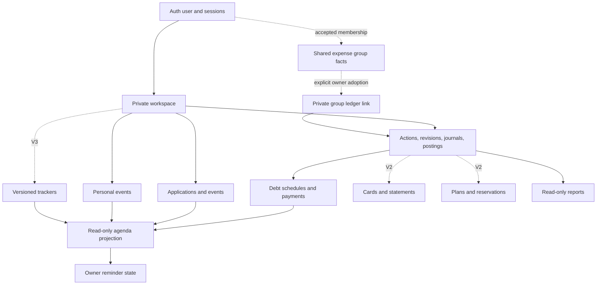
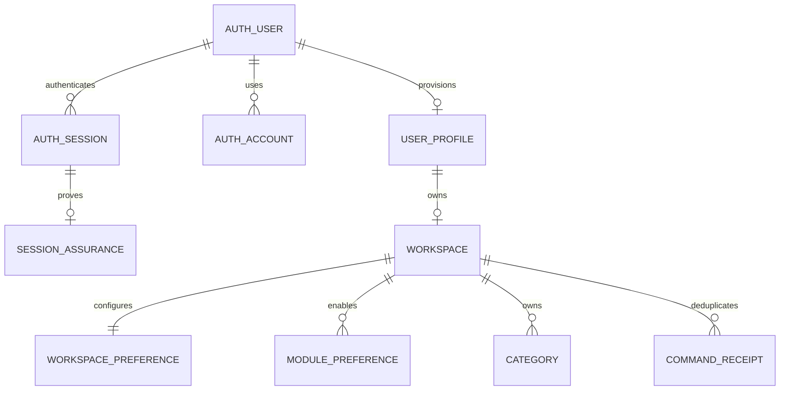
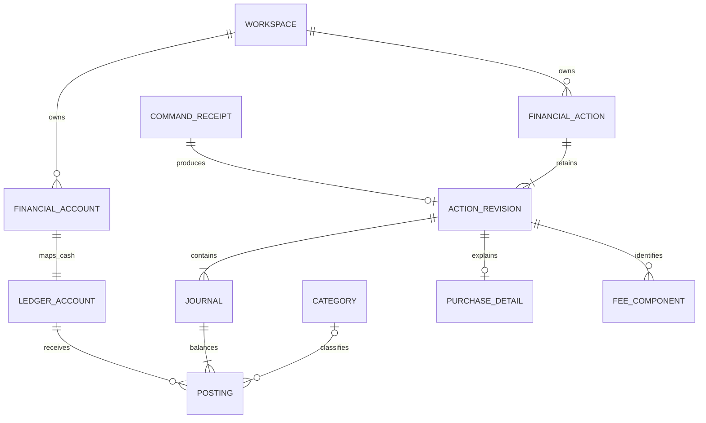
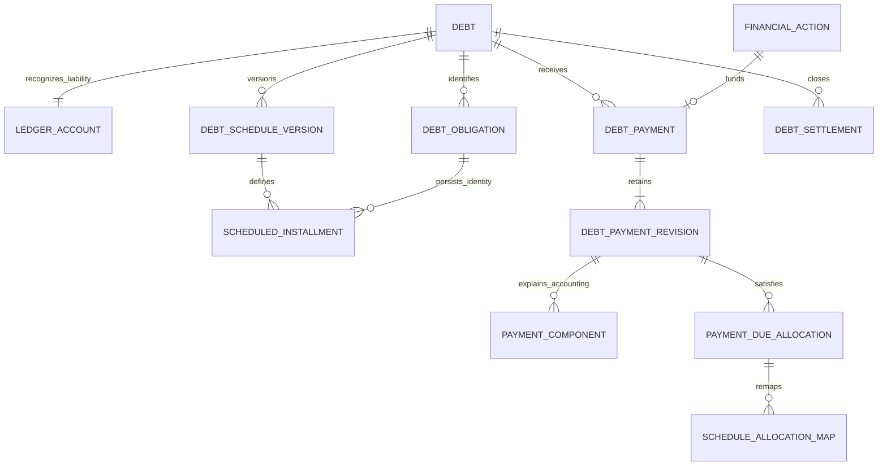
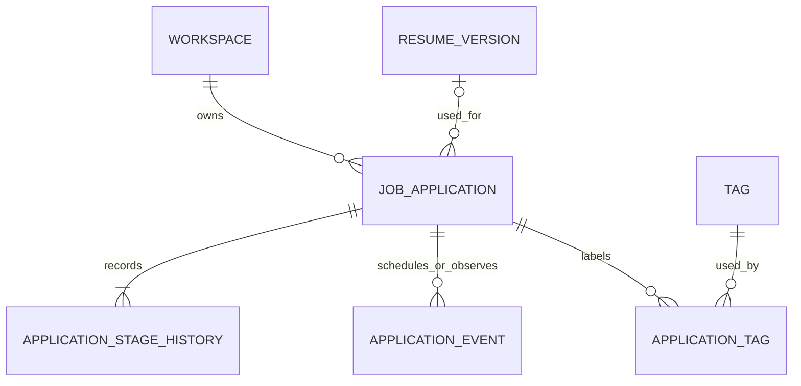
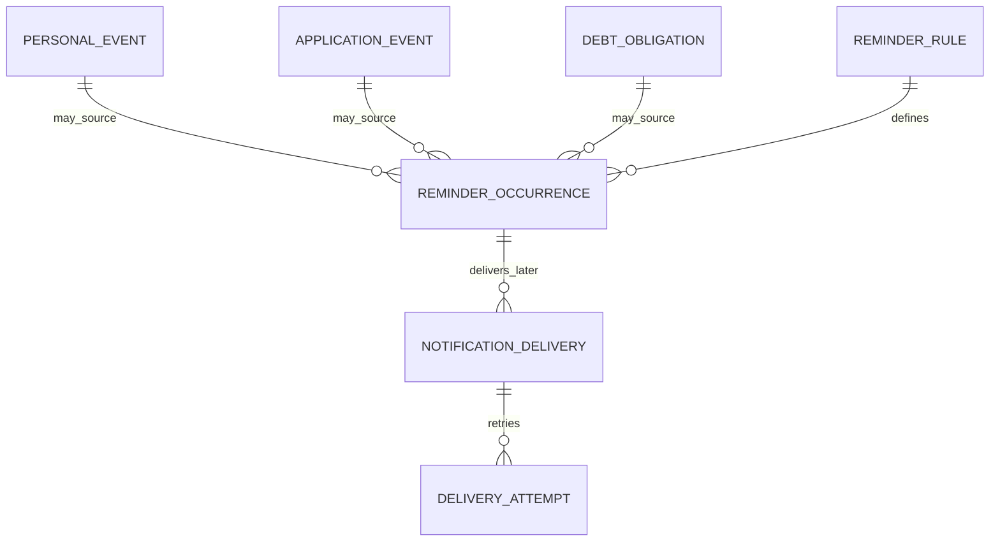
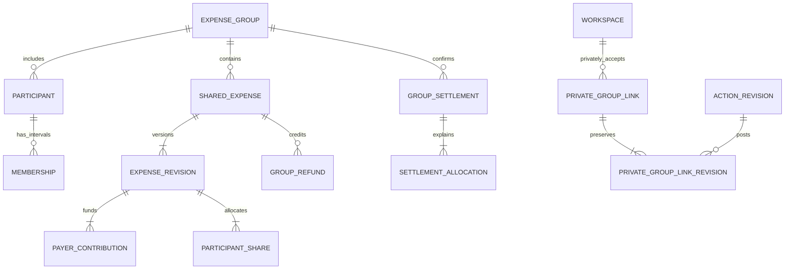
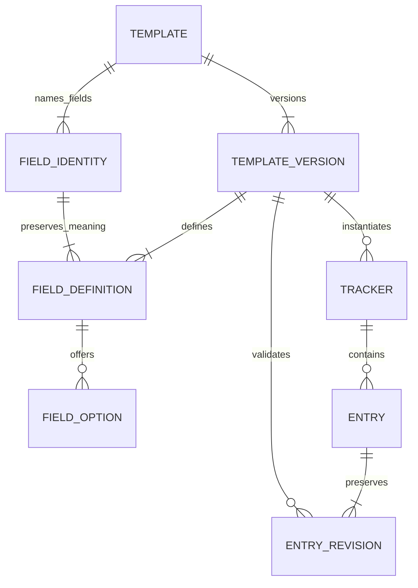

# Database

## Contents

- [Salapiya data model (product blueprint section 10)](#salapiya-data-model-product-blueprint-section-10) (from `docs/SALAPIYA_PRODUCT_AND_PLATFORM_BLUEPRINT.md`)
- [Database Architecture](#database-architecture) (formerly `docs/reference/DATABASE_ARCHITECTURE.md`)
- [V1 CSV export contract](#v1-csv-export-contract) (formerly `docs/reference/V1_CSV_EXPORTS.md`)

## Salapiya data model (product blueprint section 10)

### 10. Data model, integrity and schema evolution

The specialized financial actions, revisions that never change, journals and postings, debt and card details, planning records and group facts all stay. Reports and the Calendar are derived views. The app doesn't get flattened into a generic tracker database, and full event-sourcing isn't required just because some history is immutable.

Records that cross platforms need stable UUID-style ids, an owner scope, the current version and predecessor where that applies, civil and effective dates, the server's receipt time as the authority for synced acceptance, which device it came from, command references and an archive or tombstone state. A device's wall clock never decides who wins a financial conflict and never grants membership.

Local tables, server tables and the sync transport schema can differ, so their mapping, and which fields are writable or derived, is written down. Deletion markers and their retention are defined so an old offline device can't recreate deleted records when it syncs again. Receipts and tombstones aren't purged while supported retries and stale devices still need them.

Things that have to commit as one unit: the whole financial action with its journal and evidence, a settlement's complete allocation and state change, a complete local intent and receipt update, and explicit import batches. Test failures between the intermediate writes. PostgreSQL RLS and triggers stay as defence in depth on the backend; replication access and sync streams are configured on their own, because replication can't be assumed to apply client RLS for you.

The local database schema, the server schema, the sync protocol and command payload, the backup format and the domain calculation definitions each have their own version number, with compatible ranges recorded. Server changes leave a deliberate window for clients to upgrade. An unsupported client keeps safe local reading and export where possible, while unsafe writes are blocked with a way to recover. Incompatibility is never solved by quietly deleting a database and downloading over unsynced work.

Reviewed forward migrations, a backup before upgrading where it makes sense, transactional migrations where they're supported, and recovery from an interruption. Rolling the binary back isn't automatically safe after a database migration, so installers go with schema compatibility and a tested restore plan. Preset tracker definitions stay readable by version even before a custom editor exists.

## Database Architecture

**Native continuation (October 20, 2026):** The [Salapiya blueprint](PRODUCT_AND_FEATURES.md#salapiya--product-revision-and-windowsandroid-migration-blueprint)
sets the new Windows and Android direction. See the [P0 foundation](OPERATIONS_AND_RELEASE.md#salapiya-native-development-foundation)
and the [actual native verification](archive/salapiya/P0_VERIFICATION.md). What follows
keeps the historical web contracts and evidence; its web architecture and older
instructions to stop don't choose or accept the native implementation. G0-G4 are still open.

**Project:** Personal Management Platform  
**Version:** 1.0 — implementation design, October 6, 2026  
**Status:** The relational spec I recommend. It isn't an applied migration, and it isn't evidence of passing database tests.

**Authoritative inputs:**

- `PROJECT_VISION_AND_FEATURE_BLUEPRINT.md` v1.3: product behavior, business rules and release expectations. SHA-256: `AAB9E718338D3D11EC4D434330D2573456FA6BF953E4A6D3397DC9618915ECB4`.
- `SYSTEM_ARCHITECTURE.md` v1.0: established stack, private workspace model, balanced ledger, module boundaries, transactional commands and operating policies. SHA-256: `E1C13EF7D271DAF9BBAD2A5BDEA9A7A48CC1DA78E92417FC01E63E459846CF1F`.

I read those inputs as requirements and design references, not as instructions to carry out. Product rules win on behaviour; the System Architecture decides technical questions. What's added here fills gaps at the database level without replacing either source. Product decisions still open stay explicitly conditional in section 21.

### 1. Design contract, conventions, and release inventory

#### 1.1 Established decisions preserved

PostgreSQL 17, Drizzle ORM and Kit, and node-postgres, inside the existing TypeScript modular monolith. Better Auth owns the authentication records. Each person owns one private personal workspace. Money is signed integer centavos, with balanced postings that never change, explicit corrections and writes serialized per workspace. Reports and generated agenda entries are projections. Shared expenses have their own group permission boundary and come after V1.

There's one transactional database, not one per user or per module. PostgreSQL schemas are namespaces and privilege boundaries, not separate services. No generic entity-value store, no requirement to rebuild from events, no second expense ledger, no editable account balances and no shared household owner.

#### 1.2 Navigation

| Concern | Reference |
| --- | --- |
| Foundation and ownership | [Types and tools](#2-types-orm-and-database-tooling), [identity](#3-identity-and-shared-foundation), [isolation](#4-ownership-foreign-keys-and-row-level-security) |
| Financial implementation | [Ledger](#5-financial-actions-revisions-and-journals), [action evidence](#6-action-details-refunds-fees-and-reconciliation), [debts](#7-debts-schedules-payments-and-settlements) |
| Other core domains | [Career](#8-career-and-job-applications), [time](#9-calendar-and-reminders), [audit/jobs/lifecycle](#10-audit-jobs-commands-and-account-lifecycle) |
| Later releases | [Cards](#11-credit-cards-and-statements-f2), [planning](#12-recurring-obligations-budgets-and-goals-f2), [groups](#13-shared-expenses-g2-companion), [trackers](#14-trackers-and-template-evolution-t3), [files and portability](#15-attachments-imports-exports-and-restoration) |
| Implementation controls | [Invariants](#17-database-invariant-register), [transactions](#18-transaction-concurrency-and-failure-protocols), [queries](#19-reporting-indexes-and-large-histories), [migrations and tests](#20-migrations-seeds-tests-and-operational-recovery) |
| Final review | [Open decisions](#21-open-database-decisions), [consistency review](#22-final-consistency-review) |

#### 1.3 Schema namespaces and table inventory

Release codes: **S** = first usable slice; **C** = coherent V1 addition; **F2** = V2 financial maturity; **G2** = V2 shared-expense companion; **T3** = V3 trackers; **L** = selective later extension. S is part of V1. Future tables are written up now but only created along with their feature. Authentication and queue schemas are generated from the pinned library versions, not copied from this conceptual list.

| Namespace / release | Tables to introduce | Responsibility |
| --- | --- | --- |
| `auth`, S | `user`, `session`, `account`, `verification`, `rate_limit`; `session_assurance` as an application extension | Identity, credentials, sessions, recovery, abuse controls and recent authentication. |
| `core`, S | `user_profile`, `workspace`, `workspace_preference`, `module_preference`, `onboarding_step`, `category`, `tag`, `command_receipt` | Ownership root, preferences, classification, setup and idempotency. |
| `finance`, S | `ledger_account`, `financial_account`, `financial_action`, `action_revision`, `journal`, `posting`, `receipt_detail`, `purchase_detail`, `transfer_detail`, `fee_component`, `action_tag` | Cash and accounting truth with typed action evidence. |
| `finance`, C | `refund_detail`, `refund_allocation`, `benefit_detail`, `reconciliation`, `adjustment_detail`, `debt`, `debt_action_link`, `debt_obligation`, `debt_schedule_version`, `scheduled_installment`, `debt_payment`, `debt_payment_revision`, `payment_component`, `payment_due_allocation`, `schedule_allocation_map`, `payment_reclassification`, `debt_settlement`, `settlement_component` | Corrections/refunds, explicit debt terms/payments, settlement and reconciliation. Refund/benefit feature activation remains a scope gate. |
| `career`, S | `resume_version`, `job_application`, `application_stage_history`, `application_event`, `application_tag` | Specialized applications and history. |
| `time`, S then C | S: `personal_event`; C: `reminder_rule`, `source_reminder_setting`, `reminder_occurrence` | Manual calendar sources and in-app reminder state; generated calendar is a view. |
| `audit`, S | `private_revision`, `private_activity` | Scoped evidence and user-facing activity. Add `group_revision`, `group_activity` only in G2. |
| `ops`, S/C | S: `email_delivery`; C at latest: `deletion_request`, `deletion_tombstone`; library-owned job/rate-limit storage | Durable side effects, security mail and deletion controls. Introduce deletion before any production personal data, even if the beta is the first slice. |
| `finance`, F2 | `credit_card`, `card_activity`, `card_statement`, `card_statement_revision`, `statement_entry`, `statement_allocation`, `card_installment_plan`, `card_installment` | Provider-verified card workflows using the existing ledger. |
| `planning`, F2 | `recurring_obligation`, `recurrence_version`, `expected_occurrence`, `occurrence_actual_link`, `budget`, `savings_goal`, `goal_reservation` | Expected activity and reservations; no second asset ledger. |
| `time`, F2 | `notification_preference`, `notification_delivery`, `delivery_attempt`, `provider_event_receipt` | Opt-in scheduled reminders and delivery evidence. |
| `sharing`, G2 | `expense_group`, `participant`, `membership`, `invitation`, `participant_claim`, `group_command_receipt`, `shared_expense`, `expense_revision`, `payer_contribution`, `participant_share`, `group_refund`, `refund_revision`, `refund_payer_allocation`, `refund_share_allocation`, `group_settlement`, `settlement_allocation`, `settlement_transition`, `dispute`, `member_record_access` | Group-only facts, zero-sum balances, identity consent and historical visibility. |
| `finance`, G2 | `group_ledger_binding`, `private_group_link`, `private_group_link_revision` | Private, owner-approved adoption of group facts. |
| `tracker`, T3 | `template`, `template_version`, `field_identity`, `field_definition`, `field_option`, `tracker`, `entry`, `entry_revision`, `template_migration` | Versioned typed tracker definitions and entries. |
| `files`, F2/G2 | `private_attachment`, typed private attachment joins; G2: `group_attachment`, `group_attachment_link` | Metadata/authorization for private object storage. Exact join contracts appear in section 15. |
| `ops`, C/F2 | C: `export_run`; F2: `import_batch`, `import_row`, `restore_run`, `restore_id_map` | Export provenance, resumable imports and staged portable restore. |
| Later only | Tables in section 16 for transit, lending, external-calendar synchronization, habits and settlement simplification | Clean extensions; not prerequisites for V1 migrations. |

This list separates stored records from projections. V1 has no authoritative `account_balance`, `expense_total`, `generated_calendar_event`, `dashboard_total`, `weekly_report` or `monthly_report` tables.

#### 1.4 Naming and table-contract notation

Use singular snake_case SQL names and camelCase TypeScript properties mapped explicitly. Keys are `id`, `<entity>_id`; monetary values end in `_minor`; dates end in `_date`; instants end in `_at`; revision numbers end in `_no`. Avoid ambiguous `account` outside `auth.account`: a cash location is `finance.financial_account` and an accounting bucket is `finance.ledger_account`.

In table specifications, `!` means NOT NULL, `?` means nullable, and `= value` gives a database default. Unstated defaults do not exist. PK, UQ, FK and CK mean primary key, unique, foreign key and check constraint. `WFK(x → table)` means `(workspace_id, x) REFERENCES table(workspace_id, id)`; `GFK` similarly includes `group_id`. These are real composite database FKs, not ORM-only relations.

These bundles of columns and constraints apply exactly as written wherever they're named, which saves hundreds of repeated lines:

| Bundle | Columns and required constraints |
| --- | --- |
| **P** private record | `id uuid! DEFAULT gen_random_uuid()` PK; `workspace_id uuid!` FK `core.workspace(id)` ON DELETE RESTRICT; `created_at timestamptz! DEFAULT now()`; UQ `(workspace_id,id)`; private RLS. |
| **G** group record | `id uuid!` PK with UUID default; `group_id uuid!` FK `sharing.expense_group(id)` RESTRICT; `created_at timestamptz! DEFAULT now()`; UQ `(group_id,id)`; group RLS. |
| **M** mutable aggregate | `updated_at timestamptz! DEFAULT now()`; `version integer! DEFAULT 1 CHECK(version>0)`; updates increment version and set timestamp. Scope/ID never change. |
| **E** attribution and evidence | `recorded_by_user_id uuid?` FK `auth.user(id)` RESTRICT; `actor_kind text! CHECK IN ('user','system','import')`; `request_id uuid?`; a user actor requires a user ID. Attribution is immutable. Evidence rows allow no ordinary UPDATE/DELETE after finalization; when combined with M, the aggregate's explicitly mutable fields remain editable with audit. Use participant attribution instead in group facts that must survive identity deletion. |
| **AR** financial revision reference | `action_id uuid!`, `action_revision_id uuid!`; FK `(workspace_id,action_id,action_revision_id)` → `finance.action_revision(workspace_id,action_id,id)`. |
| **J** private join | Explicit composite PK listed for the join; `workspace_id uuid!` FK workspace RESTRICT; `created_at timestamptz! DEFAULT now()`; scoped FKs and RLS, no meaningless surrogate ID. |

Unless specified otherwise, FKs use ON DELETE RESTRICT / ON UPDATE RESTRICT, and tables inherit the scope-first lookup index implicit in their UQ. Every FK's referencing columns need an index unless an existing index has those columns as a useful left prefix. Composite references involving currency/parent identity use additional UQs explicitly listed below. Use short deterministic names: `pk_<table>`, `uq_<table>_<purpose>`, `fk_<table>_<parent>`, `ck_<table>_<rule>`, `ix_<table>_<query>`; keep PostgreSQL's identifier-length limit in mind.

Archiving is an aggregate state or `archived_at`, not a universal `deleted_at`. Facts that never change get corrected, not hidden behind a soft-delete flag. History is kept until the workspace is deleted unless a table says otherwise. Purging a whole workspace is a privileged, ordered process, and the one explicit exception to evidence never changing.

### 2. Types, ORM, and database tooling

#### 2.1 Scalar types and interpretation

| Data | PostgreSQL / TypeScript contract | Integrity rule |
| --- | --- | --- |
| Record IDs | `uuid` / opaque UUID string | UUIDv4 default is adequate; configure Better Auth's ID generator compatibly. IDs are not authorization. |
| Money | `bigint` centavos / native `bigint`; JSON integer string | No float/double/SQL `money`. `SUM(bigint)` returns numeric, so parse integer text exactly. |
| Percentage/rate, future | `numeric(20,10)` / decimal string with decimal.js | Used only for declared estimates/rules; never auto-derived provider facts. |
| Financial/due date | `date` / validated `YYYY-MM-DD` string | Do not parse into a UTC-midnight JS Date. |
| Event/audit instant | `timestamptz` / UTC ISO string or Date at driver boundary | Store separately the entered IANA timezone where local event intent matters. |
| Quiet-hour time | `time without time zone` + timezone | A local preference, not an instant; handle windows spanning midnight. |
| Codes/statuses | `text` + named CHECK | Drizzle/TypeScript enum unions mirror CHECK lists. Prefer replaceable CHECKs over native enums for evolving workflows. |
| Currency | `text CHECK(currency ~ '^[A-Z]{3}$')` | Workspace CHECK `currency='PHP'` initially; scope/currency FKs enforce matching. |
| Free text | `text` with length checks | Default names 1–200 chars, descriptions 1–2,000, notes up to 20,000, URLs up to 2,048; feature schemas can be stricter. |
| Structured payload | `jsonb` | Restricted to versioned settings/evidence/import/template data; object/size checks plus application schema validation. Not a replacement for core FKs. |
| Digest/token hash | `bytea` | SHA-256 digest length 32 where applicable. Never use digest equality as proof of record ownership. |

Journal line amounts are nonzero and bounded to ±100,000,000,000 centavos (PHP 1 billion per component). User-entered positive amount fields use `CHECK(amount_minor>0 AND amount_minor<=100000000000)`. Totals can exceed one component limit, so validate aggregate limits explicitly and accumulate with PostgreSQL numeric/native bigint before range checking. Opening zero balance is represented without a zero posting: the account stores its cutoff and may have no opening action until nonzero value exists.

`now()` is the transaction's timestamp, not the exact moment of commit. Don't promise to rebuild what was "known at" a point in history from `created_at` alone. A report's consistent snapshot, the workspace financial revision it captured and when it was generated explain what it covers. Truly rebuilding a report as it was published needs an exported artifact or a separately designed snapshot feature.

#### 2.2 Ownership of database tooling

| Tool | Status | Responsibility / benefit | Limitation and placement |
| --- | --- | --- | --- |
| PostgreSQL 17 | Required, established | Transactions, relational constraints, RLS, indexes and exact storage | Real PostgreSQL in development/CI; do not substitute SQLite. |
| Drizzle ORM + `pg` | Required, established | Typed repositories and one-connection transactions | Repositories accept only the scoped transaction handle. [node-postgres requires the same client throughout a transaction](https://node-postgres.com/features/transactions). |
| Drizzle Kit | Required, established | Versioned SQL migration generation and application | Review generated SQL; add [custom migrations](https://orm.drizzle.team/docs/kit-custom-migrations) for triggers, roles, policies and unsupported DDL. No production schema push. |
| Better Auth + Drizzle adapter | Required, established | Generated credential/session/token schema and supported auth flows | Pinned library schema is authoritative for library-internal columns. Do not implement password hashing or token consumption manually. |
| Zod | Required, established | API, job and typed JSON validation | Service validation complements rather than replaces database constraints. Do not expose generated insert schemas directly as public write APIs. |
| pg-boss | Strongly recommended, established | Durable transactional queue and retry/lease implementation | Its schema is library-owned; application handlers remain idempotent. Confirm adapter atomicity before implementation. |
| Vitest + fast-check | Required / strongly recommended, established | Integration and invariant/property tests | Test actual runtime database roles and concurrency, not only mocked repositories. |
| Docker Compose + PostgreSQL client tools | Strongly recommended, established | Repeatable DB, `pg_dump`/`pg_restore` and isolated integration environment | Match production major version and migrations. |
| `drizzle-seed` | Optional additional development dependency | Reproducible synthetic volume data with a seeded generator | [Official seed tooling](https://orm.drizzle.team/docs/seed-overview) saves fixture boilerplate. Financial scenarios must still post through valid recipes; random rows cannot bypass invariants. |
| `@testcontainers/postgresql` | Optional additional test dependency | Per-test-run real PostgreSQL lifecycle | Helpful if CI/container setup supports it; not required alongside an already isolated Compose/CI service database. Avoid adopting both lifecycle approaches without a reason. |
| `pg_stat_statements` | Optional managed PostgreSQL extension | Aggregate slow-query analysis | Enable only if host permissions allow; do not log financial parameter values. No new database service. |

Drizzle schemas use explicit `pgSchema` mappings and named constraints; the SQL migration files are the real deployed schema. A reviewed schema snapshot and the trigger and function tests live in source control. Library versions are pinned, and generated auth and queue migrations are reviewed separately from domain migrations. I checked the current PostgreSQL and Drizzle docs for constraint, trigger, RLS and migration behaviour; what the product means comes from the two input documents.

#### 2.3 High-level domain relationships



### 3. Identity and shared foundation

#### 3.1 Library-owned authentication records

Generate Better Auth's schema from the pinned configuration, map its logical `user/session/account/verification` names to `auth.*`, and use a UUID-producing supported ID callback. Preserve required adapter fields and constraints. The following is the target mapping, not permission to remove fields the selected library version requires. [Better Auth documents generation, mapping and extensions](https://better-auth.com/docs/concepts/database); the [Drizzle adapter](https://better-auth.com/docs/adapters/drizzle) must be tested with the actual schema objects.

| Table / purpose | Important columns and nullability | Keys, indexes and lifecycle |
| --- | --- | --- |
| `auth.user` — login identity | `id uuid!`; `name text!`; `email text!`; `email_verified boolean! = false`; `image text?`; `created_at,updated_at timestamptz!` | PK id; UQ library-normalized email; identity lookup and purge only through auth/lifecycle services. No workspace column before provisioning. Restrict deletion until private data is purged and group attribution is detached. |
| `auth.session` — opaque login session | `id uuid!`; `user_id uuid!`; `token text!` in library-required representation; `expires_at,created_at,updated_at timestamptz!`; `ip_address,user_agent text?` | PK id; FK user CASCADE for final identity purge; UQ token; indexes `(user_id,expires_at)` and expiry. Token is secret; do not invent incompatible hashing. Revoke by supported library operation; session deletion cascades assurance only. |
| `auth.account` — authentication method | `id uuid!`; `user_id uuid!`; `provider_id,account_id text!`; `password text?` containing library hash; library-required optional OAuth token/scope/expiry fields | PK id; FK user CASCADE; UQ `(provider_id,account_id)` consistent with adapter; index user. Initial credential provider only. This is never a bank account. |
| `auth.verification` — verification/recovery state | `id uuid!`; `identifier,value text!`; `expires_at,created_at,updated_at timestamptz!` | PK id; identifier lookup and expiry index; exact uniqueness/consumption semantics follow pinned library. No invented user FK when identifiers are token/purpose strings. Purge expiries and user-related tokens through the supported lifecycle path. |
| `auth.rate_limit` — library abuse counter | Library-generated `id`, `key`, `count`, `last_request` with documented types | UQ key; TTL cleanup; auth role only. Use the library's atomic counter semantics, not a second custom authentication limiter. |

Sessions expire under the established seven-day refresh/thirty-day absolute cap. The latter is calculated from original session creation, never updated activity. Ordinary domains cannot SELECT auth credentials/tokens. A library version that changes these fields requires a reviewed compatibility migration, not relaxed domain FK types.

**`auth.session_assurance` (S):** application-managed recent-password proof. Columns: `session_id uuid!` PK/FK session ON DELETE CASCADE; `verified_at timestamptz!`; `method text! CHECK IN ('password')`. No workspace; identity/session-scoped access only through the server. It is written only after a successful server-side reauthentication and checked for a five-minute maximum age on consequential actions. Session refresh does not update it. If the pinned library offers an equivalent server-owned freshness mechanism with the required semantics, omit this table and record that integration choice before the auth migration.

#### 3.2 Profiles, workspace and settings

| Table / bundle | Columns beyond bundle | Constraints, indexes, relationships and lifecycle |
| --- | --- | --- |
| `core.user_profile` / M | `user_id uuid!` PK/FK auth.user; `display_name text!`; `lifecycle text! = 'active'` in active/deletion_pending/purging; `created_at timestamptz!`; `deletion_requested_at timestamptz?` | One per provisioned user. App display name is authoritative for app UI; auth.name is the separate library profile value, initially copied. Owner-only policy by user ID. Lifecycle/time coherence CK; delete after workspace purge. |
| `core.workspace` / M | `id uuid!` PK default UUID; `owner_user_id uuid!` FK profile(user_id); `kind text! = 'personal'`; `currency text! = 'PHP'`; `timezone text! = 'Asia/Manila'`; `week_start smallint! = 1`; `state text! = 'active'`; `financial_revision bigint! = 0`; `created_at timestamptz!` | UQ owner for kind personal; CK only personal initially, week_start 0–6, revision >=0, state active/deletion_pending/purging/restoring; UQ `(id,currency)`. Ownership immutable. User-to-workspace is 1:0..1 during signup, exactly one when provisioned. Locks this row for finance and lifecycle. |
| `core.workspace_preference` / M | `workspace_id uuid!` PK/FK workspace; `locale text! = 'en-PH'`; `theme text! = 'system'` in system/light/dark; `default_salary_account_id uuid?`; `getting_started_dismissed_at timestamptz?`; `created_at timestamptz!` | WFK salary account; index `(workspace_id,default_salary_account_id)` if useful. No duplicated timezone/currency/week start. Default account is a prefill, not a permanent destination rule. Owner-scoped, removed in purge. |
| `core.module_preference` / J,M | PK `(workspace_id,module_key)`; `module_key text!`; `enabled boolean! = true`; `agenda_visible boolean! = true`; `reminders_enabled boolean! = true` | Module allowlist for implemented modules. Navigation, agenda and reminders are separate preferences. No data deletion when disabled. |
| `core.onboarding_step` / J | PK `(workspace_id,guide_version,step_key)`; `guide_version integer!`; `step_key text!`; `state text!` in pending/completed/skipped; `updated_at timestamptz!`; `completed_at timestamptz?` | Positive guide version; completion timestamp iff completed. State only; never use it as an account/payment record. Guide replay need not create another row or business action. |
| `core.category` / P,M | `kind text!` in income/expense; `code text?`; `name text!`; `archived_at timestamptz?`; `sort_order integer! = 0` | UQ `(workspace_id,kind,code)` for nonnull seeded codes; UQ `(workspace_id,kind,lower(name))` among active rows. Categories referenced by postings cannot be deleted; archive instead. Kind immutable once referenced. |
| `core.tag` / P,M | `name text!`; `color text?`; `archived_at timestamptz?` | UQ `(workspace_id,lower(name))` among active rows; color is validated token/hex, not raw CSS. Hard-delete only if unreferenced; otherwise archive. Domain joins are concrete tables. |

The timezone is checked against supported IANA names at the service boundary; a CHECK never holds a subquery on the system catalogue, which can change. A trigger stops the currency changing once there are postings. The profile, workspace, settings, module defaults and seeded categories are set up in one transaction after authentication is verified, and a unique owner key handles two first requests at once. The auth user might already have been committed earlier, and that's safe to retry.



### 4. Ownership, foreign keys, and row-level security

#### 4.1 Concrete ownership enforcement

Every private domain child is owned by a workspace. Identity-root tables are owned by the user; group facts go by group membership. Operational and library tables have narrowly scoped service roles. These are deliberate exceptions to the private-child pattern, not shortcuts with a nullable owner.

For a reference to a financial account, the database requires both the workspace and the account identity:

```sql
UNIQUE (workspace_id, id)
-- on finance.financial_account

FOREIGN KEY (workspace_id, receiving_account_id)
  REFERENCES finance.financial_account (workspace_id, id)
  ON DELETE RESTRICT ON UPDATE RESTRICT
```

The same pattern covers categories, tags, actions, debts, payments, applications, tracker entries, reminder sources and files. Where being in the same workspace isn't enough, the parent's identity goes into the composite key too: an installment a debt payment refers to has to belong to that same debt, and an action revision has to belong to the action it names.

For a composite FK with a required scope and an optional target, plain MATCH SIMPLE is right: a null target means there's no relationship. When a relationship has several optional target parts, a CHECK requires all or none (or MATCH FULL over those parts in a suitable key). Otherwise `(debt_id, installment_id=NULL)` could slip past the validation it was meant to get. PostgreSQL's [constraint rules](https://www.postgresql.org/docs/17/ddl-constraints.html) explain how FKs, NULLs and unique constraints behave; migration tests have to verify the combinations chosen.

#### 4.2 RLS policy shape and scoped transactions

Transaction-local `app.user_id` and `app.workspace_id` are set by a trusted server transaction helper after the session is verified. A missing value has to mean no access; use `NULLIF(current_setting('app.user_id',true),'')::uuid`, not an unguarded cast of an empty string. The workspace policy compares owner_user_id with the user context; child policies also check the workspace identity and an active, readable lifecycle. Both `USING` and `WITH CHECK` are required. Scope columns can't change, independently of RLS.

```sql
-- Illustrative policy predicate for a private child; grants/roles omitted.
workspace_id = NULLIF(current_setting('app.workspace_id', true), '')::uuid
AND EXISTS (
  SELECT 1 FROM core.workspace w
  WHERE w.id = workspace_id
    AND w.owner_user_id =
      NULLIF(current_setting('app.user_id', true), '')::uuid
    AND w.state = 'active'
)
```

The `core.workspace` policy never looks at itself recursively. Workspace lifecycle endpoints use a narrowly scoped query or procedure authorized by identity, rather than loosening every table's active-state policy. Auth credentials are reached by the auth adapter role, never through private-domain RLS. Private tables use `ENABLE ROW LEVEL SECURITY` and `FORCE ROW LEVEL SECURITY`, runtime roles are never owner or BYPASSRLS, and exposed report views use `security_invoker=true`. [PostgreSQL's RLS documentation](https://www.postgresql.org/docs/17/ddl-rowsecurity.html) is the authority on bypass behaviour.

All scoped reads and writes run in one transaction on one checked-out connection, with `set_config(..., true)` for the transaction-local context and never a lasting pool-wide SET. Even a workspace context passed from a trusted worker still has its current owner and lifecycle checked. RLS defends against a forgotten predicate; it doesn't protect against a fully compromised server setting whatever context it likes.

#### 4.3 Privilege map

| Role | Grants | Prohibitions |
| --- | --- | --- |
| `migration_owner` | Own schemas/tables, manage constraints/policies/functions | Never used by requests or ordinary workers. |
| `app_domain` | Scoped domain SELECT and approved mutations/functions | No auth credential reads, DDL, TRUNCATE, role switching or bypass. |
| `auth_adapter` | Library-managed auth tables and supported lifecycle operations | No financial, career or tracker data. |
| `queue_broker` | Library queue claim/acknowledgement; minimal delivery envelope access | No general private-domain SELECT. |
| `worker_domain` | Same scoped domain services with explicit worker identity | No blanket tenant bypass. |
| `lifecycle_operator` | Execute audited, scope-specific purge/restore operations | Not a public application administrator or a user-supplied bypass switch. |

No custom setting like `app.skip_immutability=true` can bypass triggers, because ordinary application code can set custom GUCs. The purge exception has to be authorized by a separate role that can't be granted to the runtime, or a narrowly owned procedure with a fixed search_path, checked arguments and no PUBLIC execute grant. RLS helper functions for group membership get their own review for recursion and privilege leaks.

Database ownership checks don't decide what the user meant, whether they signed in recently, invitation consent, which business transitions are allowed, or whether a recipient really confirmed a payment. Those stay as application service checks, backed by transition evidence and the constraints that apply. FK and UQ errors are cleaned up so a failure never reveals that another user's record exists.

### 5. Financial actions, revisions, and journals

#### 5.1 Account model

**`finance.ledger_account` (S, P+M)** is the internal accounting bucket. Columns: `code text!`; `name text!`; `kind text!`; `currency text!`; `archived_at timestamptz?`. UQ `(workspace_id,code)` and `(workspace_id,id,currency)`; FK `(workspace_id,currency)` → workspace(id,currency). Index `(workspace_id,kind,id)`. Allowed S kinds: `cash_asset`, `expense`, `income`, `opening_equity`, `adjustment_equity`. C adds `debt_liability`, `payment_clearing_asset`; later add card/group/receivable/transit kinds in reviewed migrations. Normal side is derived from kind, not a contradictory editable column. Seed one shared expense and income bucket per currency with category dimensions on postings; use a distinct cash bucket per financial account and a distinct liability bucket per debt. Kind/currency become immutable once referenced. No ordinary deletion while referenced.

**`finance.financial_account` (S, P+M)** is the user's cash, bank or wallet location. Columns: `ledger_account_id uuid!`; `name text!`; `account_type text!` in cash/e_wallet/checking/savings; `institution_name text?`; `currency text!`; `opening_cutoff_date date!`; `opening_action_id uuid?`; `notes text?`; `archived_at timestamptz?`. WFK ledger account and opening action; UQ `(workspace_id,ledger_account_id)`; UQ `(workspace_id,id,currency)`; workspace/currency FK. Trigger verifies mapped ledger kind cash_asset/currency and opening action belongs to this account. Index `(workspace_id,archived_at,name,id)`. Do not force account names or institution names to be globally unique; optionally warn on an active duplicate name.

There's no `current_balance` column, and no duplicated authoritative `opening_balance`. The opening action's postings set a nonzero starting value and the cutoff sets the coverage; a zero opening creates no posting. Changing the opening cutoff once there's activity needs the explicit history and baseline workflow, with an audit. Negative cash is allowed after the service warns; no database trigger enforces `balance>=0`. Archived accounts stay in balance reports and still allow historical correction commands, but ordinary new activity needs the account restored first.

#### 5.2 Action and revision contracts

| Table / bundle | Columns beyond bundle | Keys, constraints and lifecycle |
| --- | --- | --- |
| `finance.financial_action` / P,M,E | `original_command_receipt_id uuid!`; `current_revision_id uuid!`; `description text!`; `reference text?`; `notes text?` | WFK command_receipt; UQ `(workspace_id,original_command_receipt_id)`; deferred same-action FK from `(workspace_id,id,current_revision_id)` to action_revision. Description/reference/notes can change with audit; economic meaning lives in revisions. Index `(workspace_id,created_at DESC,id DESC)`. Never soft-delete posted action. |
| `finance.action_revision` / P,E | `action_id uuid!`; `revision_no integer!`; `previous_revision_id uuid?`; `command_receipt_id uuid!`; `change_kind text!`; `action_kind text!`; `primary_effective_date date!`; `currency text!`; `reason text?`; `state text! = 'building'`; `finalized_at timestamptz?` | WFK action/command; same-action previous-revision FK; UQ `(workspace_id,action_id,revision_no)`, `(workspace_id,action_id,id)`, `(workspace_id,id,currency)`, `(workspace_id,command_receipt_id)`; index `(workspace_id,primary_effective_date DESC,id DESC)`. Positive revision; change_kind create/replace/void; state building/posted. Currency matches workspace. Finalized rows immutable. |
| `finance.journal` / P,AR | `sequence_no smallint!`; `effective_date date!`; `currency text!`; `role text!` in economic/reversal; `reverses_journal_id uuid?`; `state text! = 'building'`; `finalized_at timestamptz?` | UQ `(workspace_id,action_revision_id,sequence_no)`, `(workspace_id,action_revision_id,id,currency)`; partial UQ `(workspace_id,reverses_journal_id)` when nonnull. WFK reversal parent. Index `(workspace_id,effective_date DESC,id DESC)`. Reversal parent required iff role=reversal. Finalized journals cannot be edited or extended. |
| `finance.posting` / P,AR | `journal_id uuid!`; `ledger_account_id uuid!`; `currency text!`; `line_no smallint!`; `amount_minor bigint!`; `category_id uuid?`; `expense_class text! = 'none'`; `income_class text! = 'none'`; `cash_flow_kind text! = 'none'`; `cash_flow_direction text! = 'none'`; `liability_component text?`; `reverses_posting_id uuid?`; `memo text?` | Composite journal FK includes revision and currency; composite ledger FK includes currency; WFK category/reversal line. UQ `(workspace_id,journal_id,line_no)`, `(workspace_id,action_revision_id,id)`; partial UQ reversal line. CK nonzero bounded amount and line_no>0. Index `(workspace_id,ledger_account_id,journal_id,id)` and `(workspace_id,category_id,journal_id)` for nonnull categories. Immutable after parent finalization. |

The real schema declares the referenced UQs before adding circular deferred FKs. An action and its first revision are inserted in one transaction with UUIDs allocated in advance, so `current_revision_id` never has to be nullable in a committed row. Creating revisions and moving the current pointer are controlled by the financial service's finalization protocol, never by arbitrary PATCH fields.

`action_kind` values, by the release that adds them:

- S: `opening_cash`, `income`, `expense`, `transfer`, `standalone_fee`.
- C: `opening_debt`, `borrowing`, `financed_purchase`, `debt_charge`, `debt_payment`, `debt_settlement`, `refund`, `cashback`, `liability_waiver`, `balance_adjustment`, `payment_reclassification`.
- Later values arrive with their typed contracts: card activity and payment, group adoption and settlement, transit and lending. There's no `custom_journal` command for end users.

`change_kind=create` requires revision_no=1 and no previous revision. Replace/void requires the immediately preceding revision of the same action and a nonblank reason. A void has reversal journals but no new economic journals. The latest revision pointer must equal the highest finalized revision, enforced at commit. Financial-action kind can be corrected through a new revision only if dependent typed links/refunds/payments are corrected consistently; otherwise reject and require an explicit dependent-record resolution. This avoids trapping an incorrectly classified receipt permanently while preventing an incompatible rewrite underneath existing allocations.

#### 5.3 Posting classification

| Column | Allowed values / applicability | Meaning |
| --- | --- | --- |
| `expense_class` | none/gross/refund_offset/rebate_offset/waiver_offset | Non-none only on expense buckets. Normal gross postings are positive; offset postings negative. A correction reversal keeps the class and reverses its sign. |
| `income_class` | none/earned/gift/reward/other | Non-none only on income buckets; normal income is credit-negative. Borrowing is not income. |
| `cash_flow_kind` | none/income/purchase/transfer/fee/interest/penalty/borrowing/debt_payment/refund/reward/opening/adjustment/clearing; later group/transit/lending classes | Non-none only on cash-asset postings. Identifies report meaning, not an additional balance. |
| `cash_flow_direction` | none/in/out/internal/baseline/adjustment | Non-cash requires none. Ordinary money-in/out has a stable semantic direction, inherited by its reversal. |
| `liability_component` | principal/interest/fee/penalty/unclassified, or NULL for non-debt lines | Required on debt-liability postings; distinguishes recognized components without inventing a principal breakdown. Extend card/group classification only when needed. |
| `category_id` | Owned income/expense category or NULL | Required for categorized income/expense lines, kind must match bucket. Other ledger kinds must not masquerade as category expense lines. |

Validation at finalization enforces the kind and class rules that span tables, since an ordinary CHECK can't query another table. Summing to zero doesn't prove the financial meaning is right, so the supported command recipes also check the allowed accounts, classifications and typed detail totals.

For a PHP 5,000 transfer with a PHP 15 fee, the source cash gets separate lines: -500,000 centavos as transfer/internal and -1,500 as fee/out, next to +500,000 transfer/internal at the destination and +1,500 expense gross. It's a database-level refinement of the architecture's combined preview, not an extra deduction, and it lets reports leave out the internal principal without leaving out the real fee.

Corrections never create fake new inflows: cash outflow is `-SUM(amount_minor)` over lines with direction=out, reversals with the opposite sign included, not `SUM(ABS(negative lines))`. Income, expenses, refunds and liabilities use their documented signed classes in the same way. Current logical actions are shown separately from the financial sums over all postings.

#### 5.4 Finalization and immutability

Ordinary row triggers handle the immediate lifecycle and immutability checks, and deferred constraint triggers handle the aggregate ones. [PostgreSQL constraint triggers](https://www.postgresql.org/docs/17/sql-createtrigger.html) can check the final state of a transaction, but they don't replace explicit write locking.

The trigger and function contracts needed:

1. `guard_journal_write`: entries can be inserted/updated/deleted only while their parent is building. Lock the journal row when mutating its children. A posted journal cannot return to building. Ordinary roles cannot change ownership, monetary fields or finalized timestamps.
2. `validate_journal_at_commit`: every surviving newly changed journal is posted, contains at least two nonzero lines, and `SUM(amount_minor::numeric)=0`; all referenced accounts/currency/scope and classifications match. Register checks on the journal and relevant child changes so an empty posted journal is also rejected.
3. `validate_action_revision_at_commit`: action/revision chain, current pointer, typed subtype coverage, expected journal roles, mandatory audit and command completion are coherent. No building revision/journal may commit.
4. `validate_reversal_at_commit`: each reversal refers to a prior economic journal of the immediately superseded revision; every original line is reversed exactly once with the same ledger/category/classes/currency/date and negated amount. A reversal cannot point to another reversal. New economic journals form the replacement.
5. `guard_ledger_metadata`: bucket kind/currency and posted scope cannot change; archive does not mutate financial history.

Editing only an action's metadata produces a private audit revision, not a new financial revision. Economic corrections create new revisions and postings. No trigger ever makes hidden balancing entries or quietly repairs totals.

Current balances sum **all posted journals**: originals + reversing journals + replacements. Superseded originals are never filtered out while their reversals stay in. What a receipt, purchase or payment currently means comes from the action's current non-void revision. A financial reclassification that genuinely happens later (resolving a payment clearing balance, say) is a new action linked to the earlier fact, not a backdated replacement, unless the earlier record was simply wrong.



### 6. Action details, refunds, fees, and reconciliation

Typed detail records explain the intent and enforce destinations and allocations; they don't change balances on their own. Every AR table inherits the scope, revision identity and the rule that it can't change after finalization. Tables with one row per revision use PK `(workspace_id,action_revision_id)` plus their stated AR FKs instead of bundle P's surrogate id, and also have `created_at timestamptz! DEFAULT now()` and private RLS. Below, this one-row-per-revision pattern is called **D**.

| Table / release / bundle | Columns beyond bundle | Constraints, indexes and important behavior |
| --- | --- | --- |
| `finance.receipt_detail` / S / D,AR | `receiving_account_id uuid!`; `actual_received_minor bigint!`; `sender_name text?`; `source_label text?` | WFK receiving account; positive amount; index `(workspace_id,receiving_account_id)`. Required for income, cash borrowing, cash refund and actual cashback; not for noncash waivers. Receipt inflow lines into that account equal actual_received. Sender is never an ownership identity. |
| `finance.purchase_detail` / S / D,AR | `funding_ledger_account_id uuid!`; `purchase_minor bigint!`; `merchant_name text?` | WFK funding bucket; positive amount; kind cash_asset or a released liability kind. Index funding bucket. Sum economic gross purchase expense lines equals purchase_minor, excluding separate fee components; one funding source in V1. Category portions are these postings, not another split table. |
| `finance.transfer_detail` / S / D,AR | `source_account_id,destination_account_id uuid!`; `source_principal_minor,destination_principal_minor bigint!`; `withheld_fee_minor bigint! = 0` | WFK both accounts; source != destination; principal positive, withholding>=0; same currency; source_principal = destination_principal + withheld_fee. Additional source/separate fees excluded from principal. Both principal movements same date, no pending/transit state in this table. Index each account. |
| `finance.fee_component` / S / P,AR | `label text!`; `amount_minor bigint!`; `effective_date date!`; `bearing_ledger_account_id uuid!`; `expense_posting_id uuid!`; `treatment text!` | WFK bearer; revision-scoped FK expense posting; UQ `(workspace_id,expense_posting_id)`; treatment separate/source_additional/withheld/capitalized; positive amount. Finalization verifies expense line amount/date/class, valid cash/liability bearer and recipe. Index action_revision/bearer. A capitalized fee is not also withheld absent a distinct component. |
| `finance.action_tag` / S / J | PK `(workspace_id,action_id,tag_id)`; `action_id,tag_id uuid!` | WFK action/tag; indexes `(workspace_id,tag_id,action_id)` and existing PK. Tags are mutable classification metadata with audit; joining them never multiplies report amounts. Delete join on tag unlink, not the action. |
| `finance.refund_detail` / C gate / D,AR | `purchase_action_id uuid!`; `refund_minor bigint!`; `destination_ledger_account_id uuid!`; `reason text?` | WFK purchase action/destination; positive total; index purchase and destination. Original logical purchase survives revisions. For cash destination require receipt_detail; liability credit requires no receipt. Reject an incompatible or void source purchase unless explicitly resolved. |
| `finance.refund_allocation` / C gate / P,AR | `refund_action_revision_id` is the AR revision; `original_purchase_posting_id uuid!`; `refund_posting_id uuid!`; `amount_minor bigint!`; `allocation_kind text!` in purchase/fee | WFK original line, revision-scoped FK refund line; UQ `(workspace_id,action_revision_id,original_purchase_posting_id,refund_posting_id)`. Positive amount; require original line from linked purchase/fee and refund line with offset class. Sum equals refund_detail total and each refund line's absolute amount. Index original line. |
| `finance.benefit_detail` / C gate / D,AR | `benefit_kind text!` in merchant_cashback/reward_income/recognized_waiver; `amount_minor bigint!`; `purchase_action_id uuid?`; `recognized_charge_posting_id uuid?`; `explanation text!` | Positive; WFK optional concrete sources; merchant cashback requires purchase; waiver requires known charge or documented unclassified-opening treatment via settlement component. Account receipt required only when cash actually arrived. Never represent expected cashback here. |
| `finance.reconciliation` / C / P,E | `financial_account_id uuid!`; `cutoff_date date!`; `observed_minor,calculated_minor bigint!`; `financial_revision bigint!`; `reference text?`; `notes text?`; `supersedes_reconciliation_id uuid?` | WFK account/prior comparison; signed balances allowed; difference is derived observed-calculated. Index `(workspace_id,financial_account_id,cutoff_date DESC,id DESC)`. Immutable observation; later changes make it stale by revision/date comparison. A new comparison supersedes rather than edits evidence. |
| `finance.adjustment_detail` / C / D,AR | `financial_account_id uuid!`; `signed_adjustment_minor bigint!`; `reason text!`; `reconciliation_id uuid?` | WFK account/reconciliation; nonzero bounded signed adjustment; nonblank reason; adjustment cash/equity postings must equal intended effect. Index reconciliation. No automatic income/expense classification and no forced balance. |

Refund allocations don't need a duplicate physical `refund_action_revision_id`: the table uses the inherited `action_revision_id`, and the explanatory name in the table says what it's for. Refund and benefit entities only come in when their transaction types are exposed, since the architecture's V1 refund recommendation is still a product scope gate.

**Purchase corrections with refunds:** locking the workspace makes refunds and source corrections run one at a time. The original allocation evidence keeps pointing to postings that never change. Cumulative refunds in effect are checked against the current purchase total and matching categories. If correcting the source changes the category parts or amounts a refund touches, either the refund action is corrected in the same command group to reallocate it explicitly, or the source correction is rejected until that's done. Old refund allocations never change quietly, and money never moves again. When a multi-action correction like this arrives, one command receipt can group several *child* commands with their own ids; at first V1 can reject dependent corrections and walk the user through an explicit, reviewed correction. That limit must never let a parent change through that leaves things inconsistent.

**Cutoff and fee dates:** ordinary cash activity has to come after the account's opening cutoff; opening, reversal and import baseline operations are controlled exceptions. Each dated fee belongs to a journal on its actual date. An action spanning several dates can have several journals but still saves in one go. The draft preview checks every affected account's cutoff, not just the main date.

#### 6.1 Canonical financial examples in minor units

| Intent | Signed postings / authoritative effect | Additional records |
| --- | --- | --- |
| Salary 10,000 to BDO | BDO +1,000,000; earned income -1,000,000 | Income action + receipt_detail; opening BDO +200,000 means current 1,200,000. |
| Gift 500 to GCash | GCash +50,000; gift income -50,000 | Receipt is destination-owned; opening +20,000 gives 70,000. |
| Category purchase 1,000 | Cash -100,000; expense +70,000 groceries, +30,000 household | Purchase detail 100,000; categorized postings themselves are splits. |
| Transfer 5,000 plus fee 15 | Source -500,000 principal and -1,500 fee; destination +500,000; fee expense +1,500 | Transfer + fee evidence; consolidated cash change -1,500. |
| Loan 10,000 with 200 withheld | Cash +980,000; expense fee +20,000; debt -1,000,000 | Receipt 980,000 + debt link + fee component; zero income. |
| Imported debt 6,400 | Opening equity +640,000; debt -640,000 | Opening debt action; no present-period borrowing or spending. |
| Pay principal 1,000, new interest 100, fee 10 | Cash -111,000; debt +100,000; interest expense +10,000; fee expense +1,000 | Payment and due allocation; spending 11,000 only. |
| Already recognized debt 1,100 plus fee 10 | Cash -111,000; debt +110,000; fee expense +1,000 | No duplicate interest recognition. |
| Recognized debt 6,400 settled for 6,000 + waiver | Cash -600,000; debt +600,000 and +40,000; eligible recognized-cost offset -40,000 | Settlement confirms zero residual; preserve prior schedule. |
| Scheduled 6,400, recognized 6,000, pay 6,000 | Cash -600,000; debt +600,000 | Avoided future charge 40,000 is settlement metadata only; no expense offset. |

These examples use distinct ledger kinds, not rules of thumb based only on signs. A journal has to balance, but it's the command-kind and category and component checks that establish what it means.

### 7. Debts, schedules, payments, and settlements

#### 7.1 Debt identity and recognized accounting

Every table in this section is C and private. `debt` is an aggregate of a liability and its terms, not another financial account and not an editable balance. Where marked, debt-related ids in child tables carry the debt's identity in composite keys.

| Table / bundle | Columns beyond bundle | Keys, rules, indexes and lifecycle |
| --- | --- | --- |
| `finance.debt` / P,M,E | `name,lender_name text!`; `product_name text?`; `debt_type text!` in personal_loan/installment_loan/financed_purchase/flexible_manual; `currency text!`; `liability_ledger_account_id uuid!`; `clearing_ledger_account_id uuid?`; `original_principal_minor bigint?`; `start_date date!`; `opening_cutoff_date date?`; `breakdown_status text!` in known/partial/unknown; `lifecycle text! = 'active'` in active/settled/settled_early/cancelled; `current_schedule_version_id uuid?`; `notes text?`; `closed_at timestamptz?` | WFK ledger buckets; UQ each nonnull bucket binding; UQ `(workspace_id,id,currency)`; deferred same-debt schedule pointer; positive/null principal. Liability bucket kind debt_liability; clearing kind payment_clearing_asset. Index `(workspace_id,lifecycle,id)`. Cannot delete if referenced; close only with verified accounting resolution. |
| `finance.debt_action_link` / P,AR | `debt_id uuid!`; `purpose text!` in opening/borrowing/purchase/charge/payment/settlement/waiver/reclassification | WFK debt; UQ `(workspace_id,action_revision_id,debt_id,purpose)`. Index `(workspace_id,debt_id,action_revision_id)`. V1 action addresses one debt; finalization requires its liability postings refer to that debt's bucket. Opening link requires cutoff; borrowing requires receipt. Immutable evidence. |
| `finance.debt_obligation` / P,E | `debt_id uuid!`; `external_label text?` | WFK debt; UQ `(workspace_id,debt_id,id)`; index same prefix. Stable contractual obligation identity; amounts/dates belong to versioned schedule entries. Never delete an obligation referenced by any schedule. |
| `finance.debt_schedule_version` / P,E | `debt_id uuid!`; `version_no integer!`; `previous_version_id uuid?`; `effective_date date!`; `revision_kind text!` in initial/date_correction/renegotiation/allocation_correction/settlement; `reason text!`; `frequency text!` in manual/weekly/monthly/other; `state text! = 'building'`; `finalized_at timestamptz?` | UQ `(workspace_id,debt_id,version_no)`, `(workspace_id,debt_id,id)`; same-debt previous FK; positive version; state building/finalized. Debt pointer selects active schedule; no redundant is_active flag. Finalized header/entries/mappings immutable. No building version may commit. |
| `finance.scheduled_installment` / P | `debt_id,schedule_version_id,obligation_id uuid!`; `sequence_no integer!`; `due_date date!`; `contractual_minor bigint!`; `known_principal_minor,known_interest_minor,known_fee_minor bigint?`; `breakdown_complete boolean! = false`; `opening_satisfied_minor bigint! = 0`; `disposition text! = 'scheduled'` in scheduled/cancelled; `cancellation_reason text?`; `notes text?` | Composite FKs to same-debt schedule and obligation; UQ `(workspace_id,schedule_version_id,obligation_id)`, `(workspace_id,schedule_version_id,sequence_no)`, `(workspace_id,debt_id,id)`, `(workspace_id,debt_id,schedule_version_id,id)`. Positive contractual, components nonnegative/unknown, known sums <= total; if breakdown_complete, every component is nonnull and sum=total. Opening satisfied 0..total. Index `(workspace_id,due_date,id)` and schedule. Immutable with parent. |

The recognized liability is `-SUM(debt liability postings)`; it isn't `original_principal_minor`, the sum of installments or a `remaining_balance` column. Outstanding principal is the classified principal roll-forward only when the breakdown is known well enough; otherwise it's null or unknown. The contractual schedule can include future interest that isn't recognized yet without creating a posting.

opening_satisfied is purely historical setup evidence, already reflected in the imported opening liability and cash cutoff. It isn't a new payment. It's copied deliberately when an obligation that survives is revised, and never increased to hide a later payment. An imported installment that was fully paid has opening_satisfied=contractual and gives no reminder. For a newly originated debt it's zero. Source notes are stored for past history that isn't known.

#### 7.2 Payment records and the two allocation axes

| Table / bundle | Columns beyond bundle | Keys, rules, indexes and lifecycle |
| --- | --- | --- |
| `finance.debt_payment` / P,E | `debt_id uuid!`; `action_id uuid!` | WFK debt/action; UQ `(workspace_id,action_id)`, `(workspace_id,debt_id,id)`, `(workspace_id,id,action_id)`. Exactly one logical cash payment action. Its current revision supplies current payment meaning. No editable paid flag or balance. |
| `finance.debt_payment_revision` / P,AR | `payment_id,debt_id,paid_against_schedule_version_id uuid!`; `paying_account_id uuid!`; `actual_paid_minor,contractual_minor bigint!`; `external_fee_minor bigint! = 0`; `unapplied_contractual_minor bigint! = 0`; `allocation_certainty text!` in confirmed_total/known_components/unresolved | Same-payment/action FK and same-debt payment/schedule FKs; WFK paying account. UQ `(workspace_id,action_revision_id)`, `(workspace_id,debt_id,id)`, `(workspace_id,debt_id,payment_id,id)`. actual=contractual+external_fee, all nonnegative except actual positive. Index payment. Immutable; belongs to economic replacement, never a reversal journal. |
| `finance.payment_component` / P | `debt_id,payment_revision_id uuid!`; `posting_id uuid!`; `disposition text!` in liability_reduction/new_interest/new_fee/new_penalty/clearing/advance/external_fee; `amount_minor bigint!`; `fee_component_id uuid?` | Same-debt payment revision FK; WFK posting/fee; trigger verifies posting belongs to payment revision's economic journals. UQ `(workspace_id,payment_revision_id,posting_id)`; UQ `(workspace_id,debt_id,id)`; positive amount. Index payment revision. Component totals equal actual paid; external_fee components equal external_fee_minor. No second financial effect. |
| `finance.payment_due_allocation` / P | `debt_id,payment_revision_id,schedule_version_id,installment_id uuid!`; `amount_minor bigint!` | Same-debt payment revision and same-debt/version installment FKs; UQ `(workspace_id,payment_revision_id,installment_id)`; UQ `(workspace_id,debt_id,id)`. Positive; sum allocations + unapplied = contractual amount. Index `(workspace_id,installment_id,payment_revision_id)`. Immutable original allocation evidence. |
| `finance.schedule_allocation_map` / P | `debt_id,target_schedule_version_id,payment_revision_id uuid!`; `source_allocation_id uuid?`; `source_kind text!` in allocation/unapplied; `target_installment_id uuid?`; `amount_minor bigint!`; `target_kind text!` in installment/unapplied | Same-debt FKs for source payment/allocation and target schedule/entry. CHECK source ID iff allocation; target ID iff installment. Positive; UQ NULLS NOT DISTINCT on `(workspace_id,target_schedule_version_id,payment_revision_id,source_allocation_id,target_installment_id)`. Index each source and target. Immutable when target schedule finalized. |
| `finance.payment_reclassification` / P,AR | `debt_id,payment_id,source_component_id,clearing_credit_posting_id uuid!`; `amount_minor bigint!`; `reason text!` | Same-debt payment/component FKs; revision-scoped posting FK; UQ `(workspace_id,clearing_credit_posting_id)`; index source component. Positive; source disposition clearing/advance. Cumulative current reclassifications <= original unresolved component. New journal reduces clearing and identifies expense/liability without another cash deduction. |

`payment_reclassification` is an extra concrete model the conceptual System Architecture list didn't have, and it's needed; it goes in the C migration set. It implements that architecture's explicit clearing-resolution command, not a new feature.

A debt with no due dates given can still take a payment: an initial manual schedule version with zero installments is created, and the payment's contractual amount is recorded as unapplied. No due date is invented. That's how optional schedules fit with payments that require a schedule-context reference.

Payment components explain the accounting allocation; due allocations explain what's satisfied under the contract. They're separate and are never added together as expenses or cash outflow. An unknown split between principal and interest can reduce a confirmed unclassified liability; if even the recognized reduction is unknown, debit payment clearing instead. Satisfying a due amount needs explicit confirmation from the user or provider, even if the accounting classification is still open. Clearing stays out of spendable funds and the default tracked net position.

#### 7.3 Schedule version and allocation algorithm

When a schedule changes, the earlier header, entries and original payment allocations are kept. The new schedule keeps stable obligation ids for obligations that don't change and new ids for replacements, and the reason is recorded as a date correction, renegotiation, allocation correction or settlement.

For every **current non-void** payment revision paid against a schedule older than the new version, each original due allocation and its explicit unapplied contractual pool is mapped onto new installments or an explicit unapplied remainder. For each source pool the mapped amounts sum exactly to the pool, and no source is used twice. The source allocation is checked to belong to the payment revision named. All the old maps are kept so history can be inspected.

What's satisfied on the current schedule:

```text
opening_satisfied_minor
+ direct allocations made against this schedule by current payment revisions
+ mapped allocations from older schedules by current payment revisions
```

A payment counts through either the direct path or the mapped one, never both. Remaining due = contractual − satisfaction, and it can't go negative. Any excess goes to an explicit unapplied or advance pool. Mapped rows don't create cash postings and don't count as extra payments.

If a payment correction changes its amount or due allocations after a schedule revision, a new allocation-correction schedule version with the same terms and rebuilt maps is created in the same transaction; the finalized old map never changes. The history calls this an allocation correction, not a renegotiation. A metadata correction that changes nothing needs no new schedule. Versions are only generated for meaningful commands, and projections stay rebuildable from these records.

Finalizing the new schedule checks every row total, that the mapping covers everything, that no installment is over-satisfied, and that references stay within the same debt. `debt.current_schedule_version_id`, the debt version, the required audit and the reminder generations all update together. Rounding differences can't be hidden in `opening_satisfied_minor`.

#### 7.4 Settlement evidence

**`finance.debt_settlement` (C, P+AR+E):** `debt_id uuid!`; `payment_id uuid?`; `prior_schedule_version_id uuid?`; `closing_schedule_version_id uuid?`; `settlement_date date!`; `confirmed_payoff_minor bigint!`; `actual_cash_paid_minor bigint!`; `settlement_kind text!` in normal/early; `provider_reference text?`; `reason text!`. Same-debt FKs for payment/schedules; UQ `(workspace_id,action_revision_id)`; index `(workspace_id,debt_id,settlement_date)`. Amounts nonnegative; payoff/cash differences require explicit component explanation. Zero-cash waiver settlement is supported, but zero-value journal entries are not created. For cash settlement, the optional payment record must reference this same financial action; a deferred trigger verifies this.

**`finance.settlement_component` (C, P):** `settlement_id uuid!`; `component_kind text!` in recognized_charge/recognized_waiver/avoided_future_charge/rounding_correction; `amount_minor bigint!`; `recognized_source_posting_id uuid?`; `effect_posting_id uuid?`; `explanation text!`. WFK settlement/source/effect; positive amount; index settlement and source. Recognized adjustments require effect postings from the settlement action revision, and source evidence or explicit unknown-opening classification. Avoided future charges require effect_posting=NULL: they never reverse unrecorded spending. Rounding correction requires explicit user-confirmed reason and an actual supported posting, never an automatic residual plug.

Settlement posts the payment/known changes and proves debt ledger residual zero, no unresolved relevant clearing, and complete allocation/cancellation treatment. Then create a closing schedule version that preserves satisfied history and marks remaining unpaid obligations cancelled with a settlement reason, switch the pointer and close the debt. The original terms remain available. A known pending interest schedule may exceed recognized liability; record the difference only as avoided-future-charge evidence. Overdue status is derived from unresolved scheduled obligations, not stored as an exclusive lifecycle state.

D10 settlement evidence also records `confirmation_source` (user/provider), `confirmation_note`, `resolved_unapplied_minor`, and `unapplied_resolution_note`. The last two explicitly resolve original contractual pools accepted in the final payoff when no due dates were supplied or the payoff exceeds supplied contractual terms. Every original pool still maps exhaustively into the closing version, including its explicit unapplied target; the resolved total must equal those closing unapplied maps exactly. This disposition never resolves accounting clearing/advances: the clearing ledger must already be zero. Current unresolved-unapplied totals exclude this verified disposition, while original payment evidence remains unchanged. Never invent due dates to close an otherwise verified debt.

Each recognized settlement component identifies its `liability_component` and `counter_posting_id` as well as the liability `effect_posting_id`. Both effects belong to the settlement action and balance exactly. Known-cost waivers identify an eligible current recognized-charge expense posting (including an explicitly capitalized borrowing fee) and credit its same expense ledger/category with `waiver_offset`; total waivers cannot exceed the source. A disclosed `unknown_opening` waiver requires imported opening evidence and credits `adjustment_equity`, without claiming an expense reversal. Newly recognized charges debit gross expense and credit their explicit interest/fee/penalty liability component; capitalized fees retain typed fee evidence. All components require affirmative provider-confirmed intent in the immutable audit.

An explicit `rounding_correction` records `rounding_treatment` as recognized_charge or recognized_waiver and follows that supported posting/source recipe with a provider-confirmed explanation. It is never inferred from a residual. Provider-confirmed avoided future charges remain positive metadata with no effect/counter postings, including when dates were never supplied; they cannot clear recognized liability. Normal/early settlement is explicitly confirmed and maps to settled/settled_early respectively. An already fully paid debt can close without another payment or a zero-value journal.

Closing versions preserve obligation identities, original terms, opening satisfaction and historical payment satisfaction. A partly paid obligation may retain mapped payment evidence while its unpaid remainder is cancelled by the settlement closing version. This narrow closing disposition does not permit ordinary revisions or new payments to allocate to cancelled obligations. Financial action, closing version, receipt, debt pointer/lifecycle/version, audit and Agenda/reminder generation changes commit together.



### 8. Career and job applications

Career doesn't depend on finance. An application is one attempt; neither the company name nor the role URL is unique. The data is private, contacts and salary expectations included.

| Table / release / bundle | Columns beyond bundle | Keys, rules, indexes and lifecycle |
| --- | --- | --- |
| `career.resume_version` / S / P,E | `label text!`; `reference_url text?`; `notes text?`; `archived_at timestamptz?` | Unique label per workspace recommended; reference/notes immutable after use except audited descriptive correction; archived metadata may change. Exact version is linked to applications. Attachments arrive later through a concrete join. |
| `career.job_application` / S / P,M,E | `company_name,role_title text!`; `posting_url,source_name,role_description_snapshot,location text?`; `work_arrangement text?` in onsite/hybrid/remote/unspecified; `salary_min_minor,salary_max_minor bigint?`; `salary_currency text?`; `salary_period text?` in hour/month/year; `technology_tags text[]! = '{}'`; `contact_name,contact_email,contact_phone text?`; `resume_version_id uuid?`; `applied_date date?`; `current_stage text! = 'saved'`; `current_outcome text?`; `current_history_id uuid!`; `next_action_event_id uuid?`; `notes text?`; `archived_at timestamptz?` | WFK resume; deferred same-application history/event pointers. Salary values nonnegative; both when known min<=max; any value requires currency/period; unrelated currencies not summed. Index `(workspace_id,archived_at,current_stage,applied_date DESC,id DESC)` and `(workspace_id,company_name)`. Archive preserves history. |
| `career.application_stage_history` / S / P,E | `application_id uuid!`; `sequence_no integer!`; `stage text!`; `outcome text?`; `effective_date date!`; `effective_order integer! = 0`; `supersedes_history_id uuid?`; `reason text?`; `command_receipt_id uuid!` | WFK app/command; same-app supersedes FK; UQ `(workspace_id,application_id,sequence_no)`, `(workspace_id,application_id,id)` and partial UQ supersedes. Index `(workspace_id,application_id,effective_date,effective_order,id)`. Immutable observations/corrections; current pointer agrees with resolved effective timeline, not necessarily latest inserted timestamp. |
| `career.application_event` / S / P,M,E | `application_id uuid!`; `event_kind text!`; `title text!`; `temporal_kind text!` in date/timed; `event_date date?`; `starts_at,ends_at timestamptz?`; `timezone text?`; `status text! = 'scheduled'` in scheduled/completed/cancelled; `location,meeting_url,preparation_notes,outcome_notes text?`; `completed_at timestamptz?`; `notification_generation integer! = 1` | WFK app; UQ `(workspace_id,application_id,id)`; strict temporal XOR. Index date-only `(workspace_id,event_date,id)` and timed `(workspace_id,starts_at,id)` with applicable partial predicates. Distinct repeated interviews permitted. Audited rescheduling; generation changes only for relevant reminder fields. |
| `career.application_tag` / S / J | PK `(workspace_id,application_id,tag_id)`; IDs uuid! | WFK app/tag; reverse tag index; ordinary unlink can delete join. Does not own application stage or finance categories. |

Stages: saved/applied/screening/interview/technical_assessment/final_interview/offer/accepted. Outcomes: accepted/rejected/withdrawn/offer_declined/offer_expired/employer_cancelled or NULL for still active. Accepted stage requires accepted outcome; other terminal outcomes preserve the last meaningful stage. Reopening appends a dated history entry with NULL outcome and reason. History changes update derived current columns and pointer in the same transaction; a commit check verifies agreement.

Event kinds: interview/assessment/follow_up/submission/response/offer/no_response/note. Only scheduled actionable event kinds appear as future agenda items; dated responses and no-response observations are history. Do not infer response/submission timestamps from stage changes. The first submitted history/event sets applied_date explicitly; corrections retain prior evidence. Optional date precision is day-level for stage changes; same-day `effective_order` provides deterministic ordering and durations remain day-resolution unless future requirements add timestamps.

`next_action_event_id` is the only source of truth for the next action's date. A form can create or update a follow-up event and set this pointer in one go; there's no second `next_action_date` copying the event. When an event is completed or cancelled, the pointer is cleared or explicitly replaced, without inventing a next action. Deleting an event that isn't needed checks reminder references first; for events that happened, archiving or cancelling is preferred.



### 9. Calendar and reminders

#### 9.1 Temporal shape and agenda

`time.personal_event` (S, P+M+E) columns: `title text!`; `temporal_kind text!` in date/timed; `event_date date?`; `end_date_exclusive date?`; `starts_at,ends_at timestamptz?`; `timezone text?`; `status text! = 'scheduled'` in scheduled/completed/cancelled; `description,location,reference_url text?`; `completed_at timestamptz?`; `notification_generation integer! = 1`. Date mode requires event_date, optional end_date_exclusive>event_date, and all timed columns NULL. Timed mode requires starts_at/timezone, optional ends_at>starts_at and all date columns NULL. Application events use the corresponding XOR without a multi-day end-date field initially. Completed timestamp exists iff completed. Index date and timed starts separately within workspace/status. Audited edits; no automatic scheduling changes on timezone preference change.

`time.agenda_v` is an invoker-security UNION ALL projection of eligible personal events, application events, unpaid installments on active schedules, and later statements, expected occurrences and tracker deadlines. It exposes `source_kind`, `source_id`, `occurrence_key`, `notification_generation`, the time fields and status. These source keys aren't another stored appointment; editing from the Calendar goes to the original table and service.

#### 9.2 Reminder sources and rule/state tables

V1's source-specific reminder references use a **closed, checked union of nullable concrete FK columns**, not an unconstrained `(type,id)` relation: `personal_event_id uuid?`, `application_event_id uuid?`, `debt_obligation_id uuid?`. When a source is required, exactly one is non-null, and all use WFKs. Later migrations add statement, expected-occurrence and tracker-entry references only along with those domains. A rule that's a module default has every source column NULL and a module key instead.

| Table / release / bundle | Columns beyond bundle | Constraints, indexes and lifecycle |
| --- | --- | --- |
| `time.reminder_rule` / C / P,M | Source union; `module_key text?`; `channel text! = 'in_app'`; `offset_days integer! = 0`; `local_time time! = '09:00'`; `enabled boolean! = true`; `generation integer! = 1` | Exactly one source OR one module default. CHECK offset 0..365, generation>0; source presence and module code coherent. UQ NULLS NOT DISTINCT across workspace/source columns/module/channel/offset/local_time. Index source FKs. Rule disable never completes source. V1 channel only in_app. |
| `time.source_reminder_setting` / C / P,M | Required source union; `mode text! = 'inherit'` in inherit/override/off; `notification_generation integer! = 1` | UQ NULLS NOT DISTINCT `(workspace_id,source columns)`; exactly one source. Separates no reminder from inheritance when there are zero override rules. Positive notification generation tracks debt due-resolution epochs; it remains 1 for personal/Career sources, which own their event generations. Clear settings only on intentional removal/purge. |
| `time.reminder_occurrence` / C / P,M | `rule_id uuid!`; required source union; `occurrence_key text!`; `source_generation integer!`; `rule_generation integer!`; `scheduled_for timestamptz!`; `state text! = 'active'` in active/dismissed/snoozed/cancelled; `snoozed_until timestamptz?`; `dismissed_at timestamptz?`; `cancellation_reason text?` | WFK rule/sources; UQ NULLS NOT DISTINCT `(workspace_id,rule_id,source columns,occurrence_key,source_generation,rule_generation)`. Index `(workspace_id,state,scheduled_for,id)`. Snooze timestamp iff snoozed; dismissed timestamp iff dismissed. Immutable identity/generation; state mutable and audited. No GET side-effect inserts. |

The source `debt_obligation_id` is stable across schedule date corrections. Resolve its entry through the current schedule. If obligations are replaced, cancel old reminder identities and create new ones. For debt notification generation, use the current schedule version identity encoded in occurrence_key plus explicit relevant changes; application/personal event generations avoid resending merely because a note changed. A paid/cancelled source suppresses reminders even if stale occurrence rows exist. When satisfaction cancels persisted debt reminders, advance the source setting's notification generation atomically, preserving its mode. The Agenda generation is the current schedule version number plus this reminder epoch minus one. If a later correction makes the same obligation due again within the same schedule, its new generation must not inherit a cancelled reminder. This is reminder metadata; it never rewrites obligation/payment/schedule evidence or opening satisfaction. Rules and occurrences must be scoped to the same resolved source/module; validate before dispatch and with deferred relation checks on mutation.

Past occurrences can be kept for the user's history under a bounded policy (90 days after the final state is my recommendation), unless delivery deduplication still needs them. Compact delivery keys are kept for the configured delivery-retention window. A reminder never stores a full copy of sensitive source content.

#### 9.3 External notification tables, F2

| Table / bundle | Columns beyond bundle | Integrity, indexes and retention |
| --- | --- | --- |
| `time.notification_preference` / J,M | PK `(workspace_id,channel)`; `channel text!` initially email; `opted_in_at timestamptz?`; `disabled_at timestamptz?`; `quiet_start,quiet_end time?`; `include_amounts boolean! = false`; `include_company_names boolean! = false`; `overdue_cadence_days integer?` | Quiet times both/null; cadence positive/null; email destination resolved from verified identity, not an arbitrary address in a financial reminder. Absence means no opt-in. |
| `time.notification_delivery` / P,M | `reminder_occurrence_id uuid!`; `channel text!`; `logical_key text!`; `status text!`; `scheduled_at timestamptz!`; `provider_message_id text?`; `accepted_at,delivered_at timestamptz?`; `last_error_code text?` | WFK occurrence; UQ `(workspace_id,logical_key)`; UQ `(channel,provider_message_id)` when nonnull; due-status index. Status scheduled/claimed/suppressed/cancelled/accepted/delivered/bounced/failed/uncertain. A retry does not create a new logical delivery. |
| `time.delivery_attempt` / P | `delivery_id uuid!`; `attempt_no integer!`; `started_at timestamptz!`; `finished_at timestamptz?`; `outcome text!` in in_progress/accepted/failed/uncertain; `provider_request_id text?`; `safe_error_code text?` | WFK delivery; UQ `(workspace_id,delivery_id,attempt_no)`; no full content or bearer URLs. Terminal attempts immutable; retention tied to delivery audit policy. |
| `time.provider_event_receipt` / P | `delivery_id uuid!`; `provider text!`; `provider_event_id text!`; `event_kind text!`; `received_at timestamptz!`; `processed_at timestamptz?` | WFK delivery; global UQ `(provider,provider_event_id)` in restricted webhook ingestion path; index delivery. Signature verified before insert. Store minimal event data, not arbitrary raw webhook payload. |

Webhook processing first matches an opaque provider message to its authorized delivery through a narrow service role; it never trusts a workspace id that came from the webhook. Accepted, delivered and read are different facts, and nothing is assumed read. Queue and provider deduplication limits, and reconciling uncertain deliveries, stay as the System Architecture set them.



The three source relationships exclude each other; it's the XOR constraint, not the diagram, that makes one occurrence have exactly one source.

### 10. Audit, jobs, commands, and account lifecycle

#### 10.1 Command and history records

| Table / release / bundle | Columns beyond bundle | Keys, indexes and behavior |
| --- | --- | --- |
| `core.command_receipt` / S / P | `client_command_id uuid!`; `command_type text!`; `payload_hash bytea!`; `hash_version integer! = 1`; `state text! = 'claimed'` in claimed/completed; `result_json jsonb?`; `completed_at timestamptz?`; `retain_until timestamptz?`; `parent_receipt_id uuid?` (C when grouped corrections ship) | UQ `(workspace_id,client_command_id)`; WFK parent when introduced; payload hash 32 bytes; result object plus timestamp iff completed. No claimed receipt may commit for a synchronous domain command. Financial receipts have retain_until=NULL until workspace purge. Index expiry for nonfinancial receipts. |
| `audit.private_revision` / S / P,E | `command_receipt_id uuid!`; `subject_kind text!`; `subject_id uuid!`; `subject_version integer!`; `operation text!`; `before_json,after_json jsonb?`; `reason text?`; `effective_date date?` | WFK command; UQ `(workspace_id,command_receipt_id,subject_kind,subject_id,subject_version,operation)`; indexes subject chronology and `(workspace_id,created_at DESC,id DESC)`. Append-only. Subject kind/ID is intentional audit metadata, not a financial FK or permission grant. |
| `audit.private_activity` / S / P | `revision_id uuid?`; `activity_kind text!`; `subject_kind text!`; `subject_id uuid!`; `summary_json jsonb!`; `occurred_at timestamptz!` | WFK revision; UQ `(workspace_id,revision_id,activity_kind)` when revision exists; index `(workspace_id,occurred_at DESC,id DESC)`. Sanitized presentation, not monetary truth. Regenerable; can retain a bounded period independently of financial evidence. |

Command handling has two identities: the row `id` is the receipt's PK that other FKs use, and `client_command_id` is the client's idempotency key. Every `command_receipt_id` and `original_command_receipt_id` column points to **receipt.id**. The client key is unique within the workspace, and never stands in for a receipt FK or an ownership check.

Canonical payload hashing is versioned and leaves out volatile request ids and server timestamps. The same scope, key and hash returns the original saved result ids and revision; the same key with a different hash is a conflict. Minimal result DTOs are stored, never session secrets. Balances from the original response, if kept, are labelled as evidence at commit time, not current balances. Current summaries are fetched again after a replay.

Grouped corrections in C use a parent receipt and child receipts in one transaction. The parent describes every dependent change to sources, refunds and payments; each child owns one action revision and a unique internal command key. If anything fails, none of the group commits. A retry finds the completed parent first, so it never generates new children. That's how dependent corrections work without loosening command uniqueness per revision.

The required financial audit is part of the action's finalization check: at least one suitable revision fact exists for the same receipt, action and revision, and the before and after references match. Audit payloads hold private data and get the same scope policy, and they aren't logged to Pino or Sentry by default. General subject references can outlive a removed non-financial record as deliberate audit evidence; they never imply the subject still exists or can be reached.

#### 10.2 Queue and email records

pg-boss owns its versioned tables in a dedicated `pgboss` namespace. Don't recreate a guessed internal `job` schema or build a parallel custom queue. Deployment setup applies its migrations and worker permissions; ordinary workers never need to own domain tables or have broad DDL grants. Public APIs can't reach queue payloads.

Application envelopes carry a schema version, a purpose, the scope identity, the source id and generation, and an idempotency key. They're enqueued through the tested transaction adapter, inside the existing transaction. If that integration can't enqueue safely under rollback, the documented fallback is an `ops.outbox` brought in by an ADR: UUID PK, scope, event type and version, a minimal payload, a unique dedupe key, available_at, processed_at, and attempt and lease metadata. The outbox is **not** in the default schema alongside transactional pg-boss.

**`ops.email_delivery` (S)** supports account verification/recovery before a workspace exists. Fields: `id uuid!` PK; `user_id uuid!` FK auth.user RESTRICT; `purpose text!` in verify_email/password_reset/security_notice; `logical_key text!` UQ; `status text!` in queued/accepted/delivered/failed/uncertain/expired/cancelled; `recipient_ciphertext bytea!`; `payload_ciphertext bytea?`; `key_id text!`; `expires_at timestamptz!`; `provider_message_id text?`; `accepted_at timestamptz?`; `created_at,updated_at timestamptz!`; `last_error_code text?`. Index `(status,expires_at,id)` and user. Restrict to email/auth/lifecycle roles; no normal domain SELECT. The payload may contain a short-lived secret link and must be encrypted, excluded from logs, and wiped after acceptance/expiry. Keep only nonsecret delivery evidence for the short operational retention period.

G2 invitations can add an explicit `invitation_id` FK and a checked union of user or invitation recipients, brought in then. Sending an invitation never means pretending an unregistered recipient has an auth user. Notification emails use their own source and delivery records and the user's opt-in; they're never classed as required security notices to get round preferences.

Running a queued job doesn't mean exactly-once external delivery. It checks the app's logical delivery record and rechecks the lifecycle and source state before sending. Restored jobs stay paused until they're reconciled against effects that might already have been sent.

#### 10.3 Deletion requests and tombstones

| Table | Fields | Constraints, indexes, access and retention |
| --- | --- | --- |
| `ops.deletion_request` | `id uuid!` PK; `user_id uuid?` FK auth.user; `workspace_id uuid?` FK workspace; `target_user_id uuid!`, `target_workspace_id uuid!` copied identity keys; `requested_at,purge_after timestamptz!`; `state text!` in pending/cancelled/purging/completed/failed; `scope_manifest jsonb!`; `scope_hash bytea!`; `progress_json jsonb! = '{}'`; `completed_at timestamptz?`; `last_error_code text?` | FK links are retained until final purge then explicitly cleared, not deleted by cascade. Copied target IDs support minimal post-purge evidence. Partial UQ active target_user_id for pending/purging/failed; index `(state,purge_after,id)`. Narrow lifecycle access, no workspace-active RLS dependency. Scope hash length32; purge_after>=requested_at. |
| `ops.deletion_tombstone` | `id uuid!` PK; `target_user_id,target_workspace_id uuid!`; `purged_at,expires_at timestamptz!`; `request_id uuid!` FK deletion_request; `register_exported_at timestamptz?` | UQ `(target_user_id,target_workspace_id)`; expiry index; no FK to deleted identity/workspace. No amounts, contact details or notes. Export to independently retained deletion register before reopening a restored database. |

The deletion scope manifest is a preview of counts and types, not a copy of the data. Once it's done, sensitive manifest and progress details are purged, and only minimal verification is kept for the configured backup window. The seven-day grace and thirty-day retention are recommendations carried over, and have to be confirmed before production. Cancelling is only possible before purging starts; a partial purge never goes back to active.

Released V1-C4 adds `client_command_id uuid!` and `payload_hash bytea!` (32 bytes) to `ops.deletion_request`, unique by `(target_user_id,client_command_id)`, for same-command replay and changed-payload conflicts. Request ownership does not depend on an active workspace, allowing limited grace-period access. The implemented grace is seven days; current deployment backup expiry remains explicitly unverified. A revocation completion marker is validated against absence of pre-request auth sessions; newer sign-ins provide limited lifecycle access while domain state remains blocked. Cancelled request FK links may be detached and their manifests scrubbed during a later identity purge; copied IDs remain minimal evidence.

The reviewed operator role has scoped RLS SELECT/DELETE only for the implemented private graph, guarded by its confirmed expired-grace request. No web credential can switch roles or delete immutable evidence. Current action revision, debt schedule, application history and next-action pointer FKs use deferred `NO ACTION` deletion checks: `RESTRICT` would prevent atomic removal of those circular graphs even when marked deferrable. Composite ownership and current-version integrity remain enforced at commit. Projection removal is batched; the remaining graph has a bounded total-row budget and rolls back completely on failure. Tombstones validate request identity, preserve immutable completion fields and allow only a first register-export timestamp. Their recommended expiry date does not cause automatic deletion before backup retention is verified. See [ADR 0003](adr/0003-v1-c4-reviewed-lifecycle-maintenance.md).

Purge order: disable and revoke sessions and writes; cancel or remove jobs and deliveries; list and delete private objects; remove private links and child tables; remove immutable financial rows through the privileged lifecycle procedure; remove the workspace and profile; detach the shared participant identities that are allowed to be, and remove auth records; record and export the tombstone. Blocking FKs are removed on purpose in this controlled order, rather than relying on a blanket CASCADE from the user. Shared registered_user_id values are nulled under the agreed anonymization policy; other members' bills are never deleted because one user leaves.

### 11. Credit cards and statements (F2)

All the card tables are private. They extend the existing ledger buckets and action kinds. No card balance column owns money on its own, and statement snapshots are evidence from the provider, not another source of postings.

| Table / bundle | Columns beyond bundle | Constraints, indexes and lifecycle |
| --- | --- | --- |
| `finance.credit_card` / P,M,E | `name,issuer_name text!`; `liability_ledger_account_id uuid!`; `currency text!`; `credit_limit_minor bigint?`; `limit_verified_date date?`; `notes text?`; `archived_at timestamptz?` | WFK liability; UQ binding; workspace/currency FK; limit>=0/null and verified date optional. Ledger kind card_liability. Index active name. Missing/zero limits yield no utilization ratio. |
| `finance.card_activity` / P,AR | `card_id uuid!`; `activity_kind text!` in purchase/payment/fee/interest/refund/opening/adjustment; `transaction_date,posting_date date!`; `provider_reference text?`; `signed_liability_minor bigint!` | WFK card; UQ `(workspace_id,action_revision_id,card_id)`; UQ `(workspace_id,card_id,id)`; index `(workspace_id,card_id,posting_date,id)`. Nonzero signed amount is verified against the revision's net card-liability movement, not independently mutable. Pending authorization is not a posted card_activity. |
| `finance.card_statement` / P,M | `card_id uuid!`; `cycle_start_date,cycle_end_date date!`; `current_revision_id uuid!` | WFK card; deferred same-statement revision FK; UQ `(workspace_id,card_id,cycle_start_date,cycle_end_date)` and `(workspace_id,card_id,id)`; start<=end, nonoverlap validated under card/workspace lock. No separate remaining_due value. |
| `finance.card_statement_revision` / P,E | `statement_id,card_id uuid!`; `revision_no integer!`; `previous_revision_id uuid?`; `statement_date,due_date date!`; `statement_balance_minor bigint!`; `minimum_due_minor bigint!`; `verified_at timestamptz!`; `reference,reason text?`; `state text!` in building/finalized | Same-card statement and same-statement prior FKs; UQ `(workspace_id,statement_id,revision_no)`, `(workspace_id,statement_id,id)`; minimum>=0 and <=max(balance,0); signed statement balance allows provider credit. Immutable when finalized; revisions correct a provider snapshot with reason, not routine payment changes. |
| `finance.statement_entry` / P | `statement_id,card_id,statement_revision_id,card_activity_id uuid!`; `provider_line_reference text?` | Same-statement/card FKs; UQ `(workspace_id,statement_revision_id,card_activity_id)`; index activity. Verify activity currency/card/date and valid current/correction chain. Entries explain the snapshot; unknown provider lines require explicit recorded reconciliation, not fabricated postings. |
| `finance.statement_allocation` / P,E | `statement_id,card_id,source_card_activity_id uuid!`; `amount_minor bigint!`; `allocation_kind text!` in payment/credit; `effective_date date!`; `reverses_allocation_id uuid?` | Same-card source/statement FKs; positive; partial UQ reversal target; index `(workspace_id,statement_id,effective_date,id)`. Current nonreversed allocations reduce due; source total across statements cannot exceed eligible payment/credit. Correct by reversal and new allocation, not editing closed statement balance. |
| `finance.card_installment_plan` / P,M,E | `card_id,original_purchase_action_id uuid!`; `provider_plan_reference text?`; `description text!`; `lifecycle text!` in active/settled/cancelled; `notes text?` | WFK card/action; UQ provider reference per card when provided; no new expense on plan creation if purchase already recognized. Versioned schedule changes use append-only installment supersession. |
| `finance.card_installment` / P,E | `plan_id uuid!`; `sequence_no integer!`; `due_date date!`; `expected_principal_minor bigint!`; `expected_interest_minor,expected_fee_minor bigint?`; `supersedes_installment_id uuid?`; `cancelled boolean! = false`; `reason text?` | WFK plan; same-plan supersedes FK using UQ `(workspace_id,plan_id,id)`; partial UQ `(workspace_id,supersedes_installment_id)` for nonnull targets. Positive sequence; a locked trigger preserves sequence across supersession, forbids cycles, and enforces one unsuperseded row per `(workspace_id,plan_id,sequence_no)`; values nonnegative; index due date. Derived schedule only; new recognized charges require separate financial actions. |

For statement allocations, an effective row has `reverses_allocation_id IS NULL` and no row referencing it as a reversal. Reversal rows are evidence, not additional positive allocations. Require a scoped self-FK and validate that reversal and target have identical card, statement, source, amount and kind; a reversal cannot itself be reversed. Corrections insert the reversal and any replacement atomically. If a source financial action is corrected or voided, reverse/rebuild its affected allocations in the same financial command group.

`card_statement.current_revision_id` refers to a verified statement version; it does not change merely because a payment occurs. Remaining due is current statement amount minus applicable effective payment/credit allocations with a zero floor for the due display and separate excess credit. A correction to the snapshot validates existing allocations and exposes excess rather than erasing them. Statement balance can legitimately differ from all currently recognized activity because of missing imported history; disclose/reconcile that difference.

Both date bases are stored explicitly. The architecture recommends reporting recognized purchases by transaction date; statements by posting date stay provider-specific. Settle the reporting basis before the card migration. An overpayment is a credit-normal negative liability, shown as a card credit, not liquid cash. The schema assumes no provider formula for minimum interest or payment allocation.

### 12. Recurring obligations, budgets, and goals (F2)

| Table / bundle | Columns beyond bundle | Keys, rules, indexes and lifecycle |
| --- | --- | --- |
| `planning.recurring_obligation` / P,M,E | `name text!`; `kind text!` in income/bill/subscription; `current_version_id uuid!`; `archived_at timestamptz?` | Deferred same-obligation version FK. Archive stops future generation after explicit confirmation; preserves occurred/paid history. |
| `planning.recurrence_version` / P,E | `obligation_id uuid!`; `version_no integer!`; `effective_from date!`; `frequency text!` in daily/weekly/monthly; `interval_count integer! = 1`; `weekdays smallint[]?`; `day_of_month smallint?`; `short_month_policy text?` in last_valid_day/skip; `ends_on date?`; `occurrence_limit integer?`; `expected_minor bigint!`; `currency text!`; `category_id,default_account_id uuid?`; `timezone text!`; `reason text?` | Same-obligation version UQs; WFK category/account; positive interval/amount, valid weekdays/day1..31, explicit short-month policy for monthly, end/count bounds. Defaults are suggestions only. Immutable; index `(workspace_id,obligation_id,effective_from)`. No overlapping effective rule windows after version resolution. |
| `planning.expected_occurrence` / P,M | `obligation_id,recurrence_version_id uuid!`; `logical_date date!`; `generation integer!`; `due_date date!`; `expected_minor bigint!`; `state text! = 'planned'` in planned/linked/completed/skipped/cancelled; `override_reason text?`; `completed_at timestamptz?`; `notification_generation integer! = 1` | Same-obligation version FK; UQ `(workspace_id,obligation_id,logical_date,generation)`; one active generation per logical occurrence via partial unique index excluding cancelled. Index `(workspace_id,state,due_date,id)`. Money not posted by insert/date arrival. |
| `planning.occurrence_actual_link` / P,E | `occurrence_id,action_id uuid!`; `linked_minor bigint!`; `reverses_link_id uuid?` | WFK occurrence/action/prior; positive; partial UQ reversal target; index both sources. Sum current links matches completion policy; partial payment can remain planned/linked. Link or create actual action idempotently; never repost an existing one. |
| `planning.budget` / P,M | `category_id uuid!`; `start_date,end_date_exclusive date!`; `limit_minor bigint!`; `basis text! = 'net'` in net/gross; `notes text?` | WFK expense category; UQ `(workspace_id,category_id,start_date,end_date_exclusive)`; end>start, limit>=0. Reject overlapping budgets for the same category under workspace lock unless a future policy permits hierarchies. Actual spending is queried, not stored. |
| `planning.savings_goal` / P,M | `name text!`; `target_minor bigint!`; `target_date date?`; `status text!` in active/completed/archived; `notes text?` | Positive target; index active/date. Completion is a user-visible milestone, not a new asset. |
| `planning.goal_reservation` / P,M | `goal_id,financial_account_id uuid!`; `reserved_minor bigint!` | WFK goal/cash account; UQ `(workspace_id,goal_id,financial_account_id)`; reserved>=0; index account. Updates audited under workspace financial lock. Sum reservations per eligible cash pool cannot exceed allowed availability at allocation time. |

An effective occurrence/action link has `reverses_link_id IS NULL` and no reversing row. Its reversal must match the original occurrence, action and amount and cannot itself be reversed. Reversals and replacements commit together. Validate aggregate linked amounts against the action's current eligible amount across all occurrences; a financial correction must update affected links/completion state or fail with an explicit dependency conflict. This preserves useful planning links without creating another financial source of truth.

Saving or spending after a valid reservation can leave it underfunded. A real cash transaction is never rejected, and reservations are never changed after the fact, to keep up a balance constraint that would be permanently false. The allocation command stops new over-reservation, and reports work out the underfunding as it stands. Budgets, goal targets, future bills and expected cashback never count in asset totals.

Editing one occurrence changes its override fields, with history. Changing the rule for the future adds a recurrence version and cancels or regenerates only the outstanding future occurrences; completed and skipped history stays. Nothing moves for weekends or holidays without an explicit supported rule. Forecasts usually need no table: query the actual opening funds plus expected occurrences, with a calculation version and the assumptions. A saved forecast artifact only comes in if a user explicitly saves a scenario.

### 13. Shared expenses (G2 companion)

#### 13.1 Group identity, membership, and invitations

Facts the group owns use bundle G, never the creator's private workspace. Every normal group financial write locks the group aggregate. Who did something is recorded, unchangeably, as a participant reference, so deleting an auth identity doesn't have to destroy another member's settlement evidence. How long shared history is kept is still subject to section 21's gate.

| Table / bundle | Columns beyond bundle | Constraints, indexes and lifecycle |
| --- | --- | --- |
| `sharing.expense_group` / M | `id uuid!` PK; `name text!`; `currency text! = 'PHP'`; `created_by_user_id uuid?` FK auth.user; `created_at timestamptz!`; `archived_at timestamptz?` | PHP-only initially; identity deletion explicitly clears creator reference after attribution is preserved. Ownership is membership role, not this creator pointer. Group must retain at least one active owner while unarchived. Archive, do not erase historical bills. |
| `sharing.participant` / G,M | `registered_user_id uuid?` FK auth.user; `display_name text!`; `identity_kind text!` in registered/manual/deleted; `created_by_participant_id uuid?`; `linked_at timestamptz?` | UQ `(group_id,registered_user_id)` for nonnull users; GFK creator; registered requires user+linked_at, manual/deleted require user=NULL. Auth deletion sets deleted pseudonym through lifecycle procedure, not a name-only merge. Index registered user for membership resolution. |
| `sharing.membership` / G,M | `participant_id uuid!`; `role text!` in owner/member; `joined_at timestamptz!`; `left_at timestamptz?`; `exit_kind text?` in left/removed; `history_policy_version integer!`; `accepted_invitation_id uuid?` | GFK participant/invitation; partial UQ `(group_id,participant_id)` where left_at IS NULL; left>=joined; exit iff left. Multiple membership intervals support rejoin without losing history. Manual participants have no active login membership. |
| `sharing.invitation` / G,M | `inviter_participant_id uuid!`; `target_email_normalized text!`; `token_hash bytea!`; `expires_at timestamptz!`; `state text!` in pending/accepted/revoked/expired; `accepted_user_id uuid?`; `accepted_at timestamptz?`; `role text! = 'member'` | GFK inviter; FK accepted user; token hash32 globally unique; index `(group_id,state,expires_at)`; one pending target/group via partial UQ. Accepted fields iff accepted. Only owners see/manage invitation contacts; normal group members do not get a user directory. Purge expired bearer hashes/contact details on short retention. |
| `sharing.participant_claim` / G,M | `participant_id,invitation_id uuid!`; `claiming_user_id uuid!`; `balance_review_json jsonb!`; `review_group_version integer!`; `state text!` in pending/accepted/rejected/expired; `reviewed_at timestamptz?` | GFK manual participant/invitation; FK user; one live claim per participant; index claimant/state. Acceptance checks verified identity, explicit history/balance consent and unchanged reviewed group version. Preserve compact consent evidence, expire unnecessary snapshots. |
| `sharing.group_command_receipt` / G | `client_command_id uuid!`; `actor_participant_id uuid!`; `command_type text!`; `payload_hash bytea!`; `result_json jsonb?`; `state text!` in claimed/completed; `completed_at timestamptz?` | GFK actor; UQ `(group_id,client_command_id)`; hash32 and same no-unfinished-commit rule as private receipts. Returned result must still pass current group authorization. Retain financial uniqueness evidence for group history life. |

Group membership is a 1:N series of historical intervals for a registered participant, with at most one active at a time. Group owners can manage membership but can't get into private workspaces. Removing or losing an owner needs another owner, or the group archived; this is enforced under the group lock so two owners can't both leave at once and strand an active group with no owner.

#### 13.2 Bills and shares

| Table / bundle | Columns beyond bundle | Constraints, indexes and lifecycle |
| --- | --- | --- |
| `sharing.shared_expense` / G,M | `created_by_participant_id uuid!`; `current_revision_id uuid!`; `original_command_receipt_id uuid!` | GFK creator/receipt; deferred same-expense revision pointer; UQ receipt; one logical bill, never physically delete confirmed historical evidence. |
| `sharing.expense_revision` / G | `expense_id uuid!`; `revision_no integer!`; `previous_revision_id uuid?`; `command_receipt_id,actor_participant_id uuid!`; `description text!`; `expense_date date!`; `total_minor bigint!`; `split_method text!` in equal/exact; `category_label text?`; `notes text?`; `reason text?`; `state text!` in building/finalized/void | Same-expense previous FK and UQs `(group_id,expense_id,revision_no)`, `(group_id,expense_id,id)`; GFK actor/receipt. Positive total; previous+reason for correction; finalized immutable. Void is a new revision with no effective contributions/shares; old evidence persists. Index `(group_id,expense_date,id)`. |
| `sharing.payer_contribution` / G | `expense_id,expense_revision_id,participant_id uuid!`; `amount_minor bigint!` | Same-expense revision FK; GFK participant; UQ `(group_id,expense_revision_id,participant_id)` and `(group_id,expense_revision_id,id)`; positive. One or more rows are allowed. Deferred aggregate validation requires exact sum = current revision total. |
| `sharing.participant_share` / G | `expense_id,expense_revision_id,participant_id uuid!`; `amount_minor bigint!`; `rounding_rank integer!`; `rounding_extra_minor smallint! = 0` | Same-expense revision FK; GFK participant; UQ `(group_id,expense_revision_id,participant_id)`, `(group_id,expense_revision_id,rounding_rank)`, `(group_id,expense_revision_id,id)`; amount>=0, rank>=0, extra 0/1 for equal split. Deferred aggregate validation requires exact sum = current revision total. Zero share is allowed explicitly; omitted member need not have a row. |

Only current, non-void bill revisions count towards group balances now. Historic reports with an explicit saved revision use that revision. Never sum every replacement revision, or bills get counted twice.

Several payer contributions are part of the first V2 shared-expense contract, so no trigger limits a finalized revision to exactly one payer.

What people put in and what their shares are measure separate things:

```text
sum(current payer contributions) = expense total
sum(current participant shares) = expense total
```

A participant can pay without having a share, have a share without paying, or put in an amount different from their share.

An equal split uses quotient and remainder with a stored rank. An exact split ignores `rounding_extra_minor` and needs the amounts the user entered to add up exactly.

Fees included in a shared bill are part of the agreed bill and share totals. A payer's own fee for transferring a settlement stays separate unless the group records a distinct shared fee it agreed on.


#### 13.3 Group refunds

| Table / bundle | Columns beyond bundle | Constraints, indexes and lifecycle |
| --- | --- | --- |
| `sharing.group_refund` / G,M | `expense_id uuid!`; `created_by_participant_id uuid!`; `current_revision_id uuid!` | GFK expense/creator; same-refund deferred pointer; one logical refund event. Multiple events can target a bill. |
| `sharing.refund_revision` / G | `refund_id,expense_id,actor_participant_id uuid!`; `revision_no integer!`; `previous_revision_id uuid?`; `refund_date date!`; `total_minor bigint!`; `reason text!`; `state text!` in building/finalized/void | Same-refund/expense references; UQ `(group_id,refund_id,revision_no)`, `(group_id,refund_id,id)`; positive. Immutable when final. Index refund date/source expense. |
| `sharing.refund_payer_allocation` / G | `refund_revision_id,participant_id uuid!`; `amount_minor bigint!` | GFK revision/participant; UQ `(group_id,refund_revision_id,participant_id)`; positive; sum=refund total. Records who receives the merchant's returned money; initial policy restricts to original payer. |
| `sharing.refund_share_allocation` / G | `refund_revision_id,participant_id uuid!`; `amount_minor bigint!` | Same pattern; reduces applicable consumed shares. Sum=refund total; cumulative effective refunds cannot exceed the current bill/participant shares absent an explicit separately modeled compensation. |

A group refund shows up in group balances as a negative contribution for the payer who got money back and negative shares for the people it benefits. It never deletes earlier confirmed settlements. If the bill was already settled, a refund can leave the payer owing other members money back. The private owner has to link the money actually received, or the reclassification, explicitly; creating a group refund alone can't credit anyone's private cash account.

#### 13.4 Settlements, disputes, and historical access

| Table / bundle | Columns beyond bundle | Constraints, indexes and lifecycle |
| --- | --- | --- |
| `sharing.group_settlement` / G,M | `payer_participant_id,recipient_participant_id,created_by_participant_id uuid!`; `amount_minor bigint!`; `settlement_date date!`; `reference text?`; `state text!` in proposed/confirmed/disputed/cancelled/reversed; `confirmed_by_participant_id uuid?`; `confirmation_kind text?` in recipient/manual; `confirmed_at timestamptz?`; `reversed_at timestamptz?`; `command_receipt_id uuid!` | GFK participants/receipt; payer!=recipient; positive; UQ command receipt; index `(group_id,state,settlement_date,id)`. Financial fields frozen after confirmation; reversal is recorded transition. Registered recipient confirms; manual limitation recorded. |
| `sharing.settlement_allocation` / G | `settlement_id uuid!`; `expense_id uuid?`; `debtor_participant_id,creditor_participant_id uuid!`; `allocation_kind text!` in bill/advance; `amount_minor bigint!` | GFK all references; expense required iff bill; positive; UQ NULLS NOT DISTINCT `(group_id,settlement_id,expense_id,debtor_participant_id,creditor_participant_id,allocation_kind)`; sum allocations=settlement amount. Advance explicitly records overpayment; never truncate. Index expense and participant pair. |
| `sharing.settlement_transition` / G | `settlement_id,actor_participant_id,command_receipt_id uuid!`; `from_state,to_state text!`; `reason text?`; `occurred_at timestamptz!` | GFK all; UQ receipt+settlement; index settlement/time. Immutable. Trigger verifies allowed transitions and actor consent; confirmed→disputed cannot silently remove money—use explicit reversal/resolution instead. |
| `sharing.dispute` / G,M | `expense_id uuid?`; `settlement_id uuid?`; `raised_by_participant_id uuid!`; `disputed_minor bigint?`; `reason text!`; `state text!` in open/resolved/withdrawn; `resolution_notes text?`; `resolved_by_participant_id uuid?`; `resolved_at timestamptz?` | GFK sources/actors; exactly one source; amount positive/null; resolution fields required when resolved. Index `(group_id,state,id)`. Dispute flags do not erase bill value; they suppress eligible settlement prompts. |
| `sharing.member_record_access` / G | `membership_id uuid!`; `expense_id uuid?`; `refund_id uuid?`; `settlement_id uuid?`; `visibility text!` in full/allocation_only; `granted_at timestamptz!` | GFK all; exactly one target; UQ NULLS NOT DISTINCT `(group_id,membership_id,expense_id,refund_id,settlement_id)`; index each target. Captures former-member historical entitlement, not authority to write. |
| `audit.group_revision` / G | `actor_participant_id uuid?`; `actor_kind text!` in participant/system; `command_receipt_id uuid!`; `subject_kind text!`; `subject_id uuid!`; `subject_version integer!`; `operation text!`; `before_json,after_json jsonb?`; `reason text?` | GFK actor/group receipt; unique command+subject+version+operation; subject timeline index. Immutable, group-authorized. No private account identifiers or financial balances in payload. |
| `audit.group_activity` / G | `revision_id uuid?`; `activity_kind text!`; `subject_kind text!`; `subject_id uuid!`; `summary_json jsonb!`; `occurred_at timestamptz!` | GFK revision; dedupe revision/kind; group/time index. Presentation only; honors historical visibility and redaction policy. |

A settlement can clear the whole eligible balance, a custom partial amount, one chosen bill, part of one bill, or several chosen bills. `settlement_allocation` is what explains which obligations it cleared.

The settlement allocations in effect add up to the settlement amount. An explicit `advance` allocation represents an accepted overpayment or reverse position; any excess is never quietly cut off.

A direct payment to one participant can't clear what's owed to someone else, unless it follows the explicit agreement model for redirected settlements and simplification.

With registered participants, a newly reported payment stays proposed or pending until the recipient confirms it. Proposed, disputed and cancelled settlements add nothing to confirmed balances. Confirming moves the settlement into the current balance source; it never creates a second private cash movement if the sender or recipient already recorded the money through their private clearing or link path.

Read models show pending outgoing and incoming settlement amounts separately from confirmed balances, and can work out a clearly labelled projected balance for after pending confirmations. That projection is never stored as authoritative financial state.

Settlement suggestions are worked out from participants' current confirmed net positions, and never stored as completed settlements just because they were shown. Redirected suggestions keep the original bills and everyone's net position, and need the relevant agreement before they become real settlement evidence.

Members who leave keep only the historical access they're entitled to. Later revisions that resolve obligations they could already see stay visible under the approved historical-access policy; unrelated new group records stay hidden. Historical projections built only from allocations must never leak another participant's unrelated current activity.

#### 13.5 Private adoption records

These tables live in `finance` and use **private** RLS, even though they point at group ids. Group members can't list them.

| Table / bundle | Columns beyond bundle | Keys, rules, indexes and lifecycle |
| --- | --- | --- |
| `finance.group_ledger_binding` / P | `group_id,participant_id uuid!`; `receivable_ledger_account_id,payable_ledger_account_id uuid!`; `outgoing_clearing_account_id,incoming_clearing_account_id uuid?` | Composite group/participant FK; WFK buckets; UQ `(workspace_id,group_id,participant_id)` and individual bucket bindings. Service/trigger verifies registered participant is workspace owner. No standalone loan record for these same obligations. |
| `finance.private_group_link` / P,M | `group_id,participant_id uuid!`; `expense_id,refund_id,settlement_id uuid?`; `purpose text!` in bill_adoption/refund_adoption/settlement_sent/settlement_received; `current_link_revision_id uuid!` | Exactly one group source; GFK source/participant; same-link deferred pointer; UQ NULLS NOT DISTINCT `(workspace_id,group_id,source columns,purpose)`. Owner's consent and current eligibility required on creation. Group corrections cannot mutate this private pointer. |
| `finance.private_group_link_revision` / P,AR,E | `link_id uuid!`; `revision_no integer!`; `source_expense_revision_id,source_refund_revision_id uuid?`; `source_settlement_version integer?`; `accepted_source_hash bytea!`; `adoption_kind text!` in new_posting/existing_action_reclassification/clearing_resolution; `previous_link_revision_id uuid?` | WFK link; concrete group revision FK reached with group/source keys stored for enforcement; exactly one applicable source version; UQ `(workspace_id,link_id,revision_no)`, `(workspace_id,link_id,id)`, `(workspace_id,action_revision_id,link_id)`. Hash32; owner-approved immutable evidence. Index link/source version. |

For concrete enforcement, private_group_link_revision additionally stores `group_id uuid!`, the matching `expense_id/refund_id/settlement_id uuid?` union, and `participant_id uuid!` copied from its parent, with one composite parent FK covering these fields or a parent-consistency trigger where nullable unions prevent a useful FK. Add same-source composite FKs for group revision IDs. These are constrained relationship keys, not a JSON polymorphic shortcut.

"Needs private correction" comes from comparing the accepted source version and hash with the group source as it is now; no authoritative synced flag is stored, since it could go stale. Corrected private accounting gets a new action or link revision, keeping what the user accepted before. An existing purchase is linked by reversing or reclassifying the same logical action, never by taking the cash out a second time. The linked action's purpose and amount are checked so it can't be taken in twice through different links.

Registered members can use the group without taking their share into their private records. Cash the payer records before confirmation goes through outgoing clearing; cash the recipient records before it's linked goes through incoming clearing. Later confirmation or classification reduces the clearing without moving the cash again. So actual private cash and confirmed group net balances can differ for a while, and the difference always has to be explainable.

#### 13.6 Group balance source

```text
net_receivable(participant)
 = current bill contributions
 - current consumed shares
 - effective refund-to-payer amounts
 + effective refund-of-share amounts
 + confirmed settlement amounts paid
 - confirmed settlement amounts received
```

Reversed, cancelled, proposed or pending, and disputed settlements add nothing to the current confirmed-settlement term. The transition history keeps their evidence.

Current participant balances always come from the bills, refunds and settlements in effect now. "A owes B" balances between two people are never stored as a source of truth that can be edited on its own.

Current group balances add up to exactly zero:

```text
sum(net_receivable(all current participants)) = 0
```

Positive means the participant is owed money; negative means they owe money.

Since the current balance is worked out across all the group's activity, debts running both ways cancel out automatically. If one bill leaves A owing B PHP 1,000 and another leaves B owing A PHP 800, the view between the two of them can show A owing B PHP 200 while both source bills stay as they were.

Settlement suggestions for the whole group come from matching current negative positions with current positive ones. A suggestion isn't stored as a payment and doesn't affect this formula until the settlement it leads to is actually recorded and confirmed.

Settlements reported but still pending can have a separate derived projection for display:

```text
projected_net_after_pending_confirmation(participant)
 = confirmed net position
 + eligible pending settlements paid
 - eligible pending settlements received
```

That projection is clearly labelled, and isn't authoritative while confirmation is still pending.

Personal journal postings never go straight into the group-balance formula. Each private ledger stays correct on its own for the group records its owner chose to take in.



### 14. Trackers and template evolution (T3)

Preset template definitions are seed content kept in source control and copied into the user's private workspace. That avoids a nullable "global or private owner" model, and means later customization can never change someone else's template. Where a preset came from, and its version, are metadata, not shared permissions.

| Table / bundle | Columns beyond bundle | Keys, rules, indexes and lifecycle |
| --- | --- | --- |
| `tracker.template` / P,M,E | `name text!`; `preset_key text?`; `preset_version integer?`; `current_version_id uuid!`; `archived_at timestamptz?` | Same-template version FK; preset fields both/null; index workspace/name. Archive retains definitions used by trackers. |
| `tracker.template_version` / P,E | `template_id uuid!`; `version_no integer!`; `previous_version_id uuid?`; `state text!` in building/published; `title_field_id,status_field_id,deadline_field_id uuid?`; `reason text?` | Same-template prior and field-identity FKs; UQ template/version and `(workspace_id,template_id,id)`; published immutable. Required primary-title mapping before tracker creation. Mapping types validated against this version's definitions. |
| `tracker.field_identity` / P | `template_id uuid!`; `stable_key text!` | WFK template; UQ `(workspace_id,template_id,stable_key)` and `(workspace_id,template_id,id)`; immutable identity shared by definitions across versions. Never recycle a removed field's key for different meaning. |
| `tracker.field_definition` / P | `template_id,template_version_id,field_id uuid!`; `label text!`; `field_type text!` in text/number/date/checkbox/single_select; `required boolean!`; `position integer!`; `validation_json jsonb! = '{}'`; `default_json jsonb?`; `retired boolean! = false` | Same-template version/identity FKs; UQ `(workspace_id,template_version_id,field_id)` and `(workspace_id,template_version_id,id)`; position>=0. Immutable after publish; allowlisted validation schema only. |
| `tracker.field_option` / P | `field_definition_id uuid!`; `option_key text!`; `label text!`; `position integer!`; `retired boolean! = false` | WFK definition; UQ `(workspace_id,field_definition_id,option_key)`; parent must be single_select. Immutable published options; retain retired values for old entries. |
| `tracker.tracker` / P,M,E | `template_id,template_version_id uuid!`; `name text!`; `archived_at timestamptz?` | Same-template version FK; UQ `(workspace_id,template_id,id)`; index workspace/active. Explicit version update through migration, not an automatic cascade from template.current_version. |
| `tracker.entry` / P,M,E | `tracker_id,template_version_id uuid!`; `current_revision_id uuid!`; `title text!`; `status_key text?`; `deadline_date date?`; `completed_at timestamptz?`; `archived_at timestamptz?`; `notification_generation integer! = 1` | WFK tracker and compatible template version; same-entry revision FK; UQ `(workspace_id,tracker_id,id)`; indexes tracker/status/id and `(workspace_id,deadline_date,id)` for active deadlines. Extracted fields are maintained from current revision, not separately editable. |
| `tracker.entry_revision` / P,E | `entry_id,template_version_id uuid!`; `revision_no integer!`; `previous_revision_id uuid?`; `values_json jsonb!`; `reason text?` | WFK entry/version; same-entry previous FK; UQ entry/revision and `(workspace_id,entry_id,id)`; JSON object keyed by stable field UUID/key; size cap. Immutable; validate required fields, types and option membership in version. |
| `tracker.template_migration` / P,M | `tracker_id,from_version_id,to_version_id uuid!`; `mapping_json jsonb!`; `state text!` in preview/confirmed/running/completed/failed/cancelled; `preview_counts_json jsonb!`; `last_entry_id uuid?`; `completed_at timestamptz?` | WFK tracker/versions/entry; from!=to, same template lineage; one running migration per tracker via partial UQ. Row-level retry produces entry revisions idempotently; preserve rejected/invalid entries and do not announce complete until all are resolved. |

Tracker schema validation comes from a controlled validator that knows about versions, because JSONB can't use ordinary FKs for every dynamic value. It checks both service writes and the privileged migration path, and the database keeps an object and size CHECK and published definitions that never change. If direct SQL access to entries ever becomes a supported path, add a database validator instead of assuming the TypeScript ran.

Deleting or removing a field marks it retired in a new definition version; the old entry JSON and history stay. Converting to a number type needs an explicit mapping and preview. A saved date is a date string, not midnight UTC. Habits need dated check-ins (section 16), not one completion field. A template can't define executable formulas or replace finance or career as the source of truth.



### 15. Attachments, imports, exports, and restoration

#### 15.1 Files and supporting evidence

**`files.private_attachment` (F2, P+M):** `object_key text!` globally unique opaque storage key; `bucket_key text!` logical configured bucket identifier; `object_version text?`; `original_filename text!`; `declared_mime,verified_mime text?`; `declared_bytes bigint!`; `actual_bytes bigint?`; `checksum_sha256 bytea?`; `status text!` in pending_upload/quarantined/available/rejected/deleting/deleted; `scan_engine_version,scan_result_code text?`; `uploaded_at,scanned_at,deleted_at timestamptz?`; `expires_at timestamptz?`; `created_by_user_id uuid!` FK auth.user. CHECK byte counts >=0 and within the configured accepted limit; checksum32 when present; available requires verified type, actual size, checksum and passed scan. Index `(workspace_id,status,created_at,id)`. No object bytes/public URL in the database. Quota reservations use declared_bytes while pending and actual_bytes thereafter, under a workspace quota lock.

Each concrete attachment join below uses J, a composite PK `(workspace_id,<source>_id,attachment_id)`, WFKs to both endpoints, `label text?`, and reverse index `(workspace_id,attachment_id,<source>_id)`. Joins are private and may be removed with audited unlink. The attachment is removed only after explicit deletion/retention handling and when no required reference remains.

| Join table | Source FK | Introduce with |
| --- | --- | --- |
| `files.action_attachment` | finance.financial_action | F2 receipts/action evidence |
| `files.debt_attachment` | finance.debt | F2 provider documents |
| `files.settlement_attachment` | finance.debt_settlement | F2 payoff evidence |
| `files.reconciliation_attachment` | finance.reconciliation | F2 statement comparison evidence |
| `files.card_statement_attachment` | finance.card_statement_revision | F2 exact verified statement version |
| `files.application_attachment` | career.job_application | F2 application documents |
| `files.application_event_attachment` | career.application_event | F2 assessment/interview documents |
| `files.resume_attachment` | career.resume_version | F2 exact resume version; prevent silent replacement after use |
| `files.tracker_entry_attachment` | tracker.entry | T3 if tracker attachments are released |

**`files.group_attachment` (G2, G+M)** has the same object/type/size/scan/lifecycle fields as private_attachment, but replaces workspace/user creator with `created_by_participant_id uuid!` GFK. Its object_key is globally unique; group RLS also checks record-level entitlement. Never give a group row a private_attachment_id as a shortcut to sharing a private document.

**`files.group_attachment_link` (G2, G)** has `attachment_id uuid!`, `expense_id,refund_id,settlement_id uuid?`, `label text?`; GFKs, exactly one source, UQ NULLS NOT DISTINCT `(group_id,attachment_id,source columns)`, indexes source and attachment. Private file sharing, if later supported, creates an explicit sanitized group object with separate authorization and user consent, not a public link to the original.

Membership or ownership of the source is checked before every upload completes and every download. Looking a file up can't get round a change in group membership. The database stores storage keys, never reusable signed URLs. Uploaded content never posts money or changes application state. Deleting sets the state to deleting, removes the object through an idempotent task, then records it as deleted; a failed storage cleanup stays visible and can be retried. A whole-account purge lists the keys before removing references, so no object becomes a forgotten orphan.

#### 15.2 Exports and imports

| Table / release / bundle | Columns beyond bundle | Constraints, indexes and retention |
| --- | --- | --- |
| `ops.export_run` / C / P,M | `export_kind text!` in transactions/debts/applications/report/workspace_bundle; `schema_version integer!`; `filters_json jsonb!`; `requested_by_user_id uuid!`; `command_receipt_id uuid!`; `state text!` in requested/running/completed/failed/expired; `snapshot_financial_revision bigint?`; `generated_at timestamptz?`; `row_count bigint?`; `coverage_json jsonb?`; F2: `object_key text?`, `checksum_sha256 bytea?`, `expires_at timestamptz?` | WFK receipt; FK requesting owner; UQ receipt; index `(workspace_id,created_at DESC,id DESC)`. V1 streaming exports have no object key. Data definition/filter manifest retained for a short stated period; temporary export objects expire after 24 hours. Workspace_bundle only when portable export ships. |
| `ops.import_batch` / F2 / P,M | `source_format text!`; `format_version integer!`; `file_checksum bytea!`; `staging_object_key text?`; `mapping_json jsonb!`; `date_interpretation text!`; `currency text!`; `target_account_id uuid?`; `cutoff_strategy text!` in after_opening/rebase_history; `cutoff_date date?`; `preview_hash bytea?`; `confirmed_preview_hash bytea?`; `state text!` in uploaded/previewed/confirmed/running/completed/partial/failed/cancelled; `command_receipt_id uuid!` | WFK account/receipt; SHA hashes32; currency valid; confirm exact preview before posting. Index checksum and state. Same checksum is a duplicate warning, not necessarily unconditional uniqueness. Raw file/mapping data deleted after configured support window; keep compact posted provenance. |
| `ops.import_row` / F2 / P | `batch_id uuid!`; `row_no integer!`; `source_row_hash bytea!`; `normalized_json jsonb?`; `validation_errors_json jsonb?`; `duplicate_candidate_action_id uuid?`; `state text!` in invalid/ready/skipped/posted/failed; `client_command_id uuid!`; `command_receipt_id uuid?`; `financial_action_id,job_application_id uuid?`; `safe_error_code text?`; `processed_at timestamptz?` | WFK batch/candidate/receipt/results; UQ `(workspace_id,batch_id,row_no)` and `(workspace_id,client_command_id)`; positive row; posted requires exactly one supported result and receipt/time. Index batch/state/row. Rows are mutable staging until posted, then freeze result identity; retry uses same client command. |

Raw import JSON isn't trusted and can't bypass the domain posting commands. Currency and date mappings and the historical cutoff are explicit. Deterministic row ids and commands survive retries, and committed financial action ids survive the raw file being cleaned up. If several target domain types are supported later, add concrete result FKs and checks instead of an unrestricted result id. Counts can be worked out from rows; optional cached counts are verified summaries, never the only evidence of completion.

CSV schemas name their date, centavo and decimal formats, record ids and report coverage. Text that starts like a formula is escaped for spreadsheet safety through the established CSV library. Exact monetary fields are never quietly altered, and a report CSV is never described as a full database backup. Large exports use consistent database snapshots with a bounded lifetime, recording the definition version and the snapshot's financial revision.

#### 15.3 Portable restore metadata

**`ops.restore_run` (F2, P+M):** `manifest_version integer!`; `bundle_checksum bytea!`; `mode text! = 'replace_private_workspace'`; `state text!` in uploaded/validated/previewed/confirmed/applying/completed/failed/cancelled; `staging_reference text!`; `preview_json jsonb!`; `preview_hash bytea!`; `confirmed_at timestamptz?`; `recovery_export_run_id uuid?` WFK export_run; `started_at,completed_at timestamptz?`; `last_error_code text?`. Index `(workspace_id,state,created_at)` and one applying run per workspace. Check hashes32 and validated manifest version. No credentials/sessions in bundles.

**`ops.restore_id_map` (F2, J):** PK `(workspace_id,restore_run_id,entity_kind,source_id)`; `restore_run_id uuid!` WFK restore_run; `entity_kind text!` allowlisted by manifest; `source_id text!`; `target_id uuid!`. UQ `(workspace_id,restore_run_id,entity_kind,target_id)`; index restore run. This is staging identity metadata, not a foreign-key permission bypass. Validate all source relationships and typed records before activation; drop mapping details after the restore support window unless necessary provenance is explicitly retained.

The replacement graph is validated in isolated staging (a temporary schema or database that's never exposed as another active user workspace). For the first, bounded restores: lock the existing workspace, mark it restoring, pause jobs and writes, take the explicit recovery export, and replace the supported private records under the same workspace identity in one lifecycle-authorized transaction. Entity ids are remapped, financial meaning and reversal links are kept, constraints are checked, and the workspace only goes back to active once it succeeds. If a dataset can't safely fit in this bounded transaction, the workspace stays in maintenance and a separately reviewed staged-activation mechanism is built before accepting that size; partially restored data is never exposed.

After G2, the first private-restore workflow refuses bundles or workspaces with group-linked financial records until there's a policy for mapping group references and privacy. It can't quietly drop group receivable postings or merge another group's identity, and the export and restore coverage says so. Group report exports are still available separately. This keeps the boundary the sources left explicitly open for restoring across groups.

### 16. Selective later schema extensions

These are contracts for later extensions, not migrations to create with V1. Fields follow the same type, scoping and default conventions. Where the business policy is explicitly still open, the suggested columns aren't a finished financial workflow.

| Later table | Proposed columns / key relationships | Constraints, indexes, lifecycle and release gate |
| --- | --- | --- |
| `finance.transit_transfer` / P,M,E | `source_account_id,destination_account_id uuid!`; `amount_minor bigint!`; `currency text!`; `transit_ledger_account_id uuid!`; `state text!` in initiated/departed/completed/failed/returned; `departure_action_id,arrival_action_id,return_action_id uuid?` | WFK all; distinct accounts; positive amount; UQ each event action when present; actual departure/arrival/return dates derive from those journals. Index state. Complete/fail/return under workspace lock with residual reconciliation. Preserve fees/refunds separately. |
| `finance.receivable` / P,M,E | `borrower_label text!`; `receivable_ledger_account_id uuid!`; `currency text!`; `opened_date date!`; `state text!` in active/settled/written_off; `notes text?` | WFK bucket, UQ binding; no earned income for principal recovery. Index state. Due schedules/payment links modeled explicitly when lending ships; write-off requires a reasoned financial action. |
| `finance.receivable_action_link` / P,AR | `receivable_id uuid!`; `purpose text!` in advance/principal_recovery/interest/write_off/correction | WFK receivable; unique revision/receivable/purpose; index receivable. Receipt destination mandatory for actual recovered cash. No duplicate group receivable binding. |
| `time.calendar_connection` / P,M | `provider text!`; `external_account_id text!`; `token_ciphertext bytea!`; `key_id text!`; `scopes text[]!`; `sync_direction text!`; `state text!`; `cursor_ciphertext bytea?`; `last_sync_at timestamptz?` | UQ workspace/provider/external account; owner-only secrets; revoke/delete tokens on disconnect. Direction/status codes must be finalized with integration policy, not an unrestricted string API. |
| `time.calendar_sync_link` / P,M | `connection_id uuid!`; supported concrete local source union; `external_calendar_id,external_event_id text!`; `external_version text?`; `last_local_version integer?`; `last_synced_at timestamptz?`; `deletion_seen_at timestamptz?` | WFK connection/source; UQ external identity per connection and unique local-source mapping; no double agenda authority. Conflict/echo/deletion policy before migration. |
| `tracker.habit_check_in` / P,E | `entry_id uuid!`; `local_date date!`; `timezone text!`; `count numeric(20,4)! = 1`; `command_receipt_id uuid!` | WFK entry/receipt; UQ receipt, optional entry/date uniqueness depends on one-check-in versus multiple-count policy; count>0. Index entry/date. Streaks derived from dated history. |
| `sharing.simplification_plan` / G,M | `source_group_version integer!`; `currency text!`; `proposal_json jsonb!`; `state text!` in proposed/accepted/expired/applied; `expires_at timestamptz!` | Preserve original bills; proposal validated against zero-sum positions. Index state/expiry. No application until current version and all involved consents match. |
| `sharing.simplification_consent` / G | `plan_id,participant_id uuid!`; `decision text!` in accepted/rejected; `decided_at timestamptz!` | GFKs; UQ group/plan/participant; immutable consent; applying produces explicit settlement discharge allocations, not edited bills. |

Refinancing needs a typed link between the old settlement and the new debt-origin actions, and never overwrites the old debt. Multi-payer, weighted or itemized splits add an explicit allocation policy per payer and participant without changing what private workspace ownership means. Investments and noncash assets, reimbursements, provider imports and OCR suggestions, multiple currencies and shared personal workspaces each need new ADRs and accounting and permission rules before any physical tables are specified. They're options I've acknowledged on the roadmap, not invented requirements for a securities valuation engine or a household member model.

### 17. Database invariant register

Enforcement labels: **DB** = declarative constraint; **TR** = trigger/finalization check with required lock; **SV** = authenticated service rule; **T** = mandatory test. No row claims that a SQL CHECK can validate other rows.

| ID | Concrete invariant | Enforcement and required failure test |
| --- | --- | --- |
| OWN-01 | One personal workspace per owner; immutable owner/scope IDs | DB unique + TR immutable keys; concurrent provisioning cannot create two. |
| OWN-02 | Every private reference stays in the same workspace | Composite DB FKs + RLS + SV; A's action cannot name B's valid account/category/debt. |
| OWN-03 | Nested relations belong to the same aggregate, not merely same workspace | Composite debt/payment/schedule, action/revision and application/event FKs; test mixed same-owner parents. |
| OWN-04 | Missing/stale tenant context cannot read/write private rows | RLS using/with-check under real roles; pooled connection reuse, rollback and missing context tests. |
| OWN-05 | Group membership never grants private ledger/file access | Separate scope policies and DTOs; tests with two users who share a group. |
| FIN-01 | Every posted journal sums to zero with at least two nonzero bounded lines | TR commit check; reject empty/one-line/unbalanced journals and direct SQL edits. |
| FIN-02 | A finalized journal cannot gain, lose or change postings | TR parent lock/state guard; attempt balanced pair insertion after commit. |
| FIN-03 | Currency/workspace match across workspace, ledger, journal and posting | Composite DB FKs + CK PHP baseline; no silent conversion. |
| FIN-04 | One active semantic revision per logical action, with an unbroken chain | DB unique/deferred FKs + TR pointer validation; stale/concurrent replacement test. |
| FIN-05 | A replacement reverses each prior economic posting once, with inherited class and opposite sign | DB reversal uniqueness + TR exact matching; no reversal-of-reversal shortcut. |
| FIN-06 | Category splits sum to purchase amount and funding occurs once | TR recipe/detail/posting checks; split rows cannot add a second cash deduction. |
| FIN-07 | Receipt has an owned destination and cash increase equals actual received | DB FK + TR receipt recipe; sender name cannot substitute for account. |
| FIN-08 | Internal transfer principal is excluded from consolidated income/spending/cash flow | Classification/TR + report T; source and fee cash legs separated. |
| FIN-09 | Recognized fees occur once and have explicit date/bearer/treatment | Fee-posting uniqueness + TR; withheld and capitalized paths tested independently. |
| FIN-10 | Planned/scheduled amounts do not post actual balances | No automatic financial trigger on schedules/occurrences; service and T. |
| FIN-11 | Cumulative effective refunds do not exceed eligible corrected purchase/fee portions | Workspace lock + TR/SV; concurrent refund/source-correction test. |
| FIN-12 | Negative manual cash can be recorded; it is not available funds | No nonnegative-balance DB constraint; SV warning and report T. |
| FIN-13 | Opening balances/liabilities are baseline equity, not income or present borrowing | Typed action/class checks; cutoff and imported-paid-history tests. |
| DEBT-01 | One logical payment action; payment accounting total equals actual cash | UQ payment/action; TR components and paying account; retry cannot create second deduction. |
| DEBT-02 | Original due allocations plus unapplied equal contractual payment, excluding external fees | TR sums; partial/extra/unallocated fixtures. |
| DEBT-03 | Schedule maps exhaust their source pools exactly and include a payment once | TR complete mapping + query T; revised and direct paths cannot overlap. |
| DEBT-04 | A current installment cannot be over-satisfied; history is not duplicated | TR residual checks under lock; excess is unapplied/advance. |
| DEBT-05 | Unknown breakdown remains unknown; clearing is not invented principal | SV typed component policy + report T; classification reuses cash without reposting. |
| DEBT-06 | Settled lifecycle requires zero recognized residual and resolved clearing/allocations | TR closure + SV confirmation; mismatches reject, no forced zero. |
| DEBT-07 | Avoided future interest has no recognized-expense reversal | CK effect_posting=NULL for avoided component + TR/T. |
| GROUP-01 | Bill contributions and shares each equal bill total, in exact minor units | TR under group lock; one-or-many payer contribution totals, share totals, and centavo rounding tests. |
| GROUP-02 | Sum of all group net positions equals zero | Contribution/refund/settlement TRs + independent property tests. |
| GROUP-03 | Pending/disputed settlements do not reduce confirmed balance | State transition rules + query T; actual private cash may remain in clearing. |
| GROUP-04 | Registered recipient confirmation is required; manual evidence cannot impersonate them | SV actor checks + immutable transition evidence; owner override rejected. |
| GROUP-05 | Group edits never silently post/correct another user's ledger | Private link owner policy; correction creates only a pending mismatch for other users. |
| GROUP-06 | Membership removal stops writes and unrelated new-history access | Group lock + SV/RLS/entitlements; queued jobs and attachment tests after removal. |
| TIME-01 | Date-only and timed event shapes are mutually exclusive | Row CHECKs; test timezone changes never shift all-day due dates. |
| TIME-02 | Agenda has one authoritative source and reminder state does not resolve it | No generated-event table; source union FKs + T. |
| TIME-03 | Reminder/delivery logical keys deduplicate retries and stale generations suppress sending | DB UQ + worker revalidation + crash/duplicate webhook tests. |
| OPS-01 | Required postings, allocations, history, command result and queued intent commit together | One transaction + deferred checks; inject failure after every stage. |
| OPS-02 | Same idempotency key with a changed normalized payload cannot succeed | DB UQ + SV hash comparison; simultaneous request test. |
| OPS-03 | Financial uniqueness evidence outlives request-response caches | Receipt retention + action unique keys; very late retry test. |
| LIFE-01 | Ordinary archive does not erase facts; purge is explicit and cannot resurrect from backup | FK restrict + role-gated purge/tombstones; restore drill. |
| TRACK-01 | Published template versions and old values survive customization | Immutable definitions/revisions + migration validator; required/type-removal fixtures. |

Finalization checks run with every relevant row in the same scope visible, never quietly validating a partial aggregate that RLS filtered. A missing parent or scope is an error. They don't need a global role that bypasses tenants; narrowly scoped constraints and a valid transaction context give them the records they need. Any security-definer exception needs a specific reason, a fixed search path and restricted execute privileges.

### 18. Transaction, concurrency, and failure protocols

#### 18.1 Canonical private financial command

1. Verify live session and active lifecycle; validate the typed request and idempotency key before opening the transaction.
2. BEGIN READ COMMITTED on one Drizzle/node-postgres connection. Set transaction-local actor/workspace context.
3. Acquire the lifecycle guard: lock the owner profile FOR SHARE, then `core.workspace` FOR UPDATE and recheck both states. For an operation involving a group, acquire its group lock first. Follow the group → profile → workspace order in section 18.2; ordinary personal commands use one profile/workspace.
4. Claim the scoped command receipt using its unique client command ID. After conflict, read the committed existing receipt and compare hashes; do not use a failed INSERT followed by ordinary queries in an aborted PostgreSQL transaction. Prefer `INSERT ... ON CONFLICT DO NOTHING`, then inspect, or a deliberately managed savepoint.
5. Check current aggregate versions, references, live balances, cutoff rules, recipe and preview assumptions. Validate lifecycle again after lock acquisition, not only from a previously cached session.
6. Insert the logical action if new, the building revision, typed evidence, building journals and complete postings. For corrections, reverse only the previous revision's economic journals and insert replacements.
7. Create payment/schedule mappings, settlement state, required audit, reminder invalidation and durable queue intent using the same transaction handle. Finalize journals/revision, update current pointers and increment workspace financial_revision once per committed command group.
8. Mark command receipt completed with result IDs. `SET CONSTRAINTS ALL IMMEDIATE` before returning from the service is useful to surface errors early; COMMIT is still the final success boundary.
9. Only after successful commit return success and invalidate client queries. A lost response returns the same result through command lookup/retry.

Every finance mutation root has a BEFORE-write lock and guard trigger that locks and checks the workspace before allowing a root financial action or revision, a debt schedule, a settlement or a change to a financial pointer. Child changes lock their parent while it's building, and finalized children can't change. That makes the required serialization visible in both the services and the database's own write paths, rather than resting on an unwritten convention. A new mutation root needs the same guard in its migration. A direct, unreviewed bulk insert into financial tables is never a supported integration or import path.

#### 18.2 Other transaction boundaries

| Operation | One transaction must include | External work afterwards |
| --- | --- | --- |
| Workspace provisioning | Profile/workspace/defaults/categories with unique owner | Onboarding rendering; optional welcome mail. |
| Debt schedule revision | Header/entries/allocation maps, pointer, audit, reminder generations | Optional opted-in notices, not balance updates. |
| Financial correction group | All dependent action/refund/payment revisions, schedule-map replacement if necessary, audit and parent/child receipts | Client re-fetch and optional notices. |
| Application stage and explicit interview creation | History, event, current-stage/next-action pointer and audit | Agenda reads source rows immediately; no projection worker needed. |
| Group bill or settlement confirmation | Source facts, exact allocation checks, transition/audit, group receipt and durable notices | Other users decide whether to adopt privately. |
| Explicit private group adoption | Group/version/actor checks, private link revision and one financial action revision | Other members' ledgers remain untouched. |
| Import one action | Row claim/result, command receipt, normal domain action and audit | Batch progress/report; no replay of confirmed rows. |
| Account deletion request | Lifecycle pending state, request preview evidence, ordinary-session revocation via coordinated auth storage and durable purge intent | Grace period and resumable object/database purge. |
| Large object upload | Quota reservation and pending metadata | Upload, scan, then separately authorize/finalize metadata. |

Auth sessions and domain data can use different credentials but live in the same database, so a deletion request isn't atomic across independent connections and the docs don't claim it is. Either a narrowly authorized lifecycle procedure or transaction handles setting the pending state and invalidating sessions, or the pending state is set first (every protected request checks it) and auth sessions are revoked durably before deletion is reported as started. If the auth step fails it's retried safely, and domain access stays blocked.

Nonfinancial edits use versioned compare-and-set (`UPDATE ... WHERE version=:expected`) and return conflict on zero updated rows. To prevent deletion races without serializing career edits behind finance, every private domain write first locks the owner's `core.user_profile` row FOR SHARE and checks active lifecycle state. Finance additionally locks its workspace FOR UPDATE. Lifecycle transitions lock the profile FOR UPDATE before changing profile/workspace state, so deletion waits for existing writes and blocks new ones. When group and private records participate together, the global order is group IDs ascending, profile user IDs ascending, then workspace IDs ascending, then child records; never acquire these in reverse. This uses existing rows, not another guard table. Recheck lifecycle before commit-sensitive side effects, and use the same profile guard in financial root triggers and nonfinancial write procedures.

#### 18.3 Failure and retry behavior

| Failure | Database outcome / recovery |
| --- | --- |
| Invalid split, fee or journal total | Deferred validation aborts the whole transaction; no partial balance, receipt completion or queued intent persists. |
| Browser retries after response loss | Scoped receipt returns original committed result; no additional action/payment. |
| Concurrent refund or final debt payment | Workspace serialization means the second command checks the new residual and conflicts or reallocates only after a reviewed preview. |
| Stale preview/version | 409; no write. User input retained outside the database unless an explicit draft feature exists. |
| Deadlock / serialization failure | Roll back whole command, bounded same-key retry with jitter; never retry only the last posting INSERT. |
| Connection drops mid-commit | Outcome may be unknown; reconnect and query command receipt. Do not assume failure means rollback. |
| Queue enqueue failure | Source transaction fails if the intent is mandatory. No best-effort post-commit enqueue as the only evidence. |
| Worker crashes after remote acceptance | Delivery remains accepted/uncertain with stable provider idempotency key; reconcile before resending outside provider dedupe window. |
| Group member removed while command executes | Group lock orders removal and mutation; command rechecks role after acquisition. Later jobs/downloads recheck membership. |
| Purge process interrupted | Request checkpoint remains purging/failed; account never becomes active; retry object/row deletion idempotently. |
| Restore or migration fails | Isolated staging or transaction rollback preserves active state where applicable; otherwise explicit maintenance mode until verified recovery. |

Transactions stay short and bounded; no email, object upload or download, or network calls to providers while holding finance or group locks. Statement, lock and idle-in-transaction timeouts are set to suit interactive roles versus maintenance ones. Pools start small and bounded per role and are tuned to the host's connection limits, so adding web replicas can't exhaust PostgreSQL.

### 19. Reporting, indexes, and large histories

#### 19.1 Read models and sources of truth

Expose scoped repositories or invoker-security views, never convenience views that bypass the owner. Logical views I'd suggest (only create one when it simplifies queries that repeat):

| View / query | Grain and authority | Notes |
| --- | --- | --- |
| `finance.posted_posting_v` | One immutable posting joined to posted journal/revision | Include all original/reversal/replacement lines for money sums. Join category labels separately. |
| `finance.current_action_v` | One logical action with its current revision | Use for action lists/typed detail, not as a filter that drops historical journal effects. |
| Account balance query | Group signed postings by ledger account/effective cutoff | No current-balance column; include archived accounts and negative balances in tracked liquid funds. |
| Expense/income report | One categorized posting contribution | Gross/offset/income classes use signs; preaggregate before tags/attachments/allocations. |
| `finance.current_installment_due_v` | One entry in the debt's current schedule | Opening satisfied + direct + mapped current payments; exclude cancelled entries and resolved lifecycle from due prompts. |
| Liability/principal roll-forward | Debt liability postings grouped by component/date | Unknown breakdown shown as incomplete, not zero. |
| `time.agenda_v` | One eligible source occurrence | UNION ALL concrete source queries; no materialized duplicate date authority. |
| Career cohort query | One application in a submitted-date cohort plus history as of cutoff | Distinct applications reaching interviews separate from interview-event counts. |
| Group net-position query | One participant, current bill/refund facts and confirmed settlement deltas | Never sum private-ledger adoption records into group totals. |

A report built from several queries uses read-only REPEATABLE READ and captures the workspace's financial_revision in the same snapshot, so the header and the details never describe different committed moments. The generation timestamp doesn't turn live queries into a permanent historical record. Export_run records an export's definition, filters and coverage, not a parallel set of ledger totals.

Periods are half-open: financial effective_date >= start_date AND < end_date_exclusive, and timestamp events use UTC bounds derived from the timezone. Overdue debt uses local date-only comparisons. Changing the timezone never changes financial effective dates. An opening cutoff of D means the end of day D, and ordinary activity starts on D+1. Opening records inside a report's interval are shown as baseline adjustments, not income.

The reconciliation identities are still:

```text
cash closing = cash opening + signed external inflows - signed external outflows
               + explicit baseline/adjustment changes
liability closing = liability opening + recognized increases - recognized reductions
```

"Signed external outflows" lets correction reversals cancel earlier outflows inside the corrected period, and inheriting the direction and class stops them turning into invented income. Money in transit will add a separately identified owned non-liquid movement to the cash identity; it won't become external spending.

#### 19.2 Index catalogue and pagination

The table contracts name the semantic indexes. At least these workload paths get built; then look at the actual plans and remove redundant indexes once measured:

| Workload | Index strategy |
| --- | --- |
| Ledger history and period scans | journal `(workspace_id,effective_date DESC,id DESC)`; posting `(workspace_id,ledger_account_id,journal_id,id)`; revision/action lookup UQs. |
| Category reports | posting `(workspace_id,category_id,journal_id)` where category IS NOT NULL; index on journal date above. Use report grain, not one aggregate per tag join. |
| Debt detail/due agenda | debt lifecycle index; schedule/obligation UQs; installment `(workspace_id,due_date,id)`; allocation target/source indexes. |
| Career list and cohorts | application workspace/stage/applied_date/id; stage history application/effective date; event date/timestamp partial indexes. |
| Reminders/deliveries | scope/status/scheduled timestamp; unique logical occurrence/delivery keys; expired terminal cleanup index. |
| Group screens | group/date/id bill revisions; group/state/date settlements; participant and membership user lookups; reverse historical-entitlement indexes. |
| Audit/activity | scope/created_at or occurred_at DESC/id DESC; subject-kind/subject-id chronology. |
| Idempotency | unique scope/client key; compact result lookup and nonfinancial-retention index. |
| Files/imports | scope/status/date; unique object keys; batch/state/row number; content checksum warning lookup. |

PostgreSQL doesn't automatically index the referencing side of every FK. Cover the FK lookups, purge paths and joins that need it, without blindly duplicating existing left-prefix indexes. Unions of nullable sources can use a partial index on each non-null reference. For nullable UQ combinations, use PostgreSQL 17's `NULLS NOT DISTINCT` or carefully separated partial unique indexes; ordinary uniqueness, where nulls are distinct, would let duplicate default rules or links in.

Stable keyset pagination: `(effective_date,id) < (:last_date,:last_id)` for journal feeds in descending order. Logical action lists use the current revision's primary_effective_date plus the action id. A correction can move an item between pages, so the feed refreshes after a change. A client that needs a consistent snapshot across pages uses a bounded export or snapshot flow, rather than pretending a long-lived cursor freezes data that's changing. The cursor's scope and filter hash are validated, so it can't switch ownership or inject SQL.

No partitioning, no materialized financial balances and no full-text search cluster to start with. Optional PostgreSQL FTS or trigram indexes can help company and description search once profiling shows the need. JSONB indexes are only for tracker queries proven to need them; the common title, status and deadline use indexed extracted columns. Queue and audit retention maintenance mustn't bloat tables; watch autovacuum and the connection and lock metrics.

Test with the System Architecture's fixture of 100 users, 20 at once, including a 10-year workspace with 50,000 actions and up to 300,000 postings. Meet its read, command and report latency targets before adding caches. If summaries come in later, they carry their source revision and freshness and a way to rebuild and verify them; a financial command is never validated against a stale summary.

### 20. Migrations, seeds, tests, and operational recovery

#### 20.1 Migration sequence

| Migration phase | Required scope | Gate |
| --- | --- | --- |
| S0 auth/roles | Named schemas and roles; generated Better Auth schema; profile/workspace/settings; transaction/RLS helpers | Verified register/login/reset/revoke and auth field-generation compatibility. |
| S1 ledger | Categories/tags/receipts; ledger/accounts/actions/revisions/journals/postings; typed S detail; audit; all financial triggers | Empty/full/invalid journal and cross-owner tests pass before first money UI. |
| S2 career/time | Resume/application/history/events, personal events, onboarding; safe read projections | Application/event ownership and date-shape tests. |
| S3 operations | pg-boss, encrypted security-email records, required lifecycle tables before production | Transactional enqueue rollback, failure recovery and no secret logs. |
| C1 debts | Debt buckets, terms/schedules/payments/maps/settlements/reclassification/reconciliation | All debt and backdated-correction acceptance fixtures. |
| C2 coherent V1 | In-app reminder rules/state, CSV export metadata, activated refund/benefit tables, lifecycle completion | All 18 V1 scenarios and restore/purge evidence. |
| F2 | Cards/planning/notification tables; uploads/import/portable restore separately gated | Provider example, consent, file security and restore tests. |
| G2 | Group identities/invitations/bills/refunds/settlements/history, private links and group RLS | Privacy/historical-access policy plus all six group acceptance scenarios. |
| T3 | Preset/versioned tracker tables, then editor/migration capabilities | Existing entries survive definition changes. |

The table definitions refer forward to each other, but migrations go in dependency order: create the parents without circular pointers, create the child and UQ targets, add DEFERRABLE INITIALLY DEFERRED pointer constraints, then expose the services. Auth-generated tables and queue tables have their own migration ownership, and domain migrations must never drop them by accident during schema generation.

One deployment migration process, with the migration credentials and a lock so two migration runners can't run at once. Runtime roles lose CREATE on public, and tables and functions are schema-qualified. Role bootstrap and extension requirements live in the repository. Migration DDL never runs on every web or worker startup.

For tables that already hold data: add nullable or compatible new structures; deploy code that copes with both; backfill in bounded, idempotent batches; validate ownership and totals; add and validate constraints and indexes; switch reads and writes over; remove obsolete fields in a later release. Large indexes are built concurrently in a migration phase that isn't wrapped in an incompatible transaction, and a failed or invalid index is dealt with explicitly. Use NOT VALID + VALIDATE where PostgreSQL supports it for FKs and CHECKs, not as a universal shortcut for unique constraints. Every generated migration is reviewed for locks, data loss, RLS coverage and what it means for a downgrade.

#### 20.2 Seed and demo policy

Reference seeds create the system ledger bucket kinds and codes, default categories, and the definitions for released modules and help. Provider names, bank names and family members are never hard-coded as owners. Seed commands per workspace are idempotent through scoped codes, and a new version of the category seed never overwrites categories a user renamed.

Synthetic scenario fixtures go through the normal command services, with two or more users. High-volume tests use drizzle-seed only for safe non-financial entities, or generate valid action recipes. Journal constraints are never bypassed just to make a demo faster. Demo accounts and data live in an isolated database or deployment, or a separately designed sandbox; a reset can't touch real workspaces through a loose is_demo flag.

Real password hashes, financial records, contacts and tokens never go in repository fixtures or CI logs. Auth fixtures are created through the library's supported APIs and configuration. Generated tests keep deterministic seeds and failure reproduction ids.

#### 20.3 Database test suite

Tests that are required:

- Catalog assertions: private tables have RLS enabled/forced, proper scoped FKs, no dangerous public grants and all new financial roots have their guard/finalization triggers.
- Actual runtime-role tests for every cross-owner reference and report/export/file/reminder path; owner/superuser-only tests are insufficient.
- Journal property tests: sum zero, exact centavos, complete reversal, category/fee totals, no extra insert after finalization and no unfinished journal/revision commit.
- Finance acceptance fixtures with exact expected cash/spending/liability effects; partial and later-period refunds; corrections across period/cutoff boundaries.
- Concurrency tests using independent connections: duplicate command, competing full payments/refunds, schedule revision against payment, membership removal against confirmation and deletion against ordinary writes.
- Failure injection after each action write, allocation/audit/enqueue step and commit-response boundary; confirm atomic rollback or a discoverable single committed result.
- Schedule-map tests with multiple revisions, partial history, payment corrections and unapplied pools; count each payment only once in current dues.
- Group tests for one payer, nonparticipants, rounding, refunds after settlement, overpayment advances, manual identities, departed-member projections and private adoption idempotency.
- Migration tests from empty and last released databases, including auth/queue versions; restore tests recheck all critical sums, FKs and runtime-role policies.

Tests stay independent of the implementation's formulas: they check expected business values and algebraic invariants, not a copy of the function that repeats the same mistake. Each assertion says which invariant id it proves. Unit and domain tests don't replace real PostgreSQL locks, deferred triggers, RLS and numeric behaviour.

#### 20.4 Backup and restore implications

Follow what's already set: paid managed PITR plus a daily encrypted logical backup outside the provider, the thirty-day controlled retention recommendation, and the measured targets of a 15-minute PITR RPO and a four-hour RTO. Daily backups outside the provider on their own mean a weaker RPO of up to 24 hours if managed recovery isn't available. Confirm the actual plan windows and lag before promising either target.

Back up the database objects, functions, triggers, policies, migration history, and role and grant bootstrap definitions, not just table data. Database dumps don't include object-storage files or secret-manager keys. Record a compatible app and schema version, the storage snapshot or manifest, and which decryption key versions are available. Queue and auth token data in a backup is sensitive and gets the same access controls.

Restore into an isolated target and check: row counts by scope, journals summing to zero, action revision chains, payment and schedule map totals, some ending balances, current RLS and grants, groups summing to zero, file checksums and references, and migration compatibility. Reapply deletion tombstones stored separately; revoke restored sessions and verification credentials; pause emails and reminders and reconcile external effects that already happened. Let users back in only after verifying, and tell them about any recovery cutoff or data loss.

Run a restore drill before there are real users, then monthly, and after material schema or storage changes. Keep evidence of the drill, not copies of financial content in ordinary monitoring. Deletion expiry has to cover backups, object versions, encrypted job payloads, exports and replicas; a successful row DELETE on its own doesn't mean the data is gone from everywhere it's kept.

### 21. Open database decisions

The stack and the ownership and journal decisions already made aren't reopened here. These gates keep the source decisions that are still open, and name what they mean for the database.

| Decision | Recommended default / alternatives | Database consequence | Finalize before |
| --- | --- | --- | --- |
| Auth ID/mapping and recent-auth integration | UUID generator + explicit auth schema; use supported library freshness if equivalent, otherwise session_assurance | Generated adapter types/FKs must match; avoid duplicate proof tables | S0 migration. |
| Queue transaction adapter | pg-boss in the same transaction; fallback transactional outbox only if proof fails | One durable-intent path, queue privilege/migration setup | First mandatory async operation. |
| Debt types and unknown-payment wording | Manual provider-confirmed totals with unclassified liability or explicit clearing; alternative narrower supported-debt types | Payment components and reclassification support remain explicit; no inferred principal | Debt schema/UI freeze. |
| Imported-charge waiver reporting | Known charge offsets versus disclosed opening/adjustment treatment for unknown imported debt | Settlement component source/meaning must be validated; do not invent an expense reversal | D10 validates identified recognized-cost sources or disclosed imported-opening adjustment evidence. |
| Refund/cashback V1 activation | Adopt architecture's core refund recommendation; otherwise postpone its tables and API together | No unsupported refund kind or generic negative expense bypass | Coherent V1 scope freeze. |
| Card date basis and issuer allocations | Store both dates, transaction-date recognized spending and provider-verified statements; alternative posting-date reporting | Report views/definition version and entry membership differ; schema retains both | F2 cards. |
| Historical group visibility / deleted-user history | Full prior records plus limited future resolutions; pseudonymized participants | Entitlement/projection policies, actor FK detachment and retention | G2 identity/access migrations. |
| Disputes and loss of a bill's creator | Creator-only revision; owners propose, recorded resolution; alternative delegated correction policy only with consent | A future correction-authority table/consent may be needed; never grant owner blanket private rights | G2 editing/dispute workflow. |
| External reminder cadence and content | Opt-in, quiet hours, minimal content; no automatic repeated overdue mail | Notification preference values and generation/dedup retention | F2 delivery. |
| File formats, quota and private/group export coverage | PDF/JPEG/PNG initial evidence; CSV handled by import staging; richer documents later | MIME allowlist, scan metadata, quota policy and portability manifest | Upload/import release. |
| Private portable restore after group adoption | Initially reject unsupported group-linked restores; later explicit same-group identity mapping | Group-linked postings cannot be dropped or relinked by name | G2-compatible portability. |
| Restore size and activation strategy | Bounded one-transaction replacement after staging; staged generation switch only when necessary | Upper limits and maintenance duration; no premature workspace-version partition scheme | Portable restore launch. |
| Deletion grace / retention / recovery targets | Seven-day grace, thirty-day controlled expiry and established recovery targets; adjust to verified hosting | Purge schedule, tombstone life, backup lifecycle and key retention | Any production personal data. |
| Tracker option/type migration policy | Explicit versioned transformations with invalid-entry review | No destructive JSON overwrite; migration state/idempotency requirements | Template editor, after presets. |
| External calendar synchronization | Direction/consent/conflict/deletion rules must be explicit | Connection/link tokens, dedupe versions and tombstones | Calendar integration migration. |
| Future FX, investments, general sharing | No finalized schema until product/accounting/access semantics exist | New rates/valuation/permissions design may extend, but cannot weaken, current scope/journal contracts | Each affected later feature. |

### 22. Final consistency review

#### 22.1 Established System Architecture decisions

| System Architecture decision | Database implementation | Review result |
| --- | --- | --- |
| PostgreSQL 17 / Drizzle / pg / Better Auth | Sections 2–4; generated auth schema, typed repositories and reviewed SQL migrations | Preserved. No replacement ORM, auth provider or database introduced. |
| One private workspace per user | Unique owner, scoped roots/children and explicit group boundary | Preserved; no household access or permanent single-user assumption. |
| RLS plus composite ownership FKs | Section 4 policies/privileges, parent-scoped keys and runtime-role tests | Preserved, including files, reports, jobs and nested IDs. |
| Signed centavo journal and immutable corrections | Sections 5–6 action/revision/journal/posting schema and finalization | Preserved; current semantic views are distinguished from all-posting balance sums. |
| Recognized debt versus future schedules | Section 7 separate liability postings, versioned obligations and two allocation axes | Preserved; unknown breakdown/clearing not invented accuracy. |
| Workspace write serialization / idempotency | Command receipts, root guards, version checks and section 18 protocol | Preserved; grouped dependent corrections explicitly atomic. |
| Derived agenda/reports and durable side effects | Sections 9–10 and 19; source queries, private reminder state and transactional queue | Preserved; no duplicated authoritative deadlines or report totals. |
| Separate group authority / private approval | Section 13 group facts and owner-scoped adoption links | Preserved; group confirmation cannot choose private accounts or mutate another ledger. |
| Staged cards/planning/trackers/files | Sections 11–16 and migration phases | Preserved; later tables are not prerequisites for first usable/V1 schema. |
| Deletion and backup policy | Lifecycle roles/requests/tombstones plus restore validation | Preserved as stated recommendations and launch gates, not unverified guarantees. |

#### 22.2 Blueprint acceptance traceability

| V1 scenario | Schema and integrity mechanism | Expected check |
| --- | --- | --- |
| 1. Transfer with fee | transfer_detail, fee_component, separated cash posting classes | Source -5,015; destination +5,000; spending and liquid reduction 15. |
| 2. Income/expense and reconciliation | receipt/purchase detail, postings, immutable comparison and explicit adjustment | Actual and app values reconcile without inventing income. |
| 3. Existing debt | opening_debt action, cutoff and opening_satisfied schedule evidence | No new income, duplicated borrowing or old payment cash effects. |
| 4. Partial/full payment | debt_payment/revision, accounting components and due allocations | One cash effect; principal is not repeated expense; partial residual remains. |
| 5. Early settlement | settlement components, recognized journal, closing schedule version | Zero verified liability; old terms kept; future unpaid reminders suppressed. |
| 6. Repeated interviews | application_event IDs and source-projected agenda | One source per interview; no copied calendar record. |
| 7. All periods | effective-date queries and shared classification definitions | Weekly/monthly/quarterly/yearly/custom agree with detail data. |
| 8. Onboarding skip/resume/replay | onboarding_step plus normal idempotent setup commands | Guide replay creates no money or application rows. |
| 9. Backdated correction | same-action revision chain and original/reversal/replacement sums | Historical balances/reports change together; prior reconciliation can become stale. |
| 10. User isolation | workspace/group scope, composite FKs, RLS and service actor checks | Cross-user account/application/attachment/export references fail. |
|    Category split | categorized purchase expense postings and purchase total validator | 700+300 expense portions; one 1,000 funding deduction. |
| 12. Net disbursement | borrowing receipt + debt link + fee expense | Cash 9,800, liability 10,000, fee 200, no income. |
| 13. Schedule revision | stable obligations, immutable versions and complete allocation maps | Terms and payments retained; no duplicated cash or due satisfaction. |
| 14. Recovery and revocation | Better Auth credential/session/verification records and assurance | Reset invalidates sessions; revoked session cannot read domain data. |
| 15. Disable/re-enable and deletion scope | separate module preferences, deletion request manifest/lifecycle | Hiding loses no data; deletion is explicitly scoped and resumable. |
| 16. Failed save/retry | transactional receipt, journal checks, atomic queue intent | Either rollback or exactly one committed action recoverable by key. |
| 17. Salary into selected account | income receipt destination and ledger account | 2,000+10,000=12,000; period income +10,000; others unchanged. |
| 18. Gift versus borrowing | distinct action/ledger classifications with same owned receipt contract | 200+500=700; gift income 500; borrowed receipt adds liability, zero income. |

The financial report fixture also remains intact: opening 24,500 + salary 30,000 − cash spending 12,400 − principal 4,500 − newly recognized interest 500 − fees 185 = closing 36,915; recognized expenses=13,085 and net cash change=12,415. Fees/interest overlapping debt-payment summaries are not added twice.

#### 22.3 Later acceptance and edge-case review

| Requirement | Database support |
| --- | --- |
| Credit-card purchase/statement/partial payment/refund/overpayment/installments | Existing journal plus card_activity, immutable statement versions and explicit statement allocations; no second purchase at repayment/statement closure. |
| Recurring bills/income, budgets, goals and forecasts | Versioned expected occurrences, actual links and nonasset reservations; due dates cannot auto-post. |
| Category refunds in a later period | Refund actions/allocations keep original purchase links while posting the offset on actual refund date. |
| Shared #1 independent family privacy | Group RLS/entitlements separate from private ownership, including private_group_link and files. |
| Shared #2 dinner example | Group contribution 1,200 and shares 400 each; owner's private debit expense400/receivable800, credit cash1,200; brothers adopt independently. |
| Shared #3 settlement states/overpayment | Confirmation/transition history, allocations/advance and private clearing; pending/disputed facts do not reduce confirmed group balance. |
| Shared #4 manual participant identity | Explicit participant_claim and invitation/balance consent, never a name-only identity merge. |
| Shared #5 rounding/refunds/settled corrections/leaving | Stable centavo ranks, refund allocations, current revisions and retained entitlements; group net still zero. |
| Shared #6 simplification | Later plan/consent records and redirected discharge allocations, preserving original bills and net positions. |
| Tracker type validation and preservation | Stable field identities, published definition versions, immutable entry revisions and explicit migrations. |
| Import date/currency ambiguity and duplicates | Staging batch/rows, explicit interpretation, preview hash, stable row commands and cutoff strategy. |
| Portable relationships and disaster restore | Validated manifest/ID map and isolated restore; unsupported group restoration is visibly gated; backup drills restore constraints/roles as well as rows. |
| Responsive online workflows and honest failed saves | Database contracts expose committed result/version and uncertainty lookup; no false offline durability or unsupported synchronization tables. |

#### 22.4 Review outcome and implementation handoff

The database design keeps both source documents' behavioural and architectural decisions. It makes concrete what was only conceptual before: action revisions, scoped parent relationships, mapping payments to schedules, delivery evidence, the identity lifecycle and the future group and private integration. It doesn't pull optional roadmap modules into the first release, and doesn't claim open product policies are already approved.

Build from the column bundles plus each table contract, then the declarative constraints, the required triggers and policies, and the transaction protocols. Verify every invariant id on real PostgreSQL before calling its feature complete. Any change to accounting meaning, identity scope, consent, history retention or release boundaries needs an explicit decision and matching updates to the source architecture documents. This review is design evidence: no migrations have been applied, and I'm not claiming any application or database integration tests ran.

## V1 CSV export contract

Current schema version **2**, calculation definition **`v2-a2-reports-signed-card-purchases-1`**. V2-A2 adds posted card purchase evidence to the existing export contract. Existing schema-version-1 exports retain their recorded definition. These are owner-scoped record/report snapshots, **not a complete workspace backup or a restoration format**. No attachments, passwords, sessions, full audit archive, or future modules are exported. CSV import is not released.

### Requests and periods

Authenticated `GET /api/v1/exports/{kind}.csv`, where kind is `transactions`, `debt-schedules`, `debt-payments`, `applications`, or `report`. Reports use `/api/v1/reports/financial`, `/career`, and `/contributions`; on-screen views live under `/reports`.

All use the same server-side period service: `period=week|month|quarter|year|custom`. Standard periods optionally accept `anchorDate=YYYY-MM-DD`; the default anchor is workspace today. Weeks honor workspace week start; quarters and years are calendar periods. Custom ranges require `startDate` and `endDate`, inclusive, at most 366 days. Mixing an anchor with custom dates, supplying custom dates with a standard period, reversed ranges, invalid/duplicate/unknown parameters, and client ownership parameters are rejected. `asOfDate` is an optional Career effective-observation cutoff, no later than workspace today; it does not filter financial effective dates or reconstruct past database knowledge.

Each export reads the authoritative sources in a scoped, read-only REPEATABLE READ transaction. The SQL statement timeout is 10 seconds; preparing an export is capped at 30 seconds, 10,000 data rows and 10 MiB including metadata. A request that's too big or fails gets a problem response before any download succeeds. The CSV is generated with streaming `csv-stringify`, bounded before the response, then streamed to the browser in chunks. No CSV object or file stays on the server, and a later request takes a fresh snapshot that might see a different revision.

### Format and repeated manifest columns

UTF-8 with BOM, quoted fields, CRLF records. Null values are empty fields, distinct from supplied zero. UUIDs identify sources. Calendar dates are ISO `YYYY-MM-DD`; recorded/generated instants are ISO UTC. Monetary columns ending `_minor` are exact signed integer **centavos**, never floating point. `_decimal` columns have exactly two decimal places and are derived with integer arithmetic. Parse exact monetary fields as decimal strings/integers, not JavaScript Number or spreadsheet floating point.

The first row has `record_type=manifest`, even when there are no records. Manifest values repeat on every data row, and `row_count` doesn't count the manifest. The empty data columns on the manifest row are on purpose.

| Column | Meaning |
| --- | --- |
| `export_run_id`, `export_kind`, `schema_version`, `definition_version` | Export identity, selected contents and calculation/schema versions |
| `period_start`, `period_end_inclusive`, `period_end_exclusive` | Shared calendar-date boundaries; queries use `[start, end_exclusive)` |
| `as_of_date`, `date_basis`, `filters_json` | Career cutoff, source date semantics, validated period/scope filters |
| `currency`, `timezone`, `generated_at`, `financial_revision` | Snapshot currency, workspace timezone, generation instant and financial source revision |
| `row_count`, `coverage_json` | Data row count and financial coverage/opening cutoffs; unsupplied history remains unknown |
| `scope`, `text_sanitization` | Contents limitations, numeric/text interpretation and retention |

Untrusted text beginning with a spreadsheet formula marker (`=`, `+`, `-`, `@`, tab or carriage return) is apostrophe-prefixed by `csv-stringify`. Quotes, commas, newlines and Unicode are otherwise preserved. Only allowlisted numeric columns containing validated numeric strings bypass formula escaping, so negative money stays exact. Interpret the apostrophe in those text fields as spreadsheet sanitization, not original source text.

Completed preparation creates immutable owner-scoped `ops.export_run` provenance linked to a completed command receipt, with filters, generated timestamp, financial revision, row count and coverage. It does **not** increment the financial revision or post money. The history window is 30 days; the next prepared export prunes expired provenance in that workspace. Inactive workspaces can retain older metadata until their next export; there is no background purge promise. “Completed/prepared” confirms generation, not receipt by the browser. Files are not retained for redownload. Command/audit retention remains the existing core policy.

### Contents and query grains

#### Transactions / postings

Schema version 2 additionally includes `card_id`, `card_name`, `posting_date`, and `provider_reference`. These identify the source card purchase, including on reversal rows. Spending and balances use journal transaction/effective dates; provider posting dates retain separate evidence. Card purchases recognize gross spending and card liability without cash movement. Card limits and credits do not increase liquid funds.

`record_type=posting`, **one immutable posted posting per row**, selected by journal effective date. Columns: `posting_id`, `action_id`, `action_revision_id`, `journal_id`, `ledger_account_id`, `effective_date`, `amount_minor`, `ledger_kind`, `ledger_name`, `description`, `category_id`, `category`, `journal_role`, `revision_no`, `action_kind`, `expense_class`, `income_class`, `cash_flow_kind`, `cash_flow_direction`, `liability_component`, `classification_posting_id`, `classification_revision_id`, `source_amount_minor`, `charge_kind`, `payment_disposition`, `debt_linked`, `waiver`, `transfer_source`. Classification/source columns identify original economic meaning on reversal rows; `charge_kind` identifies fee/interest/penalty costs, and separate payment/waiver flags preserve the principal and liability lenses.

Original, reversal and replacement evidence is included. Sum signed classified postings; reversal classifications are inherited from original evidence. Journal/posting rows are not additional business actions. Income is the negative signed total of non-`none` income postings; net spending is the signed total of expense-class postings; gross and eligible refund/rebate/waiver offsets are separate. Cash totals use signed cash direction, internal transfers consolidate to zero, principal is not spending, baseline/adjustment is not income, and clearing is not spendable cash. Amounts across cash, expense and liability lenses must not be added into one total.

#### Debt schedules

`record_type=schedule_entry`, **one supplied installment in one finalized schedule version**, selected by due date. Columns: `installment_id`, `debt_id`, `debt_name`, `obligation_id`, `schedule_version_id`, `version_no`, `is_current_version`, `revision_kind`, `due_date`, `contractual_minor`, `opening_satisfied_minor`, `known_principal_minor`, `known_interest_minor`, `known_fee_minor`, `breakdown_complete`, `disposition`, `cancellation_reason`, `current_payment_satisfied_minor`, `current_remaining_minor`.

Historical versions are preserved; do not sum versions as independent obligations. The two current satisfaction/remaining fields apply only to current-version entries, using current nonvoid direct and mapped payment allocations. Later payments never change opening satisfaction. Missing known components stay blank. Debts with no supplied due dates have no installment rows; the Financial report discloses that missing schedule coverage. This export is due-date evidence, not a historical-as-known schedule reconstruction.

#### Debt payments

`record_type=payment_revision`, **one posted payment revision**, selected by primary payment effective date. Columns: `payment_revision_id`, `payment_id`, `action_id`, `action_revision_id`, `debt_id`, `debt_name`, `paying_account_id`, `revision_no`, `change_kind`, `is_current_revision`, `payment_date`, `paid_against_schedule_version_id`, `actual_paid_minor`, `contractual_minor`, `external_fee_minor`, `unapplied_contractual_minor`, `allocation_certainty`, `accounting_components_json`, `direct_allocations_json`, `historical_maps_json`.

The three JSON columns retain separate accounting, contractual and mapping meanings. Each monetary JSON value is also an exact integer string. Historical revisions/maps are evidence, not additional payments. External fees are excluded from contractual due satisfaction. Use transaction postings for actual signed cash/correction totals; use current payment revisions and current maps for current contractual satisfaction. Clearing classification actions appear in transaction evidence and do not create another cash payment.

#### Application history

Submitted-date cohort within the period, through `as_of_date`, including archived attempts; saved opportunities are excluded. `record_type=stage_observation` means **one immutable stage-history row**, including superseded evidence through the effective cutoff. `record_type=event_revision` means **one recorded event audit revision for a cohort attempt**, including all currently known event versions; these are not additional interviews or applications.

Columns: `source_id`, `application_id`, `company_name`, `role_title`, `source_name`, `applied_date`, `effective_date`, `source_version`, `stage`, `outcome`, `supersedes_history_id`, `superseded`, `reason`, `recorded_at`, `event_snapshot_json`. The event JSON carries `event_id`, `operation`, `before`, `after`; dated provider responses/offers are explicit observations, never inferred from stages. Current cohort calculations exclude superseded history, use effective date/order, retain repeated visits and open-stage calendar duration through cutoff. Event counts are separately based on selected event dates, including other cohorts; this cohort-history CSV intentionally does not claim to export all workspace events. As-of is effective observation time under today's corrected snapshot, not “what the database knew then.”

#### Report aggregates

Financial metric rows contain `record_type=financial_metric`, `metric`, `label`, `amount_minor`, `amount_decimal`. The on-screen metric dictionary defines income, gross spending, offsets/net, fees/interest/penalties, cash movements, borrowing, debt payments/principal, liability increases/reductions/waivers, clearing, baseline, reconciliation adjustments and limited tracked net position. Each metric drills into the same signed posting predicate. Category/flow/component/owned-ledger detail filters are allowlisted; ledger filters support balance contributions only, preserving the documented consolidated transfer boundary. Detail totals include all matching records while pages contain at most 100 rows.

`record_type=scheduled_payable` exports current schedule remaining for selected due dates, separate from recognized liability and labeled as current allocation knowledge. Career `career_metric` rows use `metric`, `count_value`; `career_rate` uses `metric`, `numerator`, `denominator`, `label`. Cohort numerator/denominator use the same submitted attempts; no denominator is blank/not applicable, not zero percent. Event-date counts are separate from applications reaching an interview. Every on-screen summary links to contributing records. Charts use approximate coordinates for display; tables, drilldowns and CSV strings are authoritative.
